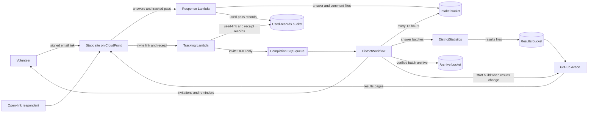
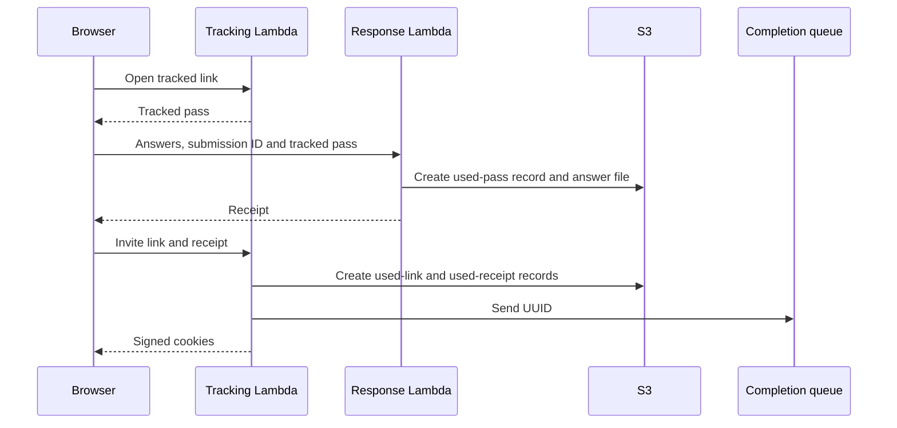

# District Survey Tool

*   **Author:** Jacob Tyler
*   **Status:** Draft
*   **Date:** 2026-11-18

--------------------------------------------------------------------------------

## Overview

Letchworth, Baldock & Ashwell Scout District needs to survey its young people,
parents and carers, volunteers and Scout Network members. This design describes
a reusable survey tool that asks each person only the questions that apply to
them, tracks which invited volunteers have responded, and keeps that tracking
apart from what they answered.

The tool is a static website with two small AWS Lambda functions. The response
Lambda validates answers and saves them to a private S3 bucket. The tracking Lambda
checks invitation links, records completion and grants access to results. Neither
sees the other's data. Three existing or planned systems share the remaining work:

*   **DistrictWorkflow** sends volunteer invitations and reminders, records who has
    completed the survey, manages comment review tasks, and runs a scheduled
    workflow every 12 hours.
*   **DistrictStatistics** stores answers with the date only, and calculates
    thresholds, cohorts and results.
*   **GitHub Actions** rebuilds the static results pages when results change.

The survey system does not store names, email addresses or invitation links.

Questions are defined in one survey file for each year. The code will be
published under the MIT licence so that other UK Scout districts can run their
own copy.

## The Problem

The district wants feedback from several groups whose experience of Scouting is
different. A general form tool does not meet three needs:

1.  **People should only see questions that apply to them.** A Cub, a parent and
    a volunteer need different questions. One adult can also hold several roles,
    and a question shared by those roles should be asked once.
2.  **The district needs to know who still has to respond, without knowing what
    they said.** Volunteers can be reminded only if their completion is tracked.
    If that tracking is connected to their answers, volunteers have less reason
    to answer honestly.
3.  **Results should encourage volunteers to take part without exposing
    individuals.** Volunteers who complete the survey can see how others
    answered, but only as grouped results.

Not everyone can be invited individually. The district holds an email list for
volunteers only, and some volunteers will find the survey through Facebook or
general emails. The tool therefore needs both personal tracked links and one
open link, and it must handle a volunteer who uses both.

Young people will take part, so safeguarding affects the design. Responses are
anonymous, so if a young person discloses harm in a comment, nobody can identify
them or follow it up. The survey must tell young people who they can talk to,
and any comment must be reviewed by a named person within an agreed time.

## Goals

### Survey experience

*   **G1. Question routing:** Every respondent sees only the questions whose tag
    conditions match their earlier answers. A question shared by several roles
    is asked once.
*   **G2. One open link:** One open link offers every persona. The first question
    separates young people from adults, and a response cannot combine a
    young-person role with an adult role.
*   **G3. Saved progress:** Unfinished answers stay in the browser and are never
    sent to the server. Answers remain in the browser until the server confirms
    that the response has been saved.
*   **G4. Accessibility and brand:** All survey and results screens meet WCAG 2.2
    AA in light and dark themes, work by keyboard, and follow the design rules
    agreed in the concepts brief.

### Tracking and privacy

*   **G5. Volunteer tracking:** Each invited volunteer has a DistrictWorkflow task.
    The task is completed within 5 minutes of a successful submission when all
    services are working normally.
*   **G6. Separation of answers from identity:** Stored responses contain no invite
    UUID, invitee ID, name, email address, IP address or time of day. An automated
    test fails if any other stored field is added without being approved. Each
    answer file's exact upload time exists only until its batch is archived, up to
    12 hours after submission.
*   **G7. One response per tracked link:** The server accepts one completion for
    each tracked link. Repeating a submission after a lost connection does not
    create a second response.
*   **G8. Open-link response counted once:** A volunteer who has already responded
    on the open link can complete their tracked invitation on the same device
    without answering again. Each receipt can complete one tracked link only.
*   **G9. Accurate promise:** Respondents are told: "Your answers are stored
    separately from your invitation, and people reviewing results only see
    grouped results. A named person reads written comments." The survey never
    claims that answers are impossible to work out.
*   **G25. Technical records notice:** The privacy notice linked from the start page
    says: "To keep the survey working and fix faults, our systems keep short-term
    technical records, such as when a submission was received. For up to 12 hours,
    this can include the exact time your answers were sent. We keep these records
    for up to [X] days, and we don't use them to work out who gave which answers."
    The young people's version says: "Our computers keep some short-term records so
    we can fix problems. We don't use them to find out what you said."

### Results

*   **G10. Results access:** Only a person with a completed tracked link can see
    results. On completion, the tracking Lambda issues CloudFront signed cookies for
    the results pages, and CloudFront refuses requests without them. DistrictWorkflow
    also sends one thank-you email with a results link that works on any device until
    3 months after the survey closes. Viewing results creates no record of who viewed
    them.
*   **G11. Minimum group size:** A question's results appear once at least 6 people
    have answered it. Each breakdown group must also reach 6.
*   **G12. Stepped updates:** Published results change only at 6, 9, 12 and later
    multiples of 3 responses, and at most once every 12 hours.
*   **G13. Comments stay private:** Written comments never appear in published
    results.

### Safeguarding

*   **G14. Young people's comments:** Scouts and Explorers can leave comments.
    Beavers and Cubs cannot, and the build fails if free text is reachable on a
    Beavers or Cubs route.
*   **G15. Safeguarding information:** Every young-person route shows who the young
    person can talk to, and every comment box says that nobody can reply.
*   **G16. Comment review:** The survey cannot open unless a named reviewer, deputy
    and review deadline are configured. An alarm fires when a comment passes that
    deadline unread.

### Operation and reuse

*   **G17. Survey validation:** The build fails when a question depends on a tag
    that has not been set earlier, a tag is unknown, a condition is impossible, or
    the survey exceeds its route or length limits.
*   **G18. Failure visibility:** Failed submissions and failed SQS messages raise an
    alarm. Each alarm is tested before launch.
*   **G19. Yearly reuse:** A new survey year needs a new survey file and no change
    to application code.
*   **G20. Reuse by other districts:** District names, domains, branding and
    contacts are supplied as settings. No district-specific values appear in the
    public code.
*   **G21. Survey window:** Each survey has configured opening and closing dates and
    runs for around one month. The server rejects submissions outside that window,
    and the survey shows a clear message explaining why.
*   **G22. Scheduled import:** Every 12 hours, a DistrictWorkflow workflow sends new
    answer files from S3 to the DistrictStatistics API. Workflows pass file names
    only, Temporal keeps its normal run history for a set retention period, and
    answers are never stored in DistrictWorkflow.
*   **G23. Recovery archive:** After a batch is imported, its answers are shuffled into
    one archive file. The originals are deleted only after the archive has been
    verified.
*   **G24. Results generation:** DistrictStatistics calculates thresholds and cohorts
    and writes new results files. DistrictWorkflow starts the GitHub Action only when
    results have changed.
*   **G26. Analyst dashboard:** Named analysts sign in to DistrictStatistics over the
    private network to see every permitted question and fixed breakdown. The dashboard
    applies the same minimum of 6 and never shows individual responses.

## Non-Goals

*   Cryptographic proof of privacy against AWS administrators.
*   Updating results after every response.
*   Showing results to open-link respondents.
*   Custom filters, role combinations in reports, or queries against individual
    responses.
*   Sending individual responses to any browser.
*   Switching devices partway through a survey.
*   Preventing every duplicate response on the open link.
*   Storing survey answers in DistrictWorkflow.
*   Sending email from the survey system.
*   A general-purpose expression language for survey logic.
*   A hosted service for other districts.
*   AlignUI Pro components.
*   An adoption guide for other districts before one real survey has run.
*   "How you compare" comparisons after submitting, in version one.
*   Participation progress displays, in version one.

## Open Questions

*   **Success measure:** What response rate or number of responses would make the
    survey a success for each persona?
*   **Start date:** On what date will the survey open? It will then run for around
    one month.
*   **Closing grace period:** Should someone who is partway through when the survey
    closes get extra time to submit?
*   **Audience sizes:** How many people are in each persona and section? This sets
    rate limits and shows whether a minimum of 6 leaves usable results.
*   **DistrictWorkflow readiness:** Is DistrictWorkflow running in production, and
    who will add the bounce monitoring it needs?
*   **DistrictStatistics readiness:** Who will build its sign-in, API, database backups
    and patching on the Kubernetes cluster?
*   **Comment timing:** A comment could wait up to 12 hours before review starts. Is
    that acceptable for young people's comments, or do they need a shorter schedule?
*   **Comment approval:** What does approving a comment do, given that comments are
    never published (G13)?
*   **Archive retention:** How long are recovery archives kept before deletion?
*   **Technical record retention:** What is the longest retention period across
    Temporal, Lambda and DistrictWorkflow logs? This sets the [X] days in G25.
*   **Reuse dependencies:** What will other districts use in place of DistrictWorkflow
    and DistrictStatistics?
*   **Started status:** Should a volunteer's task record that they started, or only
    that they completed?
*   **Result rounding:** How should percentages be rounded when a group is small?
*   **Reporting breakdowns:** Which breakdowns are needed beyond persona and section?
*   **Visible questions:** Which questions can tracked volunteers see results for,
    and who approves that list?
*   **Comment review:** Who are the named reviewer and deputy, what is the review
    deadline, and what is the escalation procedure?
*   **Adult comments:** Will adults have comment boxes, and who reviews them?
*   **Named status access:** Who can see named completion status in DistrictWorkflow?
*   **Open-link outcome:** How will parents, carers and young people hear the outcome
    of the survey?
*   **Section coverage:** Will Squirrels take part, or appear only as a section that
    parents can select?
*   **Young Leaders:** Should Explorers who volunteer as Young Leaders get extra
    questions?
*   **Network age range:** Should the survey use 18-24 or the site's 18-25?
*   **Support roles:** Who are the primary and deputy responders during the survey,
    and who maintains the code afterwards?

## Critical User Journeys (CUJs)

### CUJ 1: Invited volunteer completes the survey

*   **Given**: A volunteer has an open DistrictWorkflow task and an emailed tracked
    link.
*   **When**: They open the link, answer the questions for their roles and submit.
*   **Then**: Their response is saved without their identity, their task is completed,
    they receive no further reminders, they can view results, and they receive one
    thank-you email with a results link.

### CUJ 2: Volunteer answers on the open link, then opens their tracked link

*   **Given**: A volunteer completed the open-link survey on a device, and that device
    holds a signed receipt.
*   **When**: They open their tracked link on the same device and confirm that they
    have already responded.
*   **Then**: Their task is completed, no second response is created, the receipt cannot
    be used again, they can view results, and they receive one thank-you email with a
    results link.

### CUJ 3: Someone else on a shared device opens a tracked link

*   **Given**: A family device holds a receipt from one person's open-link response.
*   **When**: A different volunteer opens their tracked link and says they have not
    responded.
*   **Then**: The receipt is left unused and the volunteer starts the survey normally.

### CUJ 4: Parent or carer responds through the open link

*   **Given**: A parent or carer has the open link.
*   **When**: They select their adult roles, answer the matching questions and submit.
*   **Then**: Their response is saved with an open source label, a receipt is saved in
    their browser, and no results are shown.

### CUJ 5: Scout or Explorer leaves a comment

*   **Given**: A Scout or Explorer is on their section's route.
*   **When**: They reach a comment box and submit a comment.
*   **Then**: They have been told that nobody can reply and who they can talk to, the
    comment is stored apart from their answers, and the next scheduled import creates
    a DistrictWorkflow review task for the named reviewer, with no invite UUID.

### CUJ 6: Beaver or Cub takes part with an adult

*   **Given**: A Beaver or Cub is using the open link with an adult helping them.
*   **When**: They select their section and answer the questions.
*   **Then**: They see age-appropriate questions with no free text and no results, the
    safeguarding panel is shown, and nothing that identifies them is stored.

### CUJ 7: Volunteer views results

*   **Given**: A volunteer has completed their tracked link and holds valid signed
    cookies or a fresh signed link.
*   **When**: They open the results page.
*   **Then**: They see grouped results for each permitted question that has reached the
    minimum, and a clear "not enough responses yet" message for the others.

### CUJ 8: Respondent's connection fails during submission

*   **Given**: A respondent presses submit and the connection fails.
*   **When**: The browser retries using the same idempotence key.
*   **Then**: Exactly one response is stored, their answers remain in the browser until
    the server confirms success, and any tracked task is completed.

### CUJ 9: Survey author prepares next year's survey

*   **Given**: An author has written a new survey file.
*   **When**: They run the survey validation.
*   **Then**: They see every route and its length, or an error naming the file, question,
    rule and required fix.

### CUJ 10: Operator responds to a spam flood on the open link

*   **Given**: Abuse alarms show unusual open-link activity.
*   **When**: The operator closes open-link submissions.
*   **Then**: Tracked links keep working, and open-link responses from the affected days
    can be removed without affecting tracked responses.

### CUJ 11: Volunteer opens results on a second device

*   **Given**: A volunteer completed the survey on their phone and received the thank-you
    email.
*   **When**: They open the email's results link on their iPad.
*   **Then**: The iPad receives its own signed cookies and shows the results, with no
    need to answer again or sign in.

### CUJ 12: Analyst reviews results

*   **Given**: A named analyst is connected through WireGuard or a district site's fixed
    tunnel.
*   **When**: They sign in to DistrictStatistics and open the survey dashboard.
*   **Then**: They see grouped results for each permitted question and fixed breakdown,
    groups below 6 are hidden, and no individual response or comment is shown.

--------------------------------------------------------------------------------

## Technical Plan (Architecture)

### System overview

The survey website is a static Next.js export. Two AWS Lambda functions handle every
request that needs a server:

*   The **response Lambda** validates answers and writes them to a private S3 bucket. It
    never receives an invite UUID.
*   The **tracking Lambda** checks invitation links, records completion and issues signed
    cookies for results. It never receives answers.

The browser connects the two using signed values that prove a step happened without
revealing the other side's data.

DistrictWorkflow owns people, invitations, reminders and scheduled work.
DistrictStatistics owns stored answers and all result calculations. GitHub Actions
rebuilds the protected results pages.



### What each system can see

| System | Can see | Must never hold |
| --- | --- | --- |
| Static site and browser | The current person's answers until submission | Other people's answers |
| Response Lambda | One submission and a tracked pass while handling the request | Invite UUIDs |
| Tracking Lambda | One invite UUID and receipt while handling the request | Answers or comments |
| Intake bucket | Answer files, up to 12 hours | UUIDs, names, emails, IP addresses |
| Used-records bucket | One-way values for used links and receipts | UUIDs, answers, submission IDs in readable form |
| DistrictWorkflow | People, UUIDs, task status, file names, answer files while streaming them | Stored answers or comments |
| DistrictStatistics | Answers, comments, submission dates | UUIDs, names, emails, time of day |
| Results bucket and results pages | Grouped results only | Individual answers or comments |

### Survey definition and question logic

A survey is an ordered list of blocks, and a block is an ordered list of questions.
Each answer option can set one or more tags. Each question can declare a `showIf`
condition using `all`, `any` and `none` lists of tags.

```yaml
survey:
  id: district-2027
  opens: 2027-03-01
  closes: 2027-03-31
  limits: { maxRoutes: 512, maxQuestionsPerRoute: 60 }
  reportingTags: [young-person, adult, beavers, cubs, scouts, explorers, parent, volunteer, network]

blocks:
  - id: about-you
    questions:
      - id: age-group
        type: single
        text: Which best describes you?
        options:
          - { id: young-person, text: I'm in a Scout section, sets: [young-person] }
          - { id: adult, text: I'm an adult, sets: [adult] }
      - id: adult-roles
        type: multiple
        text: Which of these apply to you?
        showIf: { all: [adult] }
        options:
          - { id: parent, text: Parent or carer, sets: [parent] }
          - { id: volunteer, text: Volunteer, sets: [volunteer] }
          - { id: network, text: Scout Network member, sets: [network] }
```

The system supplies two tags that a survey file cannot set: `source:open` and
`source:tracked`. A tracked link preselects the Volunteer option.

One pure TypeScript function, `evaluateSurvey`, takes the compiled survey, the answers
and the system tags. It returns the visible questions, the current tags and any answers
that no longer apply. The browser uses it to decide what to show. The response Lambda
runs the same function and rejects a submission when any answer does not belong on the calculated
route. The response Lambda never accepts tags from the browser.

### Survey source data

Survey definitions, district settings and logos are stored in DistrictStatistics. At build time, the
site calls `GET /api/v1/surveys/{surveyId}/build-data` using the `SURVEY_ID` and `DISTRICT_STATISTICS_URL`
build variables, in the same way that `district-site` reads its data sources during its build. The public
repository contains only made-up examples.

### Survey validation

`yarn survey:validate` compiles the survey definition into a versioned JSON file with a SHA-256
fingerprint. It walks every combination of tag-setting answers and fails with the file,
question, rule and fix when any of these is true:

*   A condition uses an unknown tag, or a tag set only by a later question.
*   A question is not visible on any route.
*   The survey exceeds its route or route-length limit.
*   Free text can be reached on a route with the `beavers` or `cubs` tag.
*   A route with the `young-person` tag has no safeguarding panel.
*   A comment question exists without a configured reviewer, deputy and review deadline.
*   A question ID's wording or options changed from the previous survey without being
    marked as a new question.
*   A required colour pair in the theme misses its contrast target.

### Invitation and link format

DistrictWorkflow creates one task for each volunteer and generates a random version 4
UUID, stored separately from the task's primary key. The tracked link is:

```text
https://<survey-domain>/survey#invite=<uuid>.<signature>
```

The signature is an HMAC-SHA-256 of the survey ID and UUID, using a secret shared by
DistrictWorkflow and the tracking Lambda. The token sits after the `#`, so browsers do not send it
in page requests. The site reads it once, keeps it in memory and removes it from the
address bar.

### Survey APIs

Both Lambdas sit behind one API Gateway and are reached through CloudFront.

| Lambda | Route | Purpose | Main result |
| --- | --- | --- | --- |
| Response | `POST /api/v1/responses` | Validates and saves a response | Success and a receipt |
| Tracking | `POST /api/v1/tracking/open` | Checks a tracked link when the page opens | A tracked pass, or signed cookies if already completed |
| Tracking | `POST /api/v1/tracking/complete` | Completes a tracked link using a receipt | Success and signed cookies |
| Tracking | `POST /api/v1/tracking/results-access` | Exchanges an emailed access token for signed cookies | Success and signed cookies |

The response request contains:

```json
{
  "surveyId": "district-2027",
  "surveyVersion": "sha256:...",
  "submissionId": "random-uuid-v4",
  "trackedPass": "signed pass or null",
  "turnstileToken": "token or null",
  "answers": { "age-group": "adult", "adult-roles": ["volunteer"] }
}
```

The APIs return fixed error codes that the site turns into plain messages:
`survey_closed`, `version_changed`, `invalid_link`, `already_completed`,
`invalid_answers`, `verification_failed`, `rate_limited` and `temporarily_unavailable`.

### Signed values

Each value is signed with an Ed25519 private key held by the system that issues it. The system
that checks it holds only the public key, so it cannot forge that value.

| Value | Signed by | Holds | Purpose |
| --- | --- | --- | --- |
| Tracked pass | Tracking Lambda | Survey ID, a one-way link reference and an expiry at survey close | Proves a response came from a valid tracked link, without revealing the UUID |
| Receipt | Response Lambda | Survey ID, a random receipt ID and an expiry at survey close | Proves a response was saved, without identifying which response |
| Results access token | DistrictWorkflow | Survey ID, access level and an expiry 3 months after survey close | Lets any device holding the emailed link request results cookies, without identifying the person |

The link reference is an HMAC of the UUID, using a key held only by the tracking Lambda. None of
these values is stored with the response.

### Tracked response flow



1.  **Open the link.** The tracking Lambda checks the signature. If the link is unused, it returns
    a tracked pass.
2.  **Claim the pass.** The response Lambda creates a used-pass record named with an HMAC of the link
    reference. Its contents are a second HMAC of the link reference and submission ID. A matching
    record means a retry. A different record returns `already_completed`, so each link can submit one
    response.
3.  **Save the answers.** The file is named with the submission ID and written with an `If-None-Match`
    condition, so a retry cannot create a second file.
4.  **Save comments separately.** Each comment gets its own random ID and has no submission ID.
5.  **Return a receipt.** The browser stores the receipt before doing anything else.
6.  **Complete the link.** The browser immediately sends the invite link and receipt to the tracking
    Lambda, which creates its used records, sends the completion message and returns signed cookies.

If the browser closes between steps 5 and 6, the stored receipt completes the link the next time the
person opens it, with no further questions.

An answer file contains:

```json
{
  "schemaVersion": 1,
  "surveyId": "district-2027",
  "surveyVersion": "sha256:...",
  "submissionId": "random-uuid-v4",
  "source": "tracked",
  "submittedOn": "2027-03-14",
  "answers": { "age-group": "adult", "adult-roles": ["volunteer"] }
}
```

`submittedOn` uses the Europe/London date. The source is `tracked` only when a valid tracked pass was
presented.

### Open-link response flow

The response Lambda checks Turnstile, saves the answers and returns a receipt to adults. Young people
receive no receipt.

When a tracked link later opens on a device holding an open-link receipt, the page asks whether that
person has already responded. If they confirm, `POST /api/v1/tracking/complete` completes the link. Each
receipt can complete one link only. If the person did not choose Volunteer earlier, the response includes
a tracked pass so they can answer the volunteer questions as an optional partial response.

### Browser storage

| Data | Storage | Lifetime |
| --- | --- | --- |
| Adult draft answers | Local storage | 7 days, cleared after success or by "clear my answers" |
| Young person's draft answers | Session storage | Current tab session |
| Receipt | Local storage | Until survey close, adult routes only |
| Tracked pass | Local storage, with the adult draft | Until submitted or survey close |
| Theme preference | Local storage | Until changed |

Drafts are discarded when the survey version changes. Answers on inactive routes are removed
after the person confirms a warning.

### Scheduled import

A DistrictWorkflow Temporal schedule runs `surveyImportWorkflow` every 12 hours. Workflow inputs and
outputs hold file names and counts only.

1.  List new answer and comment files, up to a fixed batch size.
2.  Stream the files from S3 to `POST /api/v1/survey-imports/{batchId}` on DistrictStatistics.
3.  Wait for DistrictStatistics to confirm how many records it stored.
4.  Shuffle the batch into one compressed file in the archive bucket.
5.  Read the archive back and compare its record count and checksum.
6.  Delete the original intake files.
7.  Create a DistrictWorkflow review task for each new comment.
8.  Ask DistrictStatistics to calculate results.
9.  Start the GitHub Action when a new results release exists.

Each step can be repeated. DistrictStatistics rejects duplicate submission IDs without failing the
batch. A failed run leaves the intake files in place for the next run.

### DistrictStatistics

DistrictStatistics adds these tables to its PostgreSQL database:

| Table | Purpose |
| --- | --- |
| `surveys` | Survey IDs, dates and status |
| `survey_versions` | Compiled survey definitions and fingerprints |
| `import_batches` | Each batch's ID, counts and checksum |
| `survey_responses` | Submission ID, survey version, source, date and shuffled import position |
| `survey_answers` | One row per question answer |
| `survey_response_tags` | Reporting tags recalculated from the survey definition |
| `survey_comments` | Comment text, audience, review status and review deadline |
| `result_releases` | Each published release and the counts it used |

Its service API uses a separate credential for DistrictWorkflow. Staff screens require sign-in through
the district's existing Cognito setup.

Results are calculated per question and per permitted breakdown:

*   A group is shown only when at least 6 people answered that question.
*   The published count is the highest multiple of 3 that does not exceed the answered count.
*   When the answered count is not a multiple of 3, the newest responses by shuffled import position wait
    for a later release.
*   A group that was shown stays in later releases, and reporting never combines roles.
*   Comments are excluded.

A release is written to the results bucket as versioned JSON. It holds the survey version, release ID,
generation time and grouped results.

### Results build and access

The GitHub Action in the public repository accepts a results release ID and runs on `lbdistrictscouts-runners`,
so it can reach DistrictStatistics. The whole build and upload stays in that one job, because artifacts from a
public repository can be downloaded by anyone. It uses short-lived AWS credentials to read that release, builds the
results pages, uploads only the exported results files to the site bucket
and clears CloudFront's cache for `/results*`. It does not save results as artifacts or print them in logs.

CloudFront protects `/results*` with a trusted key group. A higher-priority rule leaves `/results-access*`
unprotected, because that page is how a new device gets its cookies. The tracking Lambda sets
`CloudFront-Policy`, `CloudFront-Signature` and `CloudFront-Key-Pair-Id` cookies. Their signed policy allows the
results paths only, and they are marked `Secure`, `HttpOnly` and `SameSite=Lax`.

### Thank-you email and results link

When DistrictWorkflow first moves a survey task to completed, it sends one thank-you email. A repeated
completion message does not send a second email. The email contains no answers and links to:

```text
https://<survey-domain>/results-access#token=<signed-results-access-token>
```

1.  The unprotected `/results-access` page reads the token after the `#`, then removes it from the address
    bar.
2.  The page sends the token to `POST /api/v1/tracking/results-access`.
3.  The tracking Lambda checks the signature and expiry, sets signed cookies for that device and stores
    nothing.
4.  The page opens `/results/`.

The link can be used repeatedly and on any number of devices until 3 months after the survey closes. The
cookies last 7 days, or until that date if it is sooner, and opening the link again issues new ones. Anyone
the email is forwarded to can also view results until the link expires. When the 3 months end, the protected
results pages are removed from the site bucket and the tracking Lambda stops issuing cookies. If no question has reached the minimum, the results page says that results will
appear once enough people have responded.

### Analyst dashboard

DistrictStatistics provides a staff dashboard, reached over WireGuard or a district site's fixed tunnel. Access
requires sign-in and explicit membership of a `survey-analyst` group. Being a district member, or reaching the private
network, grants no access.

The dashboard reads only from `result_releases`, so analysts see the same protected figures that the calculator has
already published. It offers fixed breakdowns, one dimension at a time, including tracked and open comparisons where
both groups reach the minimum of 6. It has no custom filters, individual responses, comment text or submission dates.
Any download contains the same grouped figures. Sign-ins and downloads are recorded in an audit log.

### Comment review

Comment text stays in DistrictStatistics. Each DistrictWorkflow task holds the comment ID, audience, due date
and a link to the review page. The task holds no comment text, UUID or submission ID. A reviewer reaches the private network through
the district's WireGuard setup, or from a district site with a fixed tunnel. They then sign in to DistrictStatistics,
read the comment and record the outcome. Network access alone never grants access to comments, because only the named
reviewer and deputy accounts can open them. DistrictWorkflow escalates to the deputy when the due date passes. The
reviewer and deputy must each complete a test review, using the connection they will rely on, before the survey opens.

### Hosting and network access

| System | Runs on | Network access |
| --- | --- | --- |
| DistrictStatistics | Kubernetes on the private LAN | Not reachable from the internet. Named comment reviewers connect through WireGuard or a district site's fixed tunnel, and it calls S3 outbound |
| DistrictWorkflow | Kubernetes, behind CloudFront through a signed Cloudflare Tunnel | Reaches DistrictStatistics inside the cluster, and polls S3 and SQS outbound |
| Site and results builds | `lbdistrictscouts-runners` on the same cluster | Reaches DistrictStatistics at build time |
| Pull request checks | GitHub-hosted runners | Uses example data only, with no access to the private network |

### AWS infrastructure

The Terraform module in `infra/terraform` creates:

*   One CloudFront distribution with access logs off, security headers on, and separate rules for the site,
    `/results/*` and `/api/*`.
*   A site bucket, intake bucket, used-records bucket, archive bucket and results bucket, all private and
    encrypted. Versioning is off on the intake bucket, so deleted files do not leave exact upload times behind.
*   One API Gateway HTTP API and two Node.js Lambda functions in `eu-west-1`, each with its own IAM role
    and secrets.
*   One SQS completion queue and dead-letter queue.
*   Route 53 records for the survey domain, which point to the CloudFront distribution.
*   One Cloudflare Turnstile widget limited to the survey domain. Its private key is stored in AWS Secrets
    Manager and read only by the response Lambda, and its public site key is passed to the website build.
*   IAM roles that limit each system to its own buckets and actions.
*   Alarms for API 5xx responses, Lambda errors, throttling, failed SQS sends, messages in the dead-letter queue
    and a missed import run.

Signing keys are created outside Terraform and stored in AWS Secrets Manager, so their values do not enter
Terraform state. The Turnstile private key is the one exception: Terraform creates it with the widget, so it is
held in Terraform state, as the contact form's key already is. `DistrictInfrastructure` imports a pinned release of
the module and passes in its AWS and Cloudflare providers, Cloudflare account ID, domain, Route 53 zone, certificate,
alert topic and the DistrictWorkflow and DistrictStatistics role ARNs.

### Logging

Each Lambda writes one structured log entry per request, using only these fields: request ID, route, outcome code,
failure code, response-time band, source, survey version and build ID. A test fails if any other field is logged.
API Gateway logs omit client IP addresses, user agents and paths containing identifiers.

### Failure handling

| Failure | Effect | Recovery |
| --- | --- | --- |
| Browser loses connection during submit | The browser does not know if the response saved | Answers stay in the browser and the retry reuses the submission ID |
| Browser closes after saving the response | The answer is saved but the task stays open | The stored receipt completes the link when it is next opened, and a reminder prompts the person to do so |
| SQS is unavailable | The answer saves but the task stays open | The tracking API returns an error and the browser retries with the receipt |
| Completion message repeats | DistrictWorkflow receives it twice | Completing a completed task succeeds without change, and no second email is sent |
| Thank-you email fails | The volunteer has no link for another device | The browser that completed the survey still has cookies, and an operator can resend the email from DistrictWorkflow |
| DistrictWorkflow is down | Imports and task updates stop | Answers wait in S3, and the queue holds messages for 14 days |
| DistrictStatistics is down | The import fails | Intake files stay in place for the next run |
| Archive verification fails | The batch has no confirmed recovery copy | Originals are kept and an alarm fires |
| GitHub Action fails | Older results remain visible | The workflow retries, and the release can be rebuilt by ID |
| Spam on the open link | Open-link responses are unreliable | An operator closes open submissions and removes open-link responses by day |
| A reviewer cannot connect through WireGuard or a fixed tunnel | A comment review is delayed | DistrictWorkflow escalates to the deputy when the review deadline passes |

--------------------------------------------------------------------------------

## Alternatives Considered

Reasons marked "inferred" were not stated directly by the author during ideation and should be
checked during review.

### Product and platform

#### Alternative A: Google Forms or Microsoft Forms

*   **Pros**: No code to build or host, familiar to respondents, and low cost.
*   **Cons**: Does not keep completion tracking apart from answers, and does not provide the
    required persona routing, cohort limits or results unlocking.
*   **Reason for Rejection**: Rejected by author: the two core requirements are tracking separated
    from answers and questions determined by persona. Applying this reason to Microsoft Forms is
    inferred.

#### Alternative B: LimeSurvey

*   **Pros**: An existing survey product with invitations, anonymised responses and conditional
    questions.
*   **Cons**: Needs a licence or a server to host and patch, and was not tested against the
    requirements.
*   **Reason for Rejection**: Rejected by author: the district does not have the budget for it, and
    building the tool is the chosen route.

#### Alternative C: Cloudflare as the platform

*   **Pros**: Some district domains already use Cloudflare, and the main domain may move there later.
*   **Cons**: The intended domain and its DNS are still on Route 53, so hosting on Cloudflare would
    depend on a migration that has not happened.
*   **Reason for Rejection**: Rejected by author: the intended domain and DNS have not moved to
    Cloudflare. The survey still uses Cloudflare Turnstile, which the Terraform module creates and
    passes to the response Lambda as a secret.

### Privacy and tracking

#### Alternative D: Blind-signed passes, browser encryption and offline keys

*   **Pros**: Could make answers unlinkable even by someone with full access to both data stores.
*   **Cons**: Adds cryptographic complexity, prevents results while the survey is open, and depends
    on someone holding an offline key.
*   **Reason for Rejection**: Rejected by author: the goal is to stop casual analysts working out who
    said what, not to provide cryptographic proof against AWS administrators.

#### Alternative E: Tracked links for everyone

*   **Pros**: One response per person and accurate response rates for every persona.
*   **Cons**: Needs contact details for every parent, carer and young person.
*   **Reason for Rejection**: Rejected by author: the district has an email list for volunteers only,
    and parents and young people will use an open link.

#### Alternative F: Counts-only completion status

*   **Pros**: Nobody can see who has responded, which limits inference from results changes.
*   **Cons**: The district cannot chase individuals through its normal workflow tools.
*   **Reason for Rejection**: Rejected by author: DistrictWorkflow will chase and track volunteer
    responses.

#### Alternative G: Daily batch of completion messages

*   **Pros**: DistrictWorkflow would hold no exact completion times.
*   **Cons**: Task status could be up to a day old, and reminders would have to wait for each batch.
*   **Reason for Rejection**: Rejected by author: completion should reach DistrictWorkflow immediately.
    Date-only storage and batch archives protect against time matching instead.

#### Alternative H: Server-side drafts and device switching

*   **Pros**: A person could start on one device and finish on another.
*   **Cons**: Unfinished answers would need storing against something that identifies the person.
*   **Reason for Rejection**: Rejected by author: unfinished answers stay in the browser.

### Backend and data flow

#### Alternative I: One Lambda with DynamoDB transactions

*   **Pros**: One atomic write could save the response and mark the invitation complete.
*   **Cons**: One function handles invite UUIDs and answers together, and the survey needs its own
    database.
*   **Reason for Rejection**: Rejected by author: the survey should have no independent database, and
    separate response and tracking Lambdas keep answers and invite UUIDs apart.

#### Alternative J: Answers through SQS and Temporal

*   **Pros**: Uses a queue to buffer answers, and needs no intake bucket.
*   **Cons**: Answers would enter DistrictWorkflow's workflow history unless encrypted or passed by
    reference.
*   **Reason for Rejection**: Rejected by author: the Lambda writes to S3, and a scheduled workflow
    moves batches to DistrictStatistics.

#### Alternative K: Browser posts directly to DistrictStatistics

*   **Pros**: Fewest AWS parts.
*   **Cons**: Exposes the application to the public internet, stops submissions during an outage, and
    needs the question logic rewritten in PHP.
*   **Reason for Rejection**: Rejected by author: a Lambda validates submissions and writes them to S3,
    so answers are safe while other systems are unavailable.

#### Alternative L: Keep individual answer files permanently

*   **Pros**: Simple recovery, one file at a time.
*   **Cons**: S3 keeps each file's exact upload time, which could be matched to DistrictWorkflow's
    completion time.
*   **Reason for Rejection**: Rejected by author: each batch is shuffled into a verified archive, and the
    originals are deleted.

### Results

#### Alternative M: Updating results on every response

*   **Pros**: The most immediate reward for taking part.
*   **Cons**: Comparing the page before and after a submission reveals what that person answered.
*   **Reason for Rejection**: Rejected by author: results appear at 6 responses and move in steps of 3.

#### Alternative N: One release after close, or a few fixed releases

*   **Pros**: Lowest risk of working out how small groups answered.
*   **Cons**: Removes most of the incentive to complete the survey early.
*   **Reason for Rejection**: Rejected by author: the survey content is low in sensitivity, and results
    should be available as questions reach the minimum.

#### Alternative O: Hard-to-guess results address

*   **Pros**: Adds no new infrastructure and works on every device.
*   **Cons**: Anyone who finds the address can view results until it is changed and re-sent.
*   **Reason for Rejection**: Rejected by author: CloudFront signed cookies block requests without valid
    access.

#### Alternative P: Encrypted results files

*   **Pros**: Files remain unreadable without the key, whatever their address.
*   **Cons**: Adds encryption to the build and decryption to the browser, and a leaked key means
    re-encrypting results and re-sending the key.
*   **Reason for Rejection**: Rejected by author: CloudFront signed cookies were chosen for results access.

### Survey logic

#### Alternative Q: Persona-level question block lists

*   **Pros**: A small, fixed set of routes that is simple to check.
*   **Cons**: Shared questions need merging, and follow-up questions need extra rules.
*   **Reason for Rejection**: Rejected by author: question-level tags allow personas, cohorts and follow-up
    questions to use one mechanism.

#### Alternative R: Tags set in the opening block only

*   **Pros**: Survey length is fixed after the opening block, and fewer routes need checking.
*   **Cons**: Later follow-up questions need a separate rule.
*   **Reason for Rejection**: Rejected by author: any earlier question can set tags, with build limits on
    routes and length.

### Safeguarding

#### Alternative S: No comment boxes for any young person

*   **Pros**: A disclosure cannot arrive through the survey, and no young-person comment review is needed.
*   **Cons**: Loses the written views of Scouts and Explorers.
*   **Reason for Rejection**: Rejected by author: Scouts and Explorers can leave comments, subject to named
    review and the safeguarding conditions in G14 to G16.

### Infrastructure and interface

#### Alternative T: Extending the shared CloudFront module

*   **Pros**: Less Terraform to maintain.
*   **Cons**: Changes could affect the live website, and the module has no access-log switch.
*   **Reason for Rejection**: Rejected by author: the survey has its own small distribution.

#### Alternative U: Separate Terraform state

*   **Pros**: Limits the effect of a Terraform mistake, and allows independent infrastructure changes.
*   **Cons**: Needs another backend, workflow and wiring for shared values.
*   **Reason for Rejection**: Rejected by author: the root Terraform imports a pinned module, and the survey
    pipeline deploys website and Lambda code separately.

#### Alternative V: district-styles with Bootstrap

*   **Pros**: Reuses the district's shared styles.
*   **Cons**: Uses Bootstrap in a Tailwind project, and installation depends on GitHub Packages.
*   **Reason for Rejection**: Rejected by author: the survey uses Tailwind and AlignUI, with a replaceable
    theme for other districts (inferred).

#### Alternative W: Native controls on survey screens

*   **Pros**: Lowest compatibility risk and strong browser defaults.
*   **Cons**: Every control needs styling by hand, and dashboards need another component source.
*   **Reason for Rejection**: Rejected by author: AlignUI is used through a local `ui/` folder.

#### Alternative X: AlignUI Pro

*   **Pros**: More ready-made components and blocks.
*   **Cons**: Paid, and its licence bans publishing its code in a public repository.
*   **Reason for Rejection**: Rejected by author: this project publishes its code, so only the free MIT
    components can be used.

#### Alternative Y: Light mode only

*   **Pros**: Fewer colours to test and stays closer to brand guidance.
*   **Cons**: Does not support people who use a dark device setting.
*   **Reason for Rejection**: Rejected by author: the survey needs a dark theme, and brand guidance can be
    adapted for it.

--------------------------------------------------------------------------------

## Non-Functional Requirements

### Security and privacy

*   Every bucket blocks public access and uses server-side encryption. Each system's IAM role can reach only
    the buckets and prefixes it needs.
*   Only DistrictWorkflow's import role can read the intake bucket. DistrictStatistics receives answers only
    through its import API.
*   Service calls to DistrictStatistics use a dedicated credential stored in a secret manager.
*   GitHub Actions uses short-lived AWS credentials limited to protected branches.
*   Because this repository is public, jobs on `lbdistrictscouts-runners` run only from protected branches, tags or
    manual dispatch. Pull requests run on GitHub-hosted runners with no secrets, and `pull_request_target` is banned.
*   The organisation's runner group allows only approved repositories to use the cluster runners.
*   The site sends a Content Security Policy, `Strict-Transport-Security`, `X-Content-Type-Options`,
    `Referrer-Policy: no-referrer` and `Permissions-Policy` headers. Tracked pages load no third-party script.
*   A data protection impact assessment and ICO Children's Code check must be signed off before the survey opens.

### Performance and capacity

*   The response API should complete within 2 seconds for 95% of requests under expected load.
*   API limits are set from the audience sizes once known, and load-tested before the first invitation is sent.
*   Survey pages should load within 3 seconds on a mid-range phone using a 4G connection.

### Rollout and rollback

1.  Deploy to a test environment using made-up data.
2.  Run a pilot under a separate survey ID.
3.  Send tracked invitations to volunteers.
4.  Open the public link.

Server-side switches can close open links, tracked links or the whole survey independently. A faulty site or
Lambda release is rolled back by redeploying the previous tagged release. A faulty results release is replaced by
rebuilding the previous release ID.

### Data retention

| Data | Retention |
| --- | --- |
| Intake files | Up to 12 hours, until archived, or longer only while an import is failing |
| Used-link and used-pass records | Deleted after survey close, once all completions are confirmed |
| Used-receipt records | Deleted after survey close, once all completions are confirmed |
| Invite UUIDs in DistrictWorkflow | Deleted after the final results email has been sent |
| Results pages and results signing keys | 3 months after survey close |
| Recovery archives | To be decided (see Open Questions) |
| Technical logs | To be decided, and stated in the privacy notice (G25) |

### Additional Resources

*   [Concepts brief](./concepts_brief.md)
*   `../DistrictInfrastructure/modules/contact-form` for the Turnstile, API and alarm patterns
*   `../DistrictWorkflow/docs/reusable-activities.md` for reminders, signed links and themed email
*   `../district-site/Notes/TSA-BRAND-COMPLIANCE-CHECKLIST.md` for brand rules

### Future Improvements

*   **Adoption guide:** Publish a guide for other districts after one real survey has run.
*   **Replaceable integrations:** Define adapters for districts without DistrictWorkflow or DistrictStatistics.
*   **Year-on-year reports:** Compare grouped results for questions whose IDs have not changed.

--------------------------------------------------------------------------------

## Detailed Implementation Plan

### Assumptions to confirm before building

*   The survey domain is `survey.lbdscouts.org.uk`.
*   The real survey definition, settings and logos are stored in DistrictStatistics. The build selects them using a
    `SURVEY_ID` build variable.
*   DistrictStatistics and DistrictWorkflow run on the Kubernetes cluster defined in the `Homelab` repository.
*   Both applications use AWS access keys stored through the cluster's existing 1Password operator pattern.
*   Other open questions become values in the private settings file and do not change the code structure.

### Delivery order

1.  **Survey engine and validation:** engine, schema, example survey and tests.
2.  **Thin working slice:** AlignUI wrappers, one routed question, both Lambdas and a test deployment.
3.  **Infrastructure:** Terraform module and `DistrictInfrastructure` import.
4.  **DistrictWorkflow:** invitations, completion intake, email and scheduled import.
5.  **DistrictStatistics:** sign-in, import API, calculations and comment review.
6.  **Results and operations:** results build, alarms, runbooks and pilot.

### Target Files to Create/Modify

#### Repository: `district-survey`

##### Project configuration

| File | Action | Change and reason |
| --- | --- | --- |
| `package.json` | Modify | Add `survey:validate`, `test`, `test:coverage`, `test:mutation`, `test:e2e`, `test:a11y` and `build:functions` scripts. Make `build` call validation directly, and add runtime and test dependencies. |
| `yarn.lock` | Modify | Records the new dependencies. |
| `next.config.ts` | Modify | Set `trailingSlash: false` so routes match CloudFront's clean address rewrite. |
| `tsconfig.json` | Modify | Include function, script and test code in type checking. |
| `eslint.config.mjs` | Modify | Ignore vendored and generated output, and ban direct imports from `src/vendor/alignui` outside `src/ui`. |
| `.gitignore` | Modify | Ignore Terraform state, variable files, invite exports, private settings and built functions. |
| `README.md` | Modify | Describe the project, setup, commands and architecture. |
| `CLAUDE.md` | Modify | Add the two-Lambda boundary, the survey commands and the rule on logged fields. |
| `LICENSE` | Create | Publishes the project under the MIT licence. |
| `THIRD_PARTY_NOTICES.md` | Create | Records the source, version and licence of each copied AlignUI component. |
| `vitest.config.ts` | Create | Configures unit and component tests and enforces the coverage thresholds. |
| `stryker.config.mjs` | Create | Runs mutation tests on the survey engine and signing code. |
| `playwright.config.ts` | Create | Configures browser tests in both themes. |
| `.pa11yci.cjs` | Create | Configures automated accessibility checks on the exported site. |
| `public/file.svg`, `public/globe.svg`, `public/next.svg`, `public/vercel.svg`, `public/window.svg` | Delete | Removes unused starter assets. |

##### Application pages and styles

| File | Action | Change and reason |
| --- | --- | --- |
| `src/app/layout.tsx` | Modify | Load Nunito Sans, set metadata from district settings, and add the theme provider. |
| `src/app/globals.css` | Modify | Define light and dark brand tokens, map AlignUI tokens to them, and add focus styles. |
| `src/app/page.tsx` | Modify | Replace the starter page with the survey start page and privacy summary. |
| `src/app/survey/page.tsx` | Create | Hosts the client-side survey runner for open and tracked links. |
| `src/app/results/page.tsx` | Create | Renders the protected grouped results from the release supplied at build time. |
| `src/app/results-access/page.tsx` | Create | Exchanges the emailed results token for signed cookies. |
| `src/app/privacy/page.tsx` | Create | Shows the privacy notice, including the technical records wording in G25. |
| `src/app/not-found.tsx` | Create | Gives missing pages an on-brand message. |

##### Survey and results components

| File | Action | Change and reason |
| --- | --- | --- |
| `src/components/survey/SurveyRunner.tsx` | Create | Controls progress through blocks, drafts, submission and retries. |
| `src/components/survey/QuestionField.tsx` | Create | Renders each supported question type. |
| `src/components/survey/BlockProgress.tsx` | Create | Shows progress by block and recalculates it when tags change. |
| `src/components/survey/SafeguardingPanel.tsx` | Create | Shows who a young person can talk to, using the reserved yellow style. |
| `src/components/survey/CommentNotice.tsx` | Create | Tells commenters that nobody can reply. |
| `src/components/survey/ReceiptPrompt.tsx` | Create | Asks a tracked visitor whether they have already responded on this device. |
| `src/components/survey/RouteChangeWarning.tsx` | Create | Warns before answers on an inactive route are removed. |
| `src/components/survey/SubmissionMessage.tsx` | Create | Maps API error codes to plain next steps. |
| `src/components/results/ResultsList.tsx` | Create | Lists permitted questions and "not enough responses yet" messages. |
| `src/components/results/PercentageBar.tsx` | Create | Displays labelled, rounded percentages without a chart library. |
| `src/components/theme/ThemeProvider.tsx` | Create | Applies the device or chosen theme before the page appears. |
| `src/components/theme/ThemeToggle.tsx` | Create | Provides the manual theme switch. |

##### AlignUI wrappers

| File | Action | Change and reason |
| --- | --- | --- |
| `src/vendor/alignui/*` | Create | Holds the unmodified source of each required free component and its utilities. |
| `src/ui/button.tsx`, `src/ui/radio.tsx`, `src/ui/checkbox.tsx`, `src/ui/input.tsx`, `src/ui/textarea.tsx`, `src/ui/select.tsx`, `src/ui/label.tsx`, `src/ui/hint.tsx`, `src/ui/progress-bar.tsx`, `src/ui/alert.tsx`, `src/ui/modal.tsx`, `src/ui/tooltip.tsx`, `src/ui/badge.tsx` | Create | Gives screens one local import point, so a failing component can be replaced in one file. |

##### Shared libraries

| File | Action | Change and reason |
| --- | --- | --- |
| `src/lib/survey-engine/types.ts` | Create | Defines surveys, blocks, questions, options, tags and routes. |
| `src/lib/survey-engine/schema.ts` | Create | Validates the structure of survey files. |
| `src/lib/survey-engine/compile.ts` | Create | Produces the compiled survey and its fingerprint. |
| `src/lib/survey-engine/evaluate.ts` | Create | Implements `evaluateSurvey` for the browser and response Lambda. |
| `src/lib/survey-engine/routes.ts` | Create | Enumerates every route for validation and preview. |
| `src/lib/survey-engine/validate.ts` | Create | Enforces dependency, safety and limit rules. |
| `src/lib/contracts/api.ts` | Create | Defines API requests, responses and error codes. |
| `src/lib/contracts/signed-values.ts` | Create | Defines tracked passes, receipts and results tokens. |
| `src/lib/contracts/files.ts` | Create | Defines answer files, comment files and completion messages. |
| `src/lib/client/api.ts` | Create | Sends API requests and retries with the same submission ID. |
| `src/lib/client/drafts.ts` | Create | Stores adult drafts locally and young people's drafts for the session. |
| `src/lib/client/receipts.ts` | Create | Stores and clears receipts on adult routes. |
| `src/lib/client/invite-link.ts` | Create | Reads the link token once and removes it from the address bar. |
| `src/lib/config/build-data.ts` | Create | Fetches and validates the survey, settings and logos from DistrictStatistics, or the examples in pull request checks. |

##### Lambda functions

| File | Action | Change and reason |
| --- | --- | --- |
| `functions/response/handler.ts` | Create | Handles `POST /api/v1/responses`, and never accepts an invite UUID. |
| `functions/response/save-response.ts` | Create | Claims the tracked pass and writes answer and comment files safely. |
| `functions/tracking/handler.ts` | Create | Routes the tracking API requests. |
| `functions/tracking/open-link.ts` | Create | Checks links and issues tracked passes or cookies. |
| `functions/tracking/complete-link.ts` | Create | Claims links and receipts, then sends the completion message. |
| `functions/tracking/results-access.ts` | Create | Checks results tokens and issues cookies. |
| `functions/shared/http.ts` | Create | Handles request limits, origin checks and fixed responses. |
| `functions/shared/logger.ts` | Create | Allows only the approved log fields. |
| `functions/shared/secrets.ts` | Create | Loads and caches keys from AWS Secrets Manager. |
| `functions/shared/signing.ts` | Create | Signs and verifies Ed25519 values and HMACs. |
| `functions/shared/s3-records.ts` | Create | Provides conditional S3 writes and read-back for retries. |
| `functions/shared/survey-window.ts` | Create | Applies opening dates and server-side close switches. |
| `functions/response/turnstile.ts` | Create | Verifies Turnstile tokens on open-link submissions. |
| `functions/tracking/cookies.ts` | Create | Creates CloudFront signed cookies. |

##### Scripts, examples and contracts

| File | Action | Change and reason |
| --- | --- | --- |
| `scripts/survey-validate.ts` | Create | Runs validation and prints each route's question count. |
| `scripts/build-functions.mjs` | Create | Bundles each Lambda separately, so neither contains the other's code. |
| `scripts/create-secrets.ts` | Create | Generates signing keys and stores them outside Terraform state. |
| `scripts/close-survey-data.ts` | Create | Deletes used records after close and writes dated evidence. |
| `examples/survey.example.yaml` | Create | Shows a complete survey using made-up questions. |
| `examples/settings.example.yaml` | Create | Lists every district setting without real values. |
| `schemas/answer-file.schema.json` | Create | Publishes the answer file format used by the import. |
| `schemas/comment-file.schema.json` | Create | Publishes the comment file format used by the import. |
| `schemas/completion-message.schema.json` | Create | Publishes the SQS message format used by DistrictWorkflow. |
| `schemas/results-release.schema.json` | Create | Publishes the results format used by the static build. |

##### Terraform module

| File | Action | Change and reason |
| --- | --- | --- |
| `infra/terraform/versions.tf` | Create | Declares the required AWS and Cloudflare providers, including the `us_east` alias. |
| `infra/terraform/variables.tf` | Create | Accepts domains, zones, alert topics, role principals and limits, with no district values. |
| `infra/terraform/outputs.tf` | Create | Returns bucket names, queue URL, API URL, distribution ID and Turnstile site key. |
| `infra/terraform/storage.tf` | Create | Creates the site, intake, used-records, archive and results buckets. |
| `infra/terraform/cloudfront.tf` | Create | Creates the distribution, key group, path rules and security headers, with logging off. |
| `infra/terraform/clean-urls.js` | Create | Rewrites extensionless addresses to exported HTML files. |
| `infra/terraform/certificate.tf` | Create | Creates the `us-east-1` certificate and validation records. |
| `infra/terraform/dns.tf` | Create | Creates Route 53 records for the survey domain. |
| `infra/terraform/api.tf` | Create | Creates the API, routes, limits and restricted access logs. |
| `infra/terraform/lambda.tf` | Create | Creates both functions with placeholder code that the survey pipeline replaces. |
| `infra/terraform/queue.tf` | Create | Creates the completion queue and dead-letter queue. |
| `infra/terraform/turnstile.tf` | Create | Creates the Turnstile widget and stores its private key in Secrets Manager. |
| `infra/terraform/secrets.tf` | Create | Creates empty secret containers for keys populated outside Terraform. |
| `infra/terraform/iam.tf` | Create | Creates separate roles for both Lambdas and GitHub Actions, and separate limited IAM users for DistrictWorkflow and DistrictStatistics. |
| `infra/terraform/alarms.tf` | Create | Creates the API, Lambda, queue and missed-import alarms. |
| `infra/terraform/README.md` | Create | Documents inputs, outputs and setup steps. |
| `infra/terraform/.tflint.hcl` | Create | Configures Terraform linting. |
| `infra/terraform/tests/storage.tftest.hcl` | Create | Proves buckets are private and encrypted, and intake versioning is off. |
| `infra/terraform/tests/cloudfront.tftest.hcl` | Create | Proves logging is off, security headers are set, `/results*` is protected and `/results-access*` takes priority. |
| `infra/terraform/tests/api-lambda.tftest.hcl` | Create | Proves routes, limits, restricted logs and separate Lambda configuration. |
| `infra/terraform/tests/iam.tftest.hcl` | Create | Proves each role and user can reach only its own resources. |
| `infra/terraform/tests/queue-turnstile-dns.tftest.hcl` | Create | Proves the queue, dead-letter queue, Turnstile widget and DNS records. |
| `infra/terraform/tests/alarms.tftest.hcl` | Create | Proves every required alarm exists and notifies the alert topic. |
| `infra/terraform/tests/module-inputs.tftest.hcl` | Create | Proves the module has no district-specific defaults and rejects invalid inputs. |

##### CI, deployment and documentation

| File | Action | Change and reason |
| --- | --- | --- |
| `.github/workflows/ci.yml` | Create | Runs validation, linting, type checks, tests, the build and Terraform validation on GitHub-hosted runners, using example data only. |
| `.github/workflows/deploy.yml` | Create | Builds and deploys the site and Lambda code on `lbdistrictscouts-runners`, from protected tagged releases only. |
| `.github/workflows/build-results.yml` | Create | Rebuilds and uploads protected results on `lbdistrictscouts-runners` for a supplied release ID, with no artifacts. |
| `docs/survey-authoring.md` | Create | Explains the survey file, tags, validation errors and question ID rules. |
| `docs/operations.md` | Create | Provides launch, incident, close-down and deletion procedures, plus WireGuard and fixed-tunnel access for comment reviewers. |
| `docs/data-flow.md` | Create | Records what each system can see, for the data protection assessment. |

##### Tests

| File | Action | Change and reason |
| --- | --- | --- |
| `tests/survey-engine/evaluate.test.ts` | Create | Covers tags, shared questions, role combinations and changed answers. |
| `tests/survey-engine/validate.test.ts` | Create | Covers each validation failure, including free text on Beavers and Cubs routes. |
| `tests/functions/response.test.ts` | Create | Covers routing rejection, retries, pass reuse and stored fields. |
| `tests/functions/tracking.test.ts` | Create | Covers forged values, receipt reuse, SQS failure and cookie issue. |
| `tests/functions/logging.test.ts` | Create | Fails if a function logs a field outside the approved list. |
| `tests/components/survey-runner.test.tsx` | Create | Covers drafts, warnings, receipt prompts and error messages. |
| `tests/e2e/tracked-link.spec.ts` | Create | Covers a tracked journey from link to results. |
| `tests/e2e/open-link.spec.ts` | Create | Covers adult and young-person routes. |
| `tests/e2e/results-access.spec.ts` | Create | Covers protected pages and the emailed link on a second device. |
| `tests/e2e/accessibility.spec.ts` | Create | Covers keyboard use, focus and axe checks on every page in both themes. |
| `tests/survey-engine/evaluate.property.test.ts` | Create | Generates random surveys and answers to prove routing rules always hold. |
| `tests/survey-engine/yearly-reuse.test.ts` | Create | Proves a new survey year needs no code change and question ID rules are enforced. |
| `tests/scripts/survey-validate-cli.test.ts` | Create | Covers route previews and error messages. |
| `tests/functions/signing.test.ts` | Create | Covers forged, expired and wrongly signed values. |
| `tests/functions/s3-records.test.ts` | Create | Covers conditional writes, retries and two simultaneous submissions. |
| `tests/functions/survey-window.test.ts` | Create | Covers opening dates, closing dates and close switches. |
| `tests/functions/stored-fields.test.ts` | Create | Fails if a stored file contains an unapproved field. |
| `tests/functions/cookies.test.ts` | Create | Covers signed cookie paths, flags and expiry. |
| `tests/functions/turnstile.test.ts` | Create | Covers accepted, rejected and unavailable Turnstile checks. |
| `tests/functions/bundle-separation.test.ts` | Create | Fails if either Lambda bundle contains the other's code or secrets. |
| `tests/client/drafts.test.ts` | Create | Covers draft expiry, version changes and session-only storage. |
| `tests/client/receipts.test.ts` | Create | Covers storing, clearing and restricting receipts. |
| `tests/client/api.test.ts` | Create | Covers retries and error mapping. |
| `tests/client/invite-link.test.ts` | Create | Proves the token is read once and removed from the address bar. |
| `tests/config/build-data.test.ts` | Create | Covers valid, invalid and unavailable build data. |
| `tests/config/theme-contrast.test.ts` | Create | Proves required colour pairs meet their contrast targets in both themes. |
| `tests/components/ui-wrappers.test.tsx` | Create | Proves each `src/ui` wrapper keeps its keyboard and label behaviour. |
| `tests/components/results-list.test.tsx` | Create | Covers results, hidden groups and empty states. |
| `tests/contracts/file-contracts.test.ts` | Create | Validates shared file, message and API fixtures against the published schemas. |
| `tests/contracts/results-golden.test.ts` | Create | Generates the golden files that DistrictStatistics must match. |
| `tests/contracts/fixtures/*` | Create | Holds shared example files and expected results for every repository. |
| `tests/infra/clean-urls.test.ts` | Create | Covers the CloudFront address rewrite. |
| `tests/repo/workflow-safety.test.ts` | Create | Fails if a pull request job can use cluster runners or a results job uploads artifacts. |
| `tests/repo/no-district-values.test.ts` | Create | Fails if district-specific values enter the public code. |
| `tests/e2e/receipt.spec.ts` | Create | Covers receipt confirmation, refusal and shared devices. |
| `tests/e2e/young-people.spec.ts` | Create | Covers every section route, safeguarding panels and comment rules. |
| `tests/e2e/resilience.spec.ts` | Create | Covers lost connections, retries, version changes and closed surveys. |
| `tests/e2e/privacy-content.spec.ts` | Create | Confirms the respondent promise and technical records wording. |
| `tests/deployed/deployed-smoke.spec.ts` | Create | Proves a tracked journey across all deployed systems. |
| `tests/deployed/deployed-access.spec.ts` | Create | Proves CloudFront blocks results without valid cookies. |
| `tests/deployed/load-test.js` | Create | Runs the k6 load test. |
| `tests/deployed/alarm-drill.sh` | Create | Triggers each alarm in the test environment. |
| `tests/deployed/restore-drill.sh` | Create | Restores a batch from a recovery archive. |

#### Repository: `DistrictInfrastructure`

| File | Action | Change and reason |
| --- | --- | --- |
| `main.tf` | Modify | Import a pinned release of the survey module, and create the account's GitHub OIDC provider. |
| `output.tf` | Modify | Expose the values needed by the survey pipeline, DistrictWorkflow and DistrictStatistics. |

#### Repository: `DistrictWorkflow`

| File | Action | Change and reason |
| --- | --- | --- |
| `packages/contracts/src/survey/types.ts` | Create | Defines invitations, completion messages and import batches. |
| `packages/contracts/src/survey/validation.ts` | Create | Validates completion messages and import responses. |
| `packages/persistence/src/schema.ts` | Modify | Adds survey invitation, import batch and comment task tables. |
| `packages/persistence/migrations/0017_survey_workflow.sql` | Create | Applies the new tables. |
| `packages/persistence/src/survey-repository.ts` | Create | Stores invitations and moves task status forward only. |
| `packages/persistence/src/runtime.ts` | Modify | Registers the survey repository. |
| `packages/integrations/src/survey/links.ts` | Create | Generates UUIDs and signs tracked links. |
| `packages/integrations/src/survey/results-token.ts` | Create | Signs results tokens that expire 3 months after close. |
| `packages/integrations/src/survey/storage.ts` | Create | Lists, streams, archives and deletes S3 files. |
| `packages/integrations/src/survey/statistics-client.ts` | Create | Calls the DistrictStatistics import and results APIs. |
| `packages/integrations/src/survey/github.ts` | Create | Starts the results build for a release ID. |
| `packages/integrations/src/survey/email.ts` | Create | Builds invitation, reminder, thank-you and final results emails, with click tracking off. |
| `apps/worker/src/workflows/survey.ts` | Create | Adds invitation, completion intake, reminder and import workflows. |
| `apps/worker/src/workflows/index.ts` | Modify | Registers the survey workflows. |
| `apps/worker/src/activities/survey/index.ts` | Create | Adds invitation, completion, import and archive activities. |
| `apps/worker/src/activities/email-notifications/survey.ts` | Create | Sends each survey email once. |
| `apps/worker/src/activities/index.ts` | Modify | Registers the survey activities. |
| `apps/worker/src/intake/survey-completion.ts` | Create | Starts the completion queue intake workflow. |
| `apps/worker/src/commands/schedule-survey-import.ts` | Create | Creates the 12-hour Temporal schedule. |
| `apps/worker/src/commands/start-survey-invitations.ts` | Create | Previews and sends invitations to the chosen volunteer group. |
| `apps/worker/package.json` | Modify | Adds the survey intake and scheduling commands. |
| `apps/worker/.env.example` | Modify | Lists the survey settings with no real values. |
| `apps/web/src/app/workflows/survey/layout.tsx` | Create | Adds the survey workflow section. |
| `apps/web/src/app/workflows/survey/page.tsx` | Create | Shows invitation and completion counts. |
| `apps/web/src/app/workflows/survey/tasks/page.tsx` | Create | Shows named status and comment review tasks to permitted users. |
| `apps/web/src/app/workflows/survey/definition/page.tsx` | Create | Documents the workflow, matching the existing workflow pages. |
| `apps/web/src/lib/workflow-tasks.ts` | Modify | Adds survey task types. |
| `apps/worker/tests/survey.test.ts` | Create | Covers repeat messages, single thank-you emails and reminder limits. |
| `apps/worker/tests/survey-import.integration.ts` | Create | Covers the import, archive verification, deletion, release detection and failed-run recovery. |
| `apps/worker/tests/survey-completion.integration.ts` | Create | Covers queue intake, repeated messages, task completion and the single thank-you email. |
| `apps/worker/tests/survey-comments.test.ts` | Create | Covers comment tasks, deadlines and escalation to the deputy. |
| `apps/worker/tests/survey-workflow-history.test.ts` | Create | Fails if Temporal history contains answers or comment text. |
| `apps/worker/tests/survey-workflow-replay.test.ts` | Create | Replays recorded histories to prove workflow changes stay compatible. |
| `apps/worker/tests/spam-recovery.integration.ts` | Create | Covers closing open links and removing affected open-link days. |
| `apps/worker/tests/survey-email.test.ts` | Create | Covers invitation, reminder, thank-you and final results emails. |
| `packages/integrations/tests/survey-links.test.ts` | Create | Covers signed links and results tokens. |
| `packages/persistence/tests/survey-repository.test.ts` | Create | Covers forward-only task status against PostgreSQL. |
| `apps/web/tests/survey-workflow-pages.test.tsx` | Create | Covers counts, named status permissions and comment tasks. |
| `packages/persistence/README.md` | Modify | Documents the new tables and retention. |
| `docs/survey.md` | Create | Documents setup, schedules, operations and deletion. |

#### Repository: `DistrictStatistics` (`data-core/`)

| File | Action | Change and reason |
| --- | --- | --- |
| `composer.json`, `composer.lock` | Modify | Add sign-in, authorisation, AWS SDK and API dependencies. |
| `config/Migrations/<timestamp>_CreateSurveyTables.php` | Create | Creates the survey, answer, comment, batch and release tables. |
| `config/routes.php` | Modify | Adds the service API and staff routes. |
| `config/app_local.example.php` | Modify | Lists Cognito, API credential and S3 settings with no real values. |
| `src/Application.php` | Modify | Adds sign-in and authorisation, and exempts only the service API from form protection. |
| `src/Middleware/ServiceApiMiddleware.php` | Create | Authenticates DistrictWorkflow's service credential. |
| `src/Controller/Api/SurveyVersionsController.php` | Create | Stores survey definitions, settings and logos. |
| `src/Controller/Api/SurveyBuildDataController.php` | Create | Returns the survey definition, settings and logos for a survey ID at build time. |
| `src/Controller/Api/SurveyImportsController.php` | Create | Accepts batches and rejects duplicate submission IDs without failing them. |
| `src/Controller/Api/SurveyReleasesController.php` | Create | Calculates results and reports whether a new release exists. |
| `src/Controller/SurveyCommentsController.php` | Create | Lets named reviewers read comments and record outcomes. |
| `src/Controller/SurveyDashboardController.php` | Create | Shows analysts published grouped results and fixed breakdowns. |
| `src/Policy/SurveyDashboardPolicy.php` | Create | Limits the dashboard to the `survey-analyst` group. |
| `src/Policy/SurveyCommentPolicy.php` | Create | Limits comments to the named reviewer and deputy. |
| `src/Service/StaffAuditLogger.php` | Create | Records staff sign-ins and downloads, with no survey answers. |
| `templates/SurveyDashboard/index.php`, `templates/SurveyDashboard/view.php` | Create | Provide the analyst dashboard screens. |
| `src/Service/SurveyImportService.php` | Create | Validates and stores each batch in one database transaction. |
| `src/Service/SurveyResultsCalculator.php` | Create | Applies minimums, steps of 3, permitted breakdowns and rounding. |
| `src/Service/SurveyResultsPublisher.php` | Create | Writes versioned results files to the results bucket. |
| `src/Model/Table/SurveysTable.php`, `SurveyVersionsTable.php`, `ImportBatchesTable.php`, `SurveyResponsesTable.php`, `SurveyAnswersTable.php`, `SurveyResponseTagsTable.php`, `SurveyCommentsTable.php`, `ResultReleasesTable.php` | Create | Provide validated access to each new table. |
| `src/Model/Entity/Survey.php`, `SurveyVersion.php`, `ImportBatch.php`, `SurveyResponse.php`, `SurveyAnswer.php`, `SurveyResponseTag.php`, `SurveyComment.php`, `ResultRelease.php` | Create | Limit which fields can be assigned on each record. |
| `templates/SurveyComments/index.php`, `templates/SurveyComments/view.php` | Create | Provide the comment review screens. |
| `tests/TestCase/Service/SurveyImportServiceTest.php` | Create | Covers repeated batches and invalid records. |
| `tests/TestCase/Service/SurveyResultsCalculatorTest.php` | Create | Covers minimums, steps of 3, held-back responses and comment exclusion. |
| `tests/TestCase/Controller/Api/SurveyImportsControllerTest.php` | Create | Covers service authentication and API errors. |
| `tests/TestCase/Controller/SurveyCommentsControllerTest.php` | Create | Confirms that only named reviewers can read comments. |
| `tests/TestCase/Controller/SurveyDashboardControllerTest.php` | Create | Confirms that only analysts have access, that groups below 6 stay hidden, and that no individual data appears. |
| `tests/TestCase/Policy/SurveyDashboardPolicyTest.php` | Create | Covers analyst access rules. |
| `tests/TestCase/Policy/SurveyCommentPolicyTest.php` | Create | Covers reviewer and deputy access rules. |
| `tests/TestCase/Service/SurveyResultsPublisherTest.php` | Create | Covers release files, repeat runs and comment exclusion. |
| `tests/TestCase/Service/SurveyGoldenFilesTest.php` | Create | Proves tags and results match the shared golden files. |
| `tests/TestCase/Service/StaffAuditLoggerTest.php` | Create | Proves audit entries contain no survey answers. |
| `tests/TestCase/Middleware/ServiceApiMiddlewareTest.php` | Create | Covers valid, missing and invalid service credentials. |
| `tests/TestCase/Controller/Api/SurveyBuildDataControllerTest.php` | Create | Covers build data, unknown surveys and access rules. |
| `tests/TestCase/Controller/Api/SurveyVersionsControllerTest.php` | Create | Covers storing and rejecting survey versions. |
| `tests/TestCase/Controller/Api/SurveyReleasesControllerTest.php` | Create | Covers changed and unchanged releases. |
| `tests/TestCase/Model/Table/SurveyTablesTest.php` | Create | Covers validation rules and unique submission IDs on the new tables. |
| `tests/Fixture/Survey*Fixture.php` | Create | Provides test data for each new table. |

#### Repository: `Homelab`

| File | Action | Change and reason |
| --- | --- | --- |
| `K8S/DistrictStatistics/kustomization.yaml` | Create | Groups the DistrictStatistics Kubernetes resources. |
| `K8S/DistrictStatistics/deployment.yaml` | Create | Runs the CakePHP application. |
| `K8S/DistrictStatistics/service.yaml` | Create | Exposes the application inside the private network only. |
| `K8S/DistrictStatistics/postgres.yaml` | Create | Runs its PostgreSQL database with persistent storage. |
| `K8S/DistrictStatistics/onepassworditem.yaml` | Create | Supplies database, service API and AWS credentials. |
| `K8S/ArgoCD/apps/apps/district-statistics.yaml` | Create | Deploys DistrictStatistics through Argo CD. |
| `K8S/DistrictWorkflow/kustomization.yaml` | Create | Groups the DistrictWorkflow Kubernetes resources. |
| `K8S/DistrictWorkflow/web-deployment.yaml` | Create | Runs the DistrictWorkflow web application. |
| `K8S/DistrictWorkflow/worker-deployment.yaml` | Create | Runs the Temporal worker and survey intake. |
| `K8S/DistrictWorkflow/cloudflared-deployment.yaml` | Create | Connects DistrictWorkflow to its signed Cloudflare Tunnel. |
| `K8S/DistrictWorkflow/onepassworditem.yaml` | Create | Supplies application, tunnel and AWS credentials. |
| `K8S/ArgoCD/apps/apps/district-workflow.yaml` | Create | Deploys DistrictWorkflow through Argo CD. |
| `K8S/scripts/validate-survey-manifests.sh` | Create | Builds and validates the survey application manifests. |
| `K8S/GitHubActionsRunnersLBDistrictScouts/README.md` | Modify | Records that `district-survey` may use the runners only from protected workflows. |

### Verification Plan

Every goal and user journey must have at least one automated test before implementation is complete. A pull request fails
if a required suite fails, a coverage threshold is missed, or a goal in the traceability matrix has no passing test.

#### Test suites

| Suite | Repository | Tools | What it proves | Runs |
| --- | --- | --- | --- | --- |
| TypeScript unit and component | `district-survey` | Vitest, Testing Library, fast-check | Survey logic, Lambdas, browser storage, screens and error handling | Every pull request |
| Mutation | `district-survey` | Stryker | The tests detect deliberate faults in the survey engine and signing code | Every pull request that changes that code |
| Contract | All application repositories | JSON Schema fixtures and shared golden files | Every system reads and writes the same file, message and API formats | Every pull request |
| End to end | `district-survey` | Playwright with Chromium, Firefox, WebKit and phone viewports | Each user journey in light and dark themes | Every pull request |
| Accessibility | `district-survey` | axe in Playwright, pa11y-ci | WCAG 2.2 AA checks, keyboard use and focus on every page in both themes | Every pull request |
| Terraform | `district-survey` | `terraform test` with mocked providers, TFLint, Trivy | Privacy, access, routing, alarm and encryption settings | Every pull request |
| Workflow safety | `district-survey` | actionlint, zizmor and a repository test | Pull requests cannot reach cluster runners, and results cannot leave as artifacts | Every pull request |
| DistrictWorkflow | `DistrictWorkflow` | Node test runner, Temporal test environment and replayer, PostgreSQL, web tests | Workflows, activities, repositories, emails, schedules and staff pages | Every pull request |
| DistrictStatistics | `DistrictStatistics` | PHPUnit with PCOV, PostgreSQL, PHPStan, Psalm, PHPCS | Imports, calculations, APIs, sign-in, permissions and dashboards | Every pull request |
| Kubernetes | `Homelab` | Kustomize and kubeconform | Manifests build and match Kubernetes schemas | Every manifest change |
| Deployed environment | Test environment | Playwright, k6 and scripted drills | The connected system works, meets its limits and recovers from faults | Before the pilot and before launch |

#### Coverage thresholds

| Code | Line coverage | Branch coverage | Additional requirement |
| --- | --- | --- | --- |
| `src/lib/survey-engine` | 100% | 100% | Mutation score of at least 90% |
| `functions/**` | 95% | 95% | Mutation score of at least 80% for signing and S3 record code |
| `src/lib/client`, `src/lib/config`, `src/lib/contracts` | 95% | 90% | None |
| `src/components`, `src/ui`, `src/app` | 90% | 85% | Every screen covered by end-to-end tests |
| DistrictWorkflow survey code | 95% | 90% | Workflow replay test for every survey workflow |
| DistrictStatistics import and results services | 100% | 95% | Shared golden files must match |
| Other DistrictStatistics survey code | 90% | 85% | PHPStan at level 8 with no ignored survey errors |
| Terraform module | Not applicable | Not applicable | Every `.tf` file has at least one `terraform test` assertion |

Vendored AlignUI source is excluded from coverage. Its local `src/ui` wrappers are included.

#### Commands

*   **Compilation/Build**: `yarn survey:validate`, `yarn build`, `yarn build:functions`, `terraform validate`,
    `corepack yarn build` in DistrictWorkflow and `composer install --no-dev` in DistrictStatistics.
*   **Unit Tests**: `yarn test:coverage`, `yarn test:mutation`, `corepack yarn test` in DistrictWorkflow and
    `vendor/bin/phpunit --coverage-text` in DistrictStatistics.
*   **Static Analysis & Linting**: `yarn lint`, `yarn typecheck`, `terraform fmt -check`, `tflint`, `trivy config infra/terraform`,
    `actionlint`, `zizmor .github/workflows`, `corepack yarn typecheck` and `corepack yarn lint` in DistrictWorkflow, and
    `vendor/bin/phpcs`, `vendor/bin/phpstan` and `vendor/bin/psalm` in DistrictStatistics.
*   **Test Coverage Requirement**: The thresholds above are enforced in each repository's CI.
*   **E2E/Integration**: `yarn test:e2e`, `yarn test:a11y`, `terraform test` in `infra/terraform`,
    `corepack yarn test:integration` in DistrictWorkflow and `K8S/scripts/validate-survey-manifests.sh` in `Homelab`.

#### Goal traceability

| Goal | Test suites | Main tests |
| --- | --- | --- |
| G1 Question routing | Unit, end to end | `evaluate.test.ts`, `evaluate.property.test.ts`, `open-link.spec.ts` |
| G2 One open link | Unit, end to end | `evaluate.test.ts`, `response.test.ts`, `open-link.spec.ts` |
| G3 Saved progress | Unit, component, end to end | `drafts.test.ts`, `survey-runner.test.tsx`, `resilience.spec.ts` |
| G4 Accessibility and brand | Unit, accessibility | `theme-contrast.test.ts`, `accessibility.spec.ts`, `.pa11yci.cjs` |
| G5 Volunteer tracking | Unit, DistrictWorkflow, deployed | `tracking.test.ts`, `survey-completion.integration.ts`, `deployed-smoke.spec.ts` |
| G6 Separation of answers from identity | Unit, contract, DistrictWorkflow, DistrictStatistics | `stored-fields.test.ts`, `file-contracts.test.ts`, `survey-import.integration.ts`, `SurveyImportServiceTest.php` |
| G7 One response per tracked link | Unit, end to end | `response.test.ts`, `s3-records.test.ts`, `tracked-link.spec.ts` |
| G8 Open-link response counted once | Unit, end to end | `tracking.test.ts`, `receipt.spec.ts` |
| G9 Accurate promise | End to end | `privacy-content.spec.ts` |
| G10 Results access | End to end, Terraform, deployed | `results-access.spec.ts`, `cloudfront.tftest.hcl`, `deployed-access.spec.ts` |
| G11 Minimum group size | Contract, DistrictStatistics | `results-golden.test.ts`, `SurveyResultsCalculatorTest.php` |
| G12 Stepped updates | DistrictStatistics, DistrictWorkflow | `SurveyResultsCalculatorTest.php`, `survey-import.integration.ts` |
| G13 Comments stay private | Contract, DistrictStatistics | `file-contracts.test.ts`, `SurveyResultsPublisherTest.php` |
| G14 Young people's comments | Unit, end to end | `validate.test.ts`, `response.test.ts`, `young-people.spec.ts` |
| G15 Safeguarding information | Unit, end to end, accessibility | `validate.test.ts`, `young-people.spec.ts`, `accessibility.spec.ts` |
| G16 Comment review | Unit, DistrictWorkflow, DistrictStatistics | `validate.test.ts`, `survey-comments.test.ts`, `SurveyCommentsControllerTest.php` |
| G17 Survey validation | Unit | `validate.test.ts`, `survey-validate-cli.test.ts` |
| G18 Failure visibility | Terraform, deployed | `alarms.tftest.hcl`, `alarm-drill.sh` |
| G19 Yearly reuse | Unit, DistrictStatistics | `yearly-reuse.test.ts`, `SurveyImportServiceTest.php` |
| G20 Reuse by other districts | Workflow safety, Terraform | `no-district-values.test.ts`, `module-inputs.tftest.hcl` |
| G21 Survey window | Unit, end to end | `survey-window.test.ts`, `resilience.spec.ts` |
| G22 Scheduled import | DistrictWorkflow | `survey-import.integration.ts`, `survey-workflow-history.test.ts` |
| G23 Recovery archive | DistrictWorkflow, deployed | `survey-import.integration.ts`, `restore-drill.sh` |
| G24 Results generation | DistrictStatistics, DistrictWorkflow, workflow safety | `SurveyResultsPublisherTest.php`, `survey-import.integration.ts`, `workflow-safety.test.ts` |
| G25 Technical records notice | End to end | `privacy-content.spec.ts` |
| G26 Analyst dashboard | DistrictStatistics | `SurveyDashboardControllerTest.php`, `SurveyDashboardPolicyTest.php` |

#### User journey traceability

| Journey | End-to-end or integration test |
| --- | --- |
| CUJ 1 Invited volunteer completes the survey | `tracked-link.spec.ts`, `survey-completion.integration.ts` |
| CUJ 2 Open-link response counts for a tracked link | `receipt.spec.ts` |
| CUJ 3 Someone else on a shared device | `receipt.spec.ts` |
| CUJ 4 Parent or carer responds | `open-link.spec.ts` |
| CUJ 5 Scout or Explorer leaves a comment | `young-people.spec.ts`, `survey-comments.test.ts` |
| CUJ 6 Beaver or Cub takes part | `young-people.spec.ts` |
| CUJ 7 Volunteer views results | `results-access.spec.ts` |
| CUJ 8 Connection fails during submission | `resilience.spec.ts` |
| CUJ 9 Survey author prepares next year's survey | `survey-validate-cli.test.ts`, `yearly-reuse.test.ts` |
| CUJ 10 Operator responds to spam | `spam-recovery.integration.ts`, `SurveyImportServiceTest.php` |
| CUJ 11 Volunteer opens results on a second device | `results-access.spec.ts` |
| CUJ 12 Analyst reviews results | `SurveyDashboardControllerTest.php` |

#### Non-functional and launch checks

*   **Performance:** k6 proves the 2-second response target at expected peak load, and confirms that rate limits do not block a
    section submitting together.
*   **Security:** Automated tests confirm security headers, forged and expired signed values, blocked results requests without
    cookies, and that direct API access outside CloudFront is refused.
*   **Privacy:** Tests confirm that stored files and logs contain only approved fields, that the response Lambda bundle contains
    no tracking code, and that Temporal history contains file names only.
*   **Recovery:** Drills restore an archive, replay a failed import, expire a results link, and complete the close-down deletion.
*   **Alarms:** Each alarm is triggered once in the test environment, and its notification is confirmed.
*   **Launch rehearsal:** All 12 user journeys pass on the test environment before the pilot.

--------------------------------------------------------------------------------

*Drafted with EGM*
