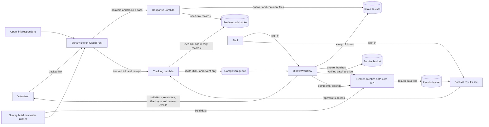
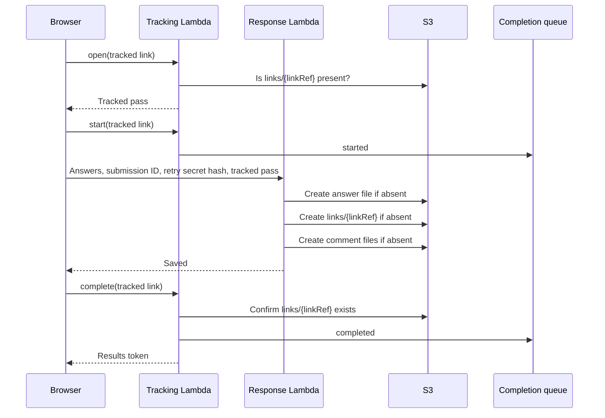

# District Survey Tool

*   **Author:** Jacob Tyler
*   **Status:** Proposed (revised after two Goldfish review rounds)
*   **Date:** 2026-11-18, revised 2026-11-26

--------------------------------------------------------------------------------

## Overview

Letchworth, Baldock & Ashwell Scout District needs to survey its young people, parents and carers,
volunteers and Scout Network members. This design describes a reusable survey tool that asks each
person only the questions that apply to them, tracks which invited volunteers have responded, and
keeps that tracking apart from what they answered.

The work spans three repositories, all public on GitHub:

| Repository | Holds |
| --- | --- |
| `DistrictSurvey` | The survey website, two AWS Lambda functions, the survey Terraform module and the shared contracts |
| `DistrictWorkflow` | The survey engine package, staff pages, invitations, reminders, completion tracking, comment review and the scheduled import |
| `DistrictStatistics` | `data-core`, a private CakePHP API that holds survey definitions, answers and comments, and `data-viz`, a Next.js results front end |

The survey website uses two Lambda functions:

*   The **response Lambda** validates answers and saves them to a private S3 bucket. It never
    receives an invite UUID.
*   The **tracking Lambda** checks invitation links, records completion and grants access to
    results. It never receives answers.

The survey system stores no names, email addresses or invite UUIDs. Survey definitions are written
as one file for each year. Other districts can reuse the code, but version one needs
DistrictWorkflow and DistrictStatistics or replacements for them.

### Current state

| System | Today | What this project needs |
| --- | --- | --- |
| `DistrictSurvey` | A Next.js 16 starter with static export | Survey site, Lambdas, Terraform module, contracts and CI/CD |
| DistrictWorkflow | A Temporal and Next.js application with tasks, tags, email and member sync | Survey engine package, survey workflows, staff pages, email tables and API clients |
| DistrictStatistics | A CakePHP 5.4 skeleton in `data-core` with one `datasets` table and no sign-in. No front end yet | A private survey API, tables, imports and calculations, plus the new `data-viz` results front end |
| DistrictInfrastructure | Terraform for district AWS and Cloudflare resources | Two pinned imports of the survey module |
| Hosting for DistrictWorkflow and DistrictStatistics | Being designed in a separate hosting plan | The items in "Dependencies on the separate hosting plan" |

## The Problem

The district wants feedback from several groups whose experience of Scouting is different. A
general form tool does not meet three needs:

1.  **People should only see questions that apply to them.** A Cub, a parent and a volunteer need
    different questions. One adult can also hold several roles, and a question shared by those
    roles should be asked once.
2.  **The district needs to know who still has to respond, without knowing what they said.**
    Volunteers can be reminded only if their completion is tracked. If that tracking is connected
    to their answers, volunteers have less reason to answer honestly.
3.  **Results should encourage volunteers to take part without exposing individuals.** Volunteers
    who complete the survey can see how others answered, but only as grouped results.

Not everyone can be invited individually. The district holds an email list for volunteers only,
and some volunteers will find the survey through Facebook or general emails. The tool therefore
needs both personal tracked links and one open link, and it must handle a volunteer who uses both.

### Who the design protects against

The design protects respondents from district staff and analysts working out who gave which
answers. It does not provide cryptographic proof against an AWS or cluster administrator.

| Risk | Control |
| --- | --- |
| Matching a named completion time to a response time | Responses store the date only. Exact upload times normally exist for up to 12 hours |
| Comparing results before and after one person submits | Results move only in steps of 3 responses, and at most every 12 hours |
| Reading a small group's answers | Groups below 6 people are hidden |
| Linking stored records back to a tracked link | Used-link records hold one-way values only, and are deleted at close-down |
| Reading answers in workflow history | Temporal history holds batch IDs, task IDs and counts only |

The owner accepts that small-group answers can occasionally be inferred (concepts brief decision 2),
and that one archive per 12-hour batch could narrow a tracked volunteer's answers to a 12-hour window
for someone with both archive and DistrictWorkflow access. The respondent promise never claims that
answers are impossible to work out.

### Glossary

| Term | Meaning | Example |
| --- | --- | --- |
| Persona | A kind of respondent | Young person, parent or carer, volunteer, Network member |
| Section | A young person's Scout section | Beavers (6-8), Cubs (8-10½), Scouts (10½-14), Explorers (14-18) |
| Role | An adult persona. One adult can hold several | A volunteer who is also a parent |
| Tag | A label set by an answer, used only to decide which questions appear | `adult`, `cubs`, `volunteer` |
| Question path | The sequence of questions one person sees | The Cubs path |
| Breakdown | A grouping of results by the answer to an opening question | Results for parents and carers |
| Tracked link | A personal invitation link for a volunteer | `/invite#invite=...` |
| Open link | The shared public survey link | `/survey` |
| Submission ID | A random ID created by the browser for one response, reused on retry | |
| Reviewer pool | DistrictWorkflow members with the `survey-reviewer` tag | |
| District building | A physical district location with a fixed network tunnel | |

## Goals

### Survey experience

*   **G1. Question routing:** Every respondent sees only the questions whose tag conditions match
    their earlier answers. A question shared by several roles is asked once.
*   **G2. One open link:** One open link offers every persona. The first question separates young
    people from adults, and a response cannot combine a young-person path with an adult role.
*   **G3. Saved progress:** Unfinished answers stay in the browser and are never sent to the
    server. Answers remain in the browser until the server confirms that the response has been
    saved.
*   **G4. Accessibility and brand:** All survey and results screens pass the automated and manual
    accessibility checks in the Verification Plan in light and dark themes, and follow the colour,
    typeface and logo rules in "Visual design".

### Tracking and privacy

*   **G5. Volunteer tracking:** Each invited volunteer has a DistrictWorkflow task. The task moves
    to `in_progress` when they press Start, and to `completed` within 5 minutes of a successful
    submission while all services are available.
*   **G6. Separation of answers from identity:** Stored responses contain only the fields approved
    in "Shared contracts", which exclude invite UUIDs, names, email addresses, IP addresses and
    time of day. An automated test fails if any other stored field is added. Each answer file's
    exact upload time normally exists for up to 12 hours, until its batch is archived.
*   **G7. One response per tracked link:** Each tracked link can save one response. Repeating a
    submission after a lost connection does not create a second response.
*   **G8. Open-link response counted once:** A volunteer who has already responded on the open link
    can complete their tracked invitation on the same device, after confirming that they responded.
    Each receipt can complete one tracked link only.
*   **G9. Respondent promise:** Respondents are told: "Your answers are stored separately from your
    invitation, and people reviewing results only see grouped results. A volunteer reviewer reads
    any written comments. Answers are kept by the district with no deletion date."
*   **G25. Technical records notice:** The privacy notice linked from the start page says: "To keep
    the survey working and fix faults, our systems keep short-term technical records, such as when
    a submission was received. This normally includes the exact time your answers were sent for up
    to 12 hours, and longer if a technical fault delays processing. We keep these records for up to
    30 days, and we don't use them to work out who gave which answers." The young people's version
    says: "Our computers keep some short-term records so we can fix problems. We don't use them to
    work out who gave which answers."

### Results

*   **G10. Results access:** Results access is issued only to people who complete a tracked link,
    through CloudFront signed cookies for `results.lbdscouts.org.uk`. DistrictWorkflow sends one
    thank-you email with a results link that works on any device until 3 months after the survey
    closes, with a rare duplicate possible after a failure. Anyone the email is forwarded to can
    also view results until then, and the owner accepts this. Viewing results creates no record of
    who viewed them.
*   **G11. Minimum group size:** A question's results appear once at least 6 people have answered
    it. Each breakdown group must also reach 6.
*   **G12. Stepped updates:** A group's published figures change only when at least 3 more people
    have answered since its last release, and at most once every 12 hours.
*   **G13. Comments stay private:** Written comments never appear in volunteer results.

### Comment review

*   **G14. Free text by section:** Beavers and Cubs see no free-text questions. Validation fails if
    free text is reachable on a Beavers or Cubs path.
*   **G15. Help message:** Every comment box says that comments are not read straight away and
    tells people who to contact if they need help now.
*   **G16. Comment review:** Every comment, from anyone, is reviewed by the reviewer pool within 48
    hours of submission. The survey does not open until the pool has at least two active members and
    the review page has been tested. An alarm alerts survey administrators when a comment is overdue.

### Operation and reuse

*   **G17. Survey validation:** Publishing fails when a question depends on a tag that has not been
    set earlier, a tag is unknown, a condition is impossible, or the survey exceeds its path or
    length limits.
*   **G18. Failure visibility:** Every alarm in "Alarms" exists, notifies the digital team, and is
    triggered once in the test environment before launch.
*   **G19. Yearly reuse:** A new survey year needs a new survey file and no change to application
    code.
*   **G20. Public code:** The checked paths in "Public code scope" contain no district-specific
    values. District names, domains, branding and contacts are supplied as settings.
*   **G21. Survey window:** Each survey has opening and closing dates and runs for around one month.
    Submissions are accepted for 1 hour after closing. After that, the server rejects submissions
    and the survey explains why.
*   **G22. Scheduled import:** Every 12 hours, a DistrictWorkflow workflow moves new answer and
    comment files from S3 to the DistrictStatistics API. Temporal history holds batch IDs and
    counts only, and answers are never stored in DistrictWorkflow.
*   **G23. Recovery archive:** After a batch is imported, its records are shuffled into one archive
    file. The originals are deleted only after the archive has been verified.
*   **G24. Results publishing:** DistrictStatistics calculates results and writes versioned results
    files to a private bucket. New results appear without rebuilding any site.
*   **G26. Analyst view:** Members with the `survey-analyst` or `survey-admin` tag sign in to the
    `data-viz` front end to see published grouped results and approved comments, during and after
    the public window. It applies the same minimum of 6 and never shows individual responses.
*   **G27. Environments:** Local development runs on one laptop with no AWS account. Test and
    production run on AWS and the district Kubernetes cluster, separately from each other.

## Non-Goals

*   Cryptographic proof of privacy against AWS or cluster administrators.
*   Updating results after every response.
*   Showing results to open-link respondents.
*   Custom filters, role combinations in reports, or queries against individual responses.
*   Sending individual responses to any browser.
*   Switching devices partway through a survey.
*   Preventing every duplicate response on the open link.
*   Storing survey answers or comment text in DistrictWorkflow.
*   Sending email from the survey Lambdas.
*   A general-purpose expression language for survey logic.
*   A hosted service for other districts.
*   AlignUI Pro components.
*   An adoption guide for other districts before one real survey has run.
*   "How you compare" comparisons and participation progress displays, in version one.
*   An optional follow-up for volunteer questions after an open-link response.
*   Hosting, Kubernetes setup and CI/CD for DistrictWorkflow, which separate plans cover.
*   Deleting survey answers or comments from DistrictStatistics.
*   Moving existing DistrictWorkflow email features onto the new email tables, which is separate
    DistrictWorkflow work.

## Open Questions

| Question | Owner | Must close by | Blocks launch | Default if not answered |
| --- | --- | --- | --- | --- |
| Success measure for each persona | Survey owner | Phase 6 | No | Report response counts only |
| Start date | Survey owner | Phase 6 | Yes | None |
| Audience sizes for each persona and section | Survey owner | Phase 2 | Yes | None. Rate limits and the load test need them |
| Visible questions in volunteer results | Survey owner | Phase 6 | No | All questions except free text |
| Additional breakdowns beyond persona and section | Survey owner | Phase 4 | No | Persona and section only |
| Reviewer pool members | Survey owner | Phase 6 | Yes | None |
| How parents, carers and young people hear the outcome | Survey owner | After close | No | A summary on the district website |
| Young Leader questions on the Explorer path | Survey owner | Phase 1 | No | No extra questions |
| Network age range | Survey owner | Phase 1 | No | 18-25, matching the district website |
| Survey support rota during the survey | Survey owner | Phase 6 | Yes | None |
| Code maintainer and backup | Survey owner | Phase 6 | No | The author |
| Reason for keeping answers with no deletion date, for the impact assessment | Survey owner | Phase 6 | Yes | None |

These were decided during review:

| Question | Decision |
| --- | --- |
| Closing grace period | 1 hour after closing |
| Comment timing | Imported at least every 12 hours and reviewed within 48 hours of submission |
| Comment approval | Approve makes a comment visible to analysts. Deny hides it. Comments never appear in volunteer results |
| Retention | DistrictStatistics keeps answers, comments and releases. The survey site, results data and archives are removed 3 months after close |
| Started status | `in_progress` when the person presses Start |
| Result rounding | Nearest 5% below 100 responses in a group, then nearest 1% |
| Adult comments | Allowed, with the same review |
| Named status access | Members with the `survey-admin` tag only |
| Squirrels | Parents can select the section. Squirrels do not complete the survey |
| Technical record retention | 30 days for Temporal history in the shared namespace, and 14 days for Lambda and API Gateway logs |

## Critical User Journeys (CUJs)

### CUJ 1: Invited volunteer completes the survey

*   **Given**: A volunteer has a `sent` DistrictWorkflow task and an emailed tracked link.
*   **When**: They open the link, press Start, answer the questions for their roles and submit.
*   **Then**: Their task moves to `in_progress`, then `completed`. Their response is saved without
    their identity, they receive no further reminders, they can view results, and they receive one
    thank-you email with a results link.

### CUJ 2: Volunteer answers on the open link, then opens their tracked link

*   **Given**: A volunteer completed the open-link survey on a device, and that device holds a
    signed receipt.
*   **When**: They open their tracked link on the same device and confirm that they have already
    responded.
*   **Then**: Their task is completed, no second response is created, the receipt cannot be used
    again, they can view results, and they receive the thank-you email.

### CUJ 3: Someone else on a shared device opens a tracked link

*   **Given**: A family device holds a receipt from one person's open-link response.
*   **When**: A different volunteer opens their tracked link and says they have not responded.
*   **Then**: The receipt is left unused and the volunteer starts the survey normally.

### CUJ 4: Parent or carer responds through the open link

*   **Given**: A parent or carer has the open link.
*   **When**: They select their adult roles, answer the matching questions and submit.
*   **Then**: Their response is saved with the source `open`, a receipt is saved in their browser,
    and no results are shown.

### CUJ 5: A comment is reviewed

*   **Given**: A Scout, Explorer or adult submits a comment.
*   **When**: The next scheduled import runs.
*   **Then**: A review task is assigned to the reviewer pool, and every pool member is emailed. The
    first reviewer to open it reads the comment in DistrictWorkflow and approves or denies it. Other
    pool members see who completed it.

### CUJ 6: Beaver or Cub takes part with an adult

*   **Given**: A Beaver or Cub is using the open link with an adult helping them.
*   **When**: They select their section and answer the questions.
*   **Then**: They see age-appropriate questions with no free text and no results, and nothing that
    identifies them is stored.

### CUJ 7: Volunteer views results

*   **Given**: A volunteer has completed their tracked link and holds valid results cookies.
*   **When**: They open the results site.
*   **Then**: They see grouped results for each visible question that has reached the minimum, and a
    "not enough responses yet" message for the others.

### CUJ 8: Respondent's connection fails during submission

*   **Given**: A respondent presses submit and the connection fails.
*   **When**: The browser retries using the same submission ID.
*   **Then**: Exactly one response is stored, their answers remain in the browser until the server
    confirms success, and any tracked task is completed.

### CUJ 9: Survey author prepares next year's survey

*   **Given**: An author has written a new survey file.
*   **When**: A survey administrator uploads it in DistrictWorkflow.
*   **Then**: They see every question path and its length, or an error naming the question, rule and
    required fix. An approved version is used by the next build.

### CUJ 10: Operator responds to a spam flood on the open link

*   **Given**: Abuse alarms show unusual open-link activity.
*   **When**: A survey administrator closes open-link submissions on the DistrictWorkflow controls
    page.
*   **Then**: Tracked links keep working, and open-link responses and comments from the affected
    days can be removed without affecting tracked ones.

### CUJ 11: Volunteer opens results on a second device

*   **Given**: A volunteer completed the survey on their phone and received the thank-you email.
*   **When**: They open the email's results link on their iPad.
*   **Then**: The iPad receives its own results cookies and shows the results, with no need to answer
    again or sign in.

### CUJ 12: Analyst reviews results

*   **Given**: A district member has the `survey-analyst` tag.
*   **When**: They sign in to the `data-viz` front end, during or after the public window.
*   **Then**: They see grouped results for each question and breakdown, plus approved comments.
    Groups below 6 are hidden, and no individual response is shown.

### CUJ 13: Volunteer opts out of reminders

*   **Given**: A volunteer has a tracked link.
*   **When**: They choose "I don't want to complete the survey, please suppress any further
    reminders for this survey."
*   **Then**: Their task moves to `declined` and they receive no more reminders. Opening the link
    again lets them take part after all.

## Changes from the Concepts Brief

The owner confirmed these changes during drafting and review. They replace the matching decisions in
[`working-files/concepts_brief.md`](./working-files/concepts_brief.md).

| Brief decision | Replaced by | Reason |
| --- | --- | --- |
| 7: results in a separate private bucket, served through an API | Results data files in a private bucket, served by the `data-viz` distribution with signed cookies | No results API is needed, and results appear without a site build |
| 9: the submit Lambda sends the UUID to SQS | A separate tracking Lambda sends it, and the response Lambda never receives the UUID | Neither Lambda sees both a UUID and answers |
| 9a: receipts complete tracked links | Tracked links use a shared one-way link record. Receipts remain for open-link responses only | A lost receipt or reload could leave a task open |
| 9a: optional volunteer follow-up | Removed | The open link now offers the Volunteer role |
| 9c: an API checks a signed results pass | CloudFront signed cookies, issued through the results distribution | Static results data can be protected without an API |
| Named reviewer and deputy | A DistrictWorkflow reviewer pool | Volunteers share the review load |
| DistrictStatistics staff sign-in | DistrictWorkflow for staff tasks, and the `data-viz` front end for results | One place to render results, usable after the public window |
| Survey engine in `DistrictSurvey` | `packages/survey-engine` in DistrictWorkflow, published to GitHub Packages | DistrictWorkflow's upload page imports it directly |

--------------------------------------------------------------------------------

## Technical Plan (Architecture)

### System overview



### What each system can see

| System | Can see | Must never hold |
| --- | --- | --- |
| Browser | The current person's answers until submission | Other people's answers |
| Response Lambda | One submission and a tracked pass while handling the request | Invite UUIDs |
| Tracking Lambda | One invite UUID and receipt while handling the request | Answers or comments |
| Intake bucket | Answer and comment files under keyed names, normally for up to 12 hours | UUIDs, names, emails, IP addresses |
| Used-records bucket | One-way values for used links and receipts | UUIDs, answers or submission IDs in readable form |
| DistrictWorkflow | People, UUIDs, task status, and file contents while streaming them | Stored answers, stored comment text, file names in Temporal history |
| DistrictStatistics `data-core` | Answers, comments, submission dates and sources | UUIDs, names, emails, time of day |
| Results bucket and `data-viz` | Grouped results and approved comments | Individual answers |

### Environments

| | Local development | Test | Production |
| --- | --- | --- | --- |
| Where it runs | One laptop | AWS and the Kubernetes cluster | AWS and the Kubernetes cluster |
| AWS services | DistrictWorkflow's Moto on port 4566, shared | A separate module instance | A separate module instance |
| Survey APIs | `functions/local/server.ts`, running the real Lambda code | API Gateway and Lambda | API Gateway and Lambda |
| Results protection | `functions/local/results-proxy.ts` | CloudFront | CloudFront |
| DistrictWorkflow | Its own compose file and launcher | Test deployment | Production deployment |
| DistrictStatistics | Its own compose file | Test deployment | Production deployment |
| Staff sign-in | DistrictWorkflow's existing dev Cognito client with its localhost callback | Cognito test client | Cognito production client |
| Turnstile | Cloudflare's published test keys | Test widget | Production widget |
| Email | Captured by Moto's SES | An allow-list of test addresses only | Real recipients |
| Survey domain | `localhost` | `survey-test.lbdscouts.org.uk` | `survey.lbdscouts.org.uk` |
| Results domain | `localhost` | `results-test.lbdscouts.org.uk` | `results.lbdscouts.org.uk` |
| Data | Made-up data only | Made-up data only, with a reset command | Real data |

`yarn dev:all` starts the survey site and local Lambda server against the shared Moto. Phase 2 must
confirm that Moto supports conditional S3 writes. LocalStack is the fallback if it does not.

Each environment's AWS permissions, API tokens and secrets work only in that environment.

### Shared contracts

Every format shared between systems is defined as a JSON Schema (draft 2020-12), and every HTTP API
is defined in OpenAPI 3.1, reusing those schemas.

*   Every file and message carries a `schemaVersion`.
*   Additive changes raise the minor version, and breaking changes create a new major version.
*   Spectral lints the OpenAPI files, and oasdiff fails a pull request with an unversioned breaking
    change.
*   Lambda, DistrictWorkflow and PHP tests validate real requests and responses against the specs.
*   `DistrictSurvey` publishes its schemas, OpenAPI files and reviewed examples as a versioned
    release. DistrictWorkflow and DistrictStatistics record the contracts version and checksum, and
    their CI downloads that exact release.
*   The survey file and compiled survey schemas live with the engine package in DistrictWorkflow.

| Contract | Between | File |
| --- | --- | --- |
| Survey definition | Author, engine, DistrictStatistics | `DistrictWorkflow/packages/survey-engine/schemas/survey.v1.json` |
| Compiled survey | Engine, survey site, response Lambda, DistrictStatistics | `DistrictWorkflow/packages/survey-engine/schemas/compiled-survey.v1.json` |
| Tracked link | DistrictWorkflow, tracking Lambda | `contracts/schemas/tracked-link.v1.json` |
| Tracked pass, receipt and results token | Lambdas, browser, DistrictWorkflow | `contracts/schemas/signed-values.v1.json` |
| Answer file | Response Lambda, DistrictStatistics | `contracts/schemas/answer-file.v1.json` |
| Comment file | Response Lambda, DistrictStatistics | `contracts/schemas/comment-file.v1.json` |
| Intake key layout | Response Lambda, DistrictWorkflow | `contracts/schemas/intake-keys.v1.json` |
| Completion message | Tracking Lambda, DistrictWorkflow | `contracts/schemas/completion-message.v1.json` |
| Import request | DistrictWorkflow, DistrictStatistics | `contracts/schemas/import-request.v1.json` |
| Archive | DistrictWorkflow, DistrictStatistics | `contracts/schemas/archive.v1.json` |
| Results release | DistrictStatistics, `data-viz` | `contracts/schemas/results-release.v1.json` |
| Control parameters | DistrictWorkflow, Lambdas | `contracts/schemas/controls.v1.json` |
| Metrics | Lambdas, DistrictWorkflow, alarms | `contracts/schemas/metrics.v1.json` |
| Survey APIs | Browser, Lambdas | `contracts/openapi/survey-api.v1.yaml` |
| DistrictStatistics API | DistrictWorkflow, survey build | `contracts/openapi/statistics-api.v1.yaml` |

#### Signed value formats

Each signed value is `base64url(JSON payload) + "." + base64url(signature)`.

| Value | Payload | Signature | Signed by | Checked by |
| --- | --- | --- | --- | --- |
| Tracked link token | `{"v":1,"s":"<surveyId>","u":"<uuid>"}` | HMAC-SHA-256 | DistrictWorkflow | Tracking Lambda |
| Tracked pass | `{"v":1,"s":"<surveyId>","l":"<linkRef>","exp":<unix>}` | Ed25519 | Tracking Lambda | Response Lambda |
| Receipt | `{"v":1,"s":"<surveyId>","r":"<random id>","exp":<unix>}` | Ed25519 | Response Lambda | Tracking Lambda |
| Results token | `{"v":1,"s":"<surveyId>","a":"volunteer","exp":<unix>}` | Ed25519 | DistrictWorkflow or tracking Lambda | Tracking Lambda |

`linkRef` is `base64url(HMAC-SHA-256(link reference key, surveyId + ":" + uuid))`. Only the tracking
Lambda holds the link reference key. Passes and receipts expire at closing + 1 hour. Results tokens
expire 3 months after closing. `contracts/examples/` holds one worked example of each value.

#### Files, keys and messages

| Item | Definition |
| --- | --- |
| Answer file | `intake/answers/{fileKey}.json`, where `fileKey` is an HMAC of the submission ID |
| Comment file | `intake/comments/{commentKey}.json`, where `commentKey` is an HMAC of the submission ID and question ID |
| Used-link record | `links/{linkRef}` in the used-records bucket, containing a SHA-256 hash of the browser's retry secret |
| Used-receipt record | `receipts/{HMAC(receiptId)}` in the used-records bucket |
| Import request | `batchId` is a random UUID created by DistrictWorkflow. The body is newline-delimited JSON records with a count header |
| Archive | `archive/{surveyId}/{batchId}.jsonl.gz`, one record per line in shuffled order, with `{batchId}.sha256` alongside |
| Results release | `results-data/{surveyId}/releases/{releaseId}.json`, plus `results-data/{surveyId}/current.json` as a full copy of the latest |
| Control parameters | `/district-survey/{environment}/controls/open`, `/tracked`, `/survey` and `/results-cookies`, each `true` or `false` |
| Metrics | Namespace `DistrictSurvey/{environment}`, with the metric names in "Alarms" |

```json
{
  "schemaVersion": "1.0",
  "surveyId": "district-2027",
  "surveyVersion": "sha256:...",
  "submissionId": "random-uuid-v4",
  "source": "tracked",
  "submittedOn": "2027-03-14",
  "answers": { "age-group": "adult", "adult-roles": ["volunteer"] }
}
```

```json
{
  "schemaVersion": "1.0",
  "surveyId": "district-2027",
  "surveyVersion": "sha256:...",
  "commentId": "random-uuid-v4",
  "questionId": "explorer-comments",
  "audience": "young-person",
  "source": "open",
  "submittedOn": "2027-03-14",
  "text": "..."
}
```

```json
{ "schemaVersion": "1.0", "surveyId": "district-2027", "inviteUuid": "uuid", "event": "completed" }
```

*   `submittedOn` uses the Europe/London date.
*   `source` is `tracked` only when a valid tracked pass was presented.
*   `audience` is `young-person` if the response has the `young-person` tag, otherwise `adult`.
*   Comment files carry no submission ID.
*   Text answers are limited to 1,000 characters unless the survey sets a lower limit.
*   The completion message `event` is `started`, `completed` or `declined`. Messages carry no
    timestamp, answers or receipt.
*   The results release holds the survey and release IDs, generation time, and for each question its
    groups with shown count, percentages and a `hidden` flag.

### Survey definition and question logic

A survey is an ordered list of blocks, and a block is an ordered list of questions and panels. Each
answer option can set one or more tags. Each question can declare a `showIf` condition using `all`,
`any` and `none` lists of tags. Any earlier question may set tags.

| Part | Definition |
| --- | --- |
| Question types | `single`, `multiple`, `scale` and `text` |
| Question fields | `id`, `text`, `help`, `required`, `showIf`, `options`, `maxLength` for text, `showInResults` |
| `scale` fields | `min`, `max`, `minLabel` and `maxLabel` |
| Comment questions | `type: text` with `comment: true`. Each needs a help panel in the same block |
| Panels | `panel` shows information without asking a question, such as the help message |
| Changed questions | `replaces` links a new question ID to the one it replaces |
| Reporting | `reporting.breakdowns` lists the questions whose answers create breakdown groups |
| Settings | Dates, limits, reviewer tag, visible questions, breakdowns, district name, contacts, logos and theme. The visible questions setting takes priority over `showInResults` |

```yaml
survey:
  id: district-2027
  limits: { maxPaths: 512, maxQuestionsPerPath: 60 }

reporting:
  breakdowns: [age-group, section, adult-roles]

blocks:
  - id: about-you
    questions:
      - id: age-group
        type: single
        text: Which best describes you?
        options:
          - { id: young-person, text: I'm in a Scout section, sets: [young-person] }
          - { id: adult, text: I'm an adult, sets: [adult] }
      - id: section
        type: single
        text: Which section are you in?
        showIf: { all: [young-person] }
        options:
          - { id: beavers, text: Beavers, sets: [beavers] }
          - { id: cubs, text: Cubs, sets: [cubs] }
          - { id: scouts, text: Scouts, sets: [scouts] }
          - { id: explorers, text: Explorers, sets: [explorers] }
      - id: adult-roles
        type: multiple
        text: Which of these apply to you?
        showIf: { all: [adult] }
        options:
          - { id: parent, text: Parent or carer, sets: [parent] }
          - { id: volunteer, text: Volunteer, sets: [volunteer] }
          - { id: network, text: Scout Network member, sets: [network] }
```

The system supplies the tags `source:open` and `source:tracked`, which a survey file cannot set. A
tracked link preselects the Volunteer option and does not offer the young-person option.

`evaluateSurvey(compiledSurvey, answers, systemTags)` in `@lbdistrictscouts/survey-engine` returns the
visible questions, current tags, answers that no longer apply, and errors. The survey site uses it to
decide what to show. The response Lambda runs the same function and rejects a submission when any
answer does not belong on the calculated path. Tags are used only for routing. DistrictStatistics
never runs routing logic and calculates breakdowns from the answers to the questions listed in
`reporting.breakdowns`.

The compiled survey's fingerprint is the SHA-256 of question IDs, options, conditions and the
breakdown list. Dates and approved wording fixes are excluded, so changing them does not discard
saved answers.

### Survey engine package

| Area | Design |
| --- | --- |
| Location | `DistrictWorkflow/packages/survey-engine` |
| Name | `@lbdistrictscouts/survey-engine` |
| Contents | Schemas, compiler, `evaluateSurvey`, path enumeration, validation and fingerprinting |
| Build | `tsc` to `dist/`, with `exports` for the engine, validator and types |
| Publishing | DistrictWorkflow's CI publishes it to GitHub Packages on each engine release, as part of the separate DistrictWorkflow CI plan |
| DistrictWorkflow use | `apps/web` imports the workspace package directly |
| `DistrictSurvey` use | The survey site, response Lambda and `yarn survey:validate` install a pinned published version |
| Authentication | `DistrictSurvey`'s CI installs it with its `GITHUB_TOKEN`, and the package grants that repository read access |

### Survey validation

`yarn survey:validate` in `DistrictSurvey` and the DistrictWorkflow upload page both run the engine's
validator. It walks every combination of tag-setting answers and fails with the question, rule and
fix when:

*   A condition uses an unknown tag, or a tag set only by a later question.
*   A question is not visible on any path.
*   The survey exceeds its path or path-length limit.
*   Free text can be reached on a path with the `beavers` or `cubs` tag.
*   A comment question has no help panel in its block.
*   A question ID's wording or options changed from the previous survey without `replaces`.
*   A required colour pair in the theme misses its contrast target.

`yarn survey:validate` reads the previous survey from a local file passed with `--previous`.

### Publishing a survey

| Step | Who or what | What happens |
| --- | --- | --- |
| 1. Write | Survey author | Writes the YAML file and checks it with `yarn survey:validate` |
| 2. Upload | Survey administrator | Uploads it on the DistrictWorkflow survey settings page |
| 3. Check | DistrictWorkflow | Validates it with the engine, compares it with the previous survey from DistrictStatistics, and shows every path |
| 4. Store | DistrictStatistics | Saves the YAML, compiled JSON and fingerprint as a new numbered draft version |
| 5. Approve | Survey administrator | Approves the version, settings and logos |
| 6. Build | Cluster runner | Fetches the approved version from `GET /api/v1/surveys/{surveyId}/build-data` using `SURVEY_ID` and the build token |
| 7. Deploy | Deploy workflow | Bundles the same compiled file into the survey site and response Lambda, and checks that the fingerprints match |
| 8. Open | Survey administrator | The "Open survey" action on the DistrictWorkflow controls page freezes the fingerprint, opens the survey and switches on the import alarms |

After opening, DistrictStatistics refuses any new version with a different fingerprint. Only dates and
wording can change. Changing a question's meaning requires closing the survey and accepting that
saved drafts will be discarded. Pull request builds use example data only, and production builds fail
if real survey data is unavailable.

### Visual design

*   Scouts Purple `#7413dc` leads, with teal `#088486` as the supporting colour. Text is `#172329`,
    muted text `#66747b`, and surfaces `#ffffff` and `#f5f8f8`.
*   Dark theme: background `#10191c`, panels `#162226`, text `#f4f8f8`, muted `#aab9bc`, primary buttons
    white on `#7413dc`, and links, progress, selected answers and focus `#b78cf2`.
*   Nunito Sans with real font weights. Inputs have 8px corners and cards 14px.
*   The official logo appears once per page and is supplied through district settings.
*   Black on yellow `#ffe627` is reserved for the help panel. Sentence case, no italics and no emoji.
*   AlignUI free Base Components, imported only through `src/ui/`.

### Survey APIs

| Lambda | Route | Purpose |
| --- | --- | --- |
| Tracking | `POST /api/v1/tracking/open` | Checks a tracked link and returns a tracked pass, or `completed` with a results token |
| Tracking | `POST /api/v1/tracking/start` | Sends a `started` completion message |
| Tracking | `POST /api/v1/tracking/complete` | Confirms a used-link record exists, sends `completed` and returns a results token |
| Tracking | `POST /api/v1/tracking/claim` | Completes a tracked link using an open-link receipt and returns a results token |
| Tracking | `POST /api/v1/tracking/decline` | Sends a `declined` completion message |
| Tracking | `POST /api/results-access` (results domain) | Exchanges a results token for results cookies |
| Response | `POST /api/v1/responses/tracked` | Saves a tracked response |
| Response | `POST /api/v1/responses/open` | Saves an open-link response after a Turnstile check |

Error codes: `survey_closed`, `version_changed`, `invalid_link`, `already_completed`, `invalid_answers`,
`verification_failed`, `rate_limited` and `temporarily_unavailable`. Each code's message and action are
defined in `contracts/openapi/survey-api.v1.yaml`.

### Tracked response flow



1.  **Open.** The tracking Lambda checks the link signature and calculates `linkRef`. If
    `links/{linkRef}` exists, it resends `completed` and returns a results token. Otherwise it returns
    a tracked pass.
2.  **Start.** Pressing Start sends a `started` message.
3.  **Save the answers.** The response Lambda writes the answer file with `If-None-Match`. A repeat
    with the same submission ID finds the existing file and continues.
4.  **Claim the link.** It then creates `links/{linkRef}` with `If-None-Match`, containing a hash of a
    random retry secret that the browser keeps with its draft. A matching record means a retry. A
    different record means the link was already used, so the Lambda deletes the answer file it
    created in step 3, only if this request created it, and returns `already_completed`.
5.  **Save comments.** Comment files are written only after the claim succeeds, with names that a
    retry reproduces exactly.
6.  **Complete.** The browser sends the tracked link to `tracking/complete`. The tracking Lambda
    confirms the record exists, sends `completed`, and returns a results token.
7.  **Results cookies.** The completion page sends the person to
    `https://results.lbdscouts.org.uk/access#token=<results token>`, which sets the results cookies.

If the page is reloaded, the tracked link is no longer in memory. The page tells the person to reopen
their email link, which completes the task through step 1. The response Lambda can delete only
`intake/answers/*`.

### Open-link response flow

The response Lambda checks Turnstile, saves the answer file and comment files, and returns a receipt to
adults. Young people receive no receipt. Each retry gets a new Turnstile token while keeping the same
submission ID. During the grace hour after closing, open-link submissions are accepted without a start
check, because the page stops offering the survey at closing.

When a tracked link opens on a device holding an open-link receipt, the page always asks whether this
person has already responded. If they confirm, `tracking/claim` creates the used-receipt and used-link
records, sends `completed` and returns a results token. Each receipt can complete one link only.

### Declining

The `/invite` page offers: "I don't want to complete the survey, please suppress any further reminders
for this survey." After a confirmation step, `tracking/decline` sends a `declined` message.
DistrictWorkflow sets the task to `declined` and stops reminders. Opening the link again shows that
reminders are suppressed and offers to take part after all.

### Browser storage

| Data | Storage | Lifetime |
| --- | --- | --- |
| Adult draft answers, submission ID and retry secret | Local storage | 7 days, cleared after success or by "clear my answers" |
| Young person's draft answers and submission ID | Session storage | Current tab session |
| Tracked pass | Local storage, with the adult draft | Until submitted or closing + 1 hour |
| Receipt | Local storage | Until closing + 1 hour, adult open-link responses only |
| Theme preference | Local storage | Until changed |

Answers on paths that no longer apply are removed after the person confirms a warning.

### Scheduled import

A DistrictWorkflow Temporal schedule runs `surveyImportWorkflow` every 12 hours. One activity does the
following steps, so file names never enter workflow history:

1.  List up to 2,000 new intake files.
2.  Stream them to `POST /api/v1/survey-imports/{batchId}` on DistrictStatistics.
3.  Wait for DistrictStatistics to confirm how many records it stored.
4.  Shuffle the batch into one compressed archive in the archive bucket.
5.  Read the archive back and compare its record count and SHA-256 checksum.
6.  Delete the original intake files.
7.  Return the batch ID and counts.

The workflow then:

1.  Asks DistrictStatistics for comments with no task, creates a task for each, and records each with
    `PUT /api/v1/comments/{id}/task`.
2.  Emails every active `survey-reviewer` member once if new review tasks were created.
3.  Asks DistrictStatistics to calculate results.
4.  Publishes the import heartbeat metric.

A run that fails before step 6 leaves the intake files for the next run. Later steps repeat safely,
because task creation reads DistrictStatistics, not the intake files. DistrictStatistics rejects
duplicate submission and comment IDs without failing the batch.

### DistrictStatistics `data-core`

`data-core` is a private API with no staff screens. Its production Datasets routes are removed. Callers
use scoped service tokens:

| Token | Used by | Allowed routes |
| --- | --- | --- |
| Import | DistrictWorkflow | Survey imports and result calculation |
| Comments | DistrictWorkflow | Listing, reading, task recording and deciding comments |
| Survey admin | DistrictWorkflow | Survey versions, settings, removals and close-down evidence |
| Build | Survey build job | Build data only |
| Results viewer | `data-viz` build | Published releases and approved comments |

| Route | Method | Token | Purpose |
| --- | --- | --- | --- |
| `/api/v1/surveys/{id}/versions` | `POST`, `GET` | Survey admin | Store and list numbered versions |
| `/api/v1/surveys/{id}/versions/{number}/approve` | `POST` | Survey admin | Approve a version |
| `/api/v1/surveys/{id}/open` | `POST` | Survey admin | Freeze the fingerprint and open the survey |
| `/api/v1/surveys/{id}/settings` | `PUT`, `GET` | Survey admin | Settings and logos |
| `/api/v1/surveys/{id}/build-data` | `GET` | Build | Approved version, settings and logos |
| `/api/v1/survey-imports/{batchId}` | `POST` | Import | Import a batch |
| `/api/v1/surveys/{id}/releases` | `POST` | Import | Calculate and publish results |
| `/api/v1/surveys/{id}/comments?task=none` | `GET` | Comments | Comments without a task |
| `/api/v1/comments/{id}` | `GET` | Comments | Comment text while it has no decision |
| `/api/v1/comments/{id}/task` | `PUT` | Comments | Record that a task exists |
| `/api/v1/comments/{id}/decision` | `POST` | Comments | Approve or deny |
| `/api/v1/surveys/{id}/removals` | `POST`, `DELETE` | Survey admin | Preview, apply and undo spam removal |
| `/api/v1/surveys/{id}/close-down-evidence` | `POST` | Survey admin | Record close-down evidence |
| `/api/v1/surveys/{id}/analyst-data` | `GET` | Results viewer | Published releases and approved comments |

Status codes and bodies are defined in `contracts/openapi/statistics-api.v1.yaml`.

| Table | Main columns | Rule |
| --- | --- | --- |
| `surveys` | `id`, `name`, `opens_on`, `closes_on`, `status` | One row per survey |
| `survey_versions` | `id`, `survey_id`, `version_number`, `fingerprint`, `source_yaml`, `compiled_json`, `status`, `approved_at`, `frozen_at` | Unique on survey ID and version number |
| `survey_settings` | `survey_id`, `settings_json`, `logo_light`, `logo_dark` | One current row per survey |
| `import_batches` | `id`, `survey_id`, `answer_count`, `comment_count`, `checksum`, `status` | Repeating a batch changes nothing |
| `survey_responses` | `submission_id`, `survey_version_id`, `source`, `submitted_on`, `removed_at` | `submission_id` unique, no time of day |
| `survey_answers` | `response_id`, `question_id`, `option_id`, `value` | One row per answer or selected option |
| `survey_comments` | `id`, `survey_id`, `question_id`, `audience`, `source`, `text`, `submitted_on`, `task_created_at`, `decision`, `decided_by`, `decided_at`, `removed_at` | No response ID |
| `result_releases` | `id`, `survey_id`, `survey_version_id`, `counts_json`, `release_json`, `generated_at` | Keeps the counts behind each release |
| `close_down_evidence` | `survey_id`, `stage`, `store`, `item_count`, `outcome`, `approved_by`, `recorded_at` | No answers, comments, UUIDs or names |

`decided_by` and `approved_by` hold the DistrictWorkflow user ID only. These tables are kept with no
deletion date.

#### Results calculation

*   A group is shown only when at least 6 people answered that question.
*   A group's figures update only when at least 3 more people have answered since its last release.
*   The shown count is rounded down to a multiple of 3.
*   Percentages are rounded to the nearest 5% below 100 responses in a group, then to the nearest 1%.
*   Breakdowns come from `reporting.breakdowns`, one at a time. A person with several roles counts in
    each matching group, and role combinations are never shown.
*   Removed responses are excluded. A group that falls below 6 because of removals is hidden again.
*   Comments are excluded from volunteer results. Approved comments appear in the analyst view only.

Each release is written to `results-data/{surveyId}/releases/{releaseId}.json`, and
`results-data/{surveyId}/current.json` is overwritten with a copy. Rolling back means copying an
earlier release over `current.json`. Release files are cached for a long time, and `current.json` for
60 seconds.

### DistrictStatistics `data-viz` results front end

`data-viz` is a static Next.js export in the DistrictStatistics repository. It renders survey results
for both volunteers and analysts, so no rendering code is duplicated.

| Area | Design |
| --- | --- |
| Domain | `results.lbdscouts.org.uk`, on its own CloudFront distribution created by the survey module |
| Pages | `/` lists surveys, `/surveys/{surveyId}` shows results, `/access` exchanges a results token, `/sign-in` starts staff sign-in |
| Volunteer access | Signed cookies for `/results-data/*`, valid until 3 months after close |
| Staff access | Cognito sign-in checked at the edge, reusing `DistrictInfrastructure/modules/members-area/edge`. Only `survey-analyst` and `survey-admin` members pass |
| Staff data | Approved comments are fetched at build time by the `data-viz` build with the results viewer token, and served only under a staff-protected path |
| After 3 months | Volunteer cookies and tokens stop working, and staff sign-in carries on |
| Results data | Read from the results bucket through `/results-data/*` |
| Build and deploy | DistrictStatistics CI builds `data-viz` and uploads it to its site bucket |

### Results access

| Path on `results.lbdscouts.org.uk` | Protection | Content |
| --- | --- | --- |
| `/`, `/surveys/*` | Public shell | Static pages with no questions or figures |
| `/results-data/*` | Volunteer signed cookies, or staff sign-in | Results JSON from the results bucket |
| `/staff-data/*` | Staff sign-in only | Approved comments |
| `/access` | Public | Exchanges a results token for cookies |
| `/api/results-access` | Public, origin header added by CloudFront | Routed to the tracking Lambda |

The tracking Lambda sets `CloudFront-Policy`, `CloudFront-Signature` and `CloudFront-Key-Pair-Id`
cookies for `/results-data/*`, marked `Secure`, `HttpOnly` and `SameSite=Lax`, on the results domain.
Cookies last 7 days, or until the results token's expiry if sooner.

When DistrictWorkflow first moves a survey task to `completed`, it sends the thank-you email, linking to
`/access#token=<results token>`. The link works on any device until 3 months after close, and anyone
it is forwarded to can also use it. If a link is posted publicly, a survey administrator can stop
cookie issue with the `/results-cookies` control, replace the CloudFront key, and resend links.

### Staff interface in DistrictWorkflow

Staff sign in with DistrictWorkflow's existing Cognito setup. `apps/web/src/lib/survey-access.ts`
checks tags before every survey page and API call.

| Page | Tag | What it does |
| --- | --- | --- |
| Survey settings | `survey-admin` | Uploads, previews and approves survey versions, settings and logos |
| Invitations | `survey-admin` | Selects volunteers, previews, test-sends, sends, reissues and adds late invitations |
| Named status | `survey-admin` | Shows each volunteer's task status |
| Survey controls | `survey-admin` | Opens the survey, closes link types, controls results cookies, removes spam, resends emails and approves close-down steps |
| Comment review | `survey-reviewer` | Shows the reviewer pool's comment tasks |

Comment text is fetched from DistrictStatistics on the server each time the page loads, with no
caching. It is never stored in DistrictWorkflow tasks, drafts, Temporal history, logs or emails.

### DistrictWorkflow tasks

Survey tasks use the shared `tasks` table. Its `task_status` enum gains `sent`, `bounced`, `declined`
and `not_completed`.

| Status | Used for |
| --- | --- |
| `pending` | Created but not yet sent |
| `sent` | Invitation sent |
| `bounced` | Invitation email bounced |
| `in_progress` | The volunteer pressed Start, or a reviewer opened a comment |
| `completed` | Response received, or comment decided |
| `declined` | The volunteer opted out of reminders |
| `not_completed` | Closed at close-down without a response |

| From | Allowed next statuses |
| --- | --- |
| `pending` | `sent`, `bounced`, `declined`, `not_completed` |
| `sent` | `bounced`, `in_progress`, `completed`, `declined`, `not_completed` |
| `bounced` | `sent` after a resend, `in_progress`, `completed`, `declined`, `not_completed` |
| `in_progress` | `completed`, `declined`, `not_completed` |
| `declined` | `in_progress`, `completed`, `not_completed` |
| `completed`, `not_completed` | None |

*   Invitation tasks are assigned to the volunteer through `assigned_user_id`, with a
    `survey-invitee` tag that has no members, so they appear only in that volunteer's own digest.
*   Comment review tasks are assigned to the `survey-reviewer` tag.
*   Existing screens, counts, filters and state rules in Training Fund, Awards, responses and
    activity notifications must handle the new values, with tests.
*   One migration adds the enum values, and a second hand-written migration seeds the survey
    workflow, its steps and the `survey-admin`, `survey-reviewer`, `survey-analyst` and
    `survey-invitee` tags, following `0014_workflow_cases.sql`.

| Table | Main columns |
| --- | --- |
| `survey_invitations` | `task_id`, `survey_id`, `user_id`, `link_uuid`, `reminder_count`, `created_at` |
| `survey_comment_tasks` | `task_id`, `comment_id`, `audience`, `imported_at`, `decision` |
| `survey_import_runs` | `batch_id`, `status`, `answer_count`, `comment_count`, `started_at`, `finished_at` |
| `survey_audit_log` | `user_id`, `action`, `target`, `recorded_at`. Never answers or comment text |
| `emails` | `id`, `recipient`, `template`, `purpose`, `task_id`, `configuration_set`, `status`, `ses_message_id`, `template_values`, `claimed_at`, `sent_at` |
| `email_traces` | `id`, `email_id`, `event`, `occurred_at`, `detail` |

### Email

DistrictWorkflow gains a general email record for every sending task. A row in `emails` claims each
send before it happens, unique on task and purpose. `email_traces` holds one row per SES event:
`send`, `delivery`, `bounce`, `complaint`, and `open` or `click` where allowed.

| Configuration set | Used by | Records |
| --- | --- | --- |
| Survey | All survey emails | Send, delivery, bounce and complaint. Open and click tracking off |
| DistrictWorkflow general | Other DistrictWorkflow emails, moved over as separate work | Send, delivery, bounce, complaint, open and click |

*   `template_values` never holds signed links or tokens.
*   Every link containing a signed token carries the `ses:no-track` attribute, and a test fails if one
    is missing.
*   `deliverThemedEmail` gains an optional `configurationSetName`.
*   Survey emails never use the task status badge image.
*   A crash after sending leaves the email `uncertain`, which allows the rare duplicate accepted in G10.

| Survey email | Sent when | To |
| --- | --- | --- |
| Invitation | An administrator sends invitations | Each selected volunteer |
| Reminder | Midpoint and 7 days before closing | Volunteers whose task is `sent`, `bounced` after a resend, or `in_progress` |
| Thank-you | A task first moves to `completed` | That volunteer |
| Final results | After the final release at close-down | Volunteers who completed |
| New comments | After an import creates review tasks | Every active `survey-reviewer` member |
| Comment reminder | 12 and 24 hours after import, if still open | Every active `survey-reviewer` member |

`packages/integrations/src/survey/email.ts` builds these emails, and
`apps/worker/src/activities/email-notifications/survey.ts` claims and sends them.

### Comment review

| Time | What happens |
| --- | --- |
| Within 12 hours of submission | The import creates a task for the `survey-reviewer` pool and emails every active member |
| Review | The first reviewer to open the task reads the comment and chooses approve or deny. DistrictStatistics records the decision |
| Other reviewers | They see that the task was completed by that reviewer, and the comment text is no longer shown |
| 12 and 24 hours after import | The pool is reminded if the task is still open |
| 36 hours after import | DistrictWorkflow publishes the `CommentOverdue` metric, and the alarm alerts survey administrators |

Counting from import keeps exact times out of storage: an import within 12 hours followed by 36 hours of
review stays within 48 hours of submission. If a comment raises a concern, the reviewer denies it and
follows the district's usual safeguarding procedure.

### Invitation lifecycle

| Stage | What happens |
| --- | --- |
| Select | A survey administrator chooses a DistrictWorkflow member tag, using the existing member sync |
| Preview | The page shows the recipient count, duplicates and members with no usable email address |
| Test send | One invitation goes to the administrator for the pilot survey ID, so it never counts |
| Send | One task, one UUID and one link are created per volunteer. Repeating the action creates no duplicates |
| Reminders | Up to two, as in "Email" |
| Bounces | The survey feedback queue marks bounced tasks and stops their reminders |
| Lost link | An administrator resends the same link |
| Late additions | An administrator can add a volunteer until the survey closes |
| Opt out | As in "Declining" |
| Close | Open tasks become `not_completed` during close-down |

The completion intake is one activity that receives a batch from SQS, matches each UUID to its task,
updates the tasks, deletes the messages, and returns counts and task IDs only.

### Survey controls and recovery

| Control | How it works |
| --- | --- |
| Open survey | Freezes the fingerprint, opens the survey and switches on import alarms |
| Close open links, tracked links or the whole survey | Updates the SSM control parameter, applied by the Lambdas within 1 minute |
| Stop issuing results cookies | Updates `/results-cookies` |
| Remove spam | An administrator chooses the date and source, previews the counts, then confirms. Matching responses and comments are marked as removed |
| Undo removal | Possible until the survey closes |
| Resend an email | An administrator action on the task |
| Restore an archive | `bin/cake survey_archive_restore <surveyId> <batchId>` in DistrictStatistics, which skips stored and removed submissions |

Every control writes a `survey_audit_log` row.

### Close-down

`surveyCloseDownWorkflow` in DistrictWorkflow runs these stages in order:

| When | Step | Must be true before continuing |
| --- | --- | --- |
| Close + 1 hour | Reject new submissions | Close switches are on |
| Next import | Import all remaining files | The intake bucket is empty |
| After import | Finish comment reviews | No review task is open |
| After review | Publish the final release | The release passes its checks |
| After release | Send the final results email | Every send succeeded, or its failure is listed |
| Admin approval | Delete used-link and receipt records, their HMAC keys, and invite UUIDs | A `survey-admin` approves the task |
| Close + 3 months | Remove the survey site, results data, recovery archives and results signing keys, and stop issuing cookies. Switch off import alarms | The expiry date has passed |

`apps/worker/src/activities/survey/close-down.ts` performs each deletion with S3 and Secrets Manager
clients, and saves a `close_down_evidence` record through DistrictStatistics. Answers, comments and
releases in DistrictStatistics are not deleted. Long-running survey workflows continue as new runs each
day, so their history does not build up.

### Dependencies on the separate hosting plan

| Needed | Used for |
| --- | --- |
| Test and production deployments of DistrictWorkflow and DistrictStatistics `data-core` | Phase 4 onwards |
| PostgreSQL, a self-hosted Temporal server, migrations and backups | Stored answers, imports and schedules |
| Temporal history retention of 30 days in the shared namespace | G25 |
| A private hostname for `data-core`, such as `data-core.lbdscouts.org.uk`, with TLS | Imports, builds and DistrictWorkflow calls |
| `App.fullBaseUrl` and probe `Host` headers set to that hostname | DistrictStatistics host check |
| Identities for both applications with the survey module's IAM policies attached | S3, SQS, SSM, SES, Secrets Manager and CloudWatch |
| DistrictWorkflow's public address through CloudFront and its Cloudflare Tunnel | Staff pages and email links |
| A separate, non-privileged runner scale set for survey builds | Builds that read DistrictStatistics |
| A `us-east-1` digital team alert topic, subscribed like the existing topic | CloudFront and firewall alarms |
| Deployment of the DistrictStatistics container image | Running `data-core` |
| DistrictWorkflow CI that builds, tests and publishes the survey engine package, and runs the survey tests and traceability check | Phases 1 and 5 |

### AWS infrastructure

The Terraform module in `infra/terraform` creates, for each environment:

*   A survey CloudFront distribution with access logs off, the security headers below, and separate
    rules for the site and `/api/*`.
*   A results CloudFront distribution for `data-viz`, with rules for the site, `/results-data/*`,
    `/staff-data/*` and `/api/results-access`, and the staff sign-in edge function.
*   Survey site, `data-viz` site, intake, used-records, archive and results buckets, all private and
    encrypted. Versioning is off on the intake bucket.
*   One API Gateway HTTP API and two Node.js Lambda functions in `eu-west-1`.
*   One SQS completion queue and dead-letter queue.
*   Route 53 records for the survey and results domains.
*   One Cloudflare Turnstile widget limited to the survey domain.
*   An SES survey configuration set, survey SNS topic with a policy allowing SES, and survey feedback
    queue.
*   A CloudFront web ACL in `us-east-1` with a per-connection rate rule on `/api/v1/responses/open`,
    enabled by a Terraform variable for the survey period.
*   SSM control parameters, empty secret containers, IAM roles and policies, and the alarms in
    "Alarms".

| Owner | Resources |
| --- | --- |
| Survey module | Everything listed above |
| Root Terraform in DistrictInfrastructure | Certificates, using `modules/certificates`, the GitHub OIDC provider and a Route 53 zone lookup by name |
| Separate hosting plan | Application identities and access keys, which attach the module's policies |

| Input | Type |
| --- | --- |
| `environment` | `string`, `test` or `prod` |
| `survey_domain`, `results_domain` | `string` |
| `route53_zone_id` | `string` |
| `survey_certificate_arn`, `results_certificate_arn` | `string` |
| `cloudflare_account_id` | `string` |
| `alert_topic_arn`, `alert_topic_arn_us_east` | `string` |
| `github_oidc_provider_arn`, `github_repository`, `statistics_repository` | `string` |
| `allowed_deploy_refs` | `map(string)` |
| `cloudfront_public_key_pem` | `string` |
| `staff_cognito` | `object({ user_pool_id = string, client_id = string, domain = string })` |
| `firewall_enabled` | `bool` |
| `limits` | `object({ rate = number, burst = number, waf_requests_per_5_minutes = number })` |

Outputs: `survey_site_bucket`, `results_site_bucket`, `results_bucket`, `intake_bucket`,
`used_records_bucket`, `archive_bucket`, `survey_distribution_id`, `results_distribution_id`,
`api_url`, `completion_queue_url`, `email_feedback_queue_url`, `ses_configuration_set`,
`control_parameter_names`, `secret_arns`, `turnstile_site_key`, `deploy_role_arn`,
`results_deploy_role_arn`, `district_workflow_policy_arn` and `district_statistics_policy_arn`.

The module requires the `aws`, `aws.us_east` and `cloudflare` providers. DistrictInfrastructure imports
`git::https://github.com/LBDistrictScouts/DistrictSurvey.git//infra/terraform?ref=v1.0.0` twice, once for
test and once for production, in the existing shared state.

#### Permissions

| Identity | Actions | Resources |
| --- | --- | --- |
| Response Lambda | `s3:PutObject`, and `s3:DeleteObject` on `intake/answers/*` only | Intake bucket, and `links/*` in the used-records bucket |
| Response Lambda | `secretsmanager:GetSecretValue`, `ssm:GetParameter`, `cloudwatch:PutMetricData` | Its secrets, survey parameters and namespace |
| Tracking Lambda | `s3:GetObject`, `s3:PutObject` | `links/*` and `receipts/*` |
| Tracking Lambda | `sqs:SendMessage` | Completion queue |
| Tracking Lambda | `secretsmanager:GetSecretValue`, `ssm:GetParameter`, `cloudwatch:PutMetricData` | Its secrets, survey parameters and namespace |
| DistrictWorkflow | `s3:ListBucket`, `s3:GetObject`, `s3:DeleteObject` | Intake bucket |
| DistrictWorkflow | `s3:PutObject`, `s3:GetObject`, and `s3:DeleteObject` at close-down | Archive bucket |
| DistrictWorkflow | `sqs:ReceiveMessage`, `sqs:DeleteMessage` | Completion and email feedback queues |
| DistrictWorkflow | `ssm:PutParameter`, `cloudwatch:PutMetricData`, `cloudwatch:EnableAlarmActions`, `cloudwatch:DisableAlarmActions` | Survey parameters, namespace and import alarms |
| DistrictWorkflow | `ses:SendEmail` with the survey configuration set | SES identity and configuration set |
| DistrictWorkflow | `s3:DeleteObject` on used records and the survey site, `secretsmanager:DeleteSecret` on between-survey and results keys | Close-down resources |
| DistrictStatistics | `s3:PutObject`, `s3:DeleteObject` | `results-data/*` in the results bucket |
| DistrictStatistics | `s3:GetObject` | Archive bucket, for restores |
| Survey deploy role | `s3:PutObject`, `s3:DeleteObject`, `lambda:UpdateFunctionCode`, `cloudfront:CreateInvalidation` | Survey site bucket, both Lambdas, survey distribution |
| Results deploy role | `s3:PutObject`, `s3:DeleteObject`, `cloudfront:CreateInvalidation` | `data-viz` site bucket and results distribution |

No application identity can change the CloudFront web ACL.

#### Security headers and limits

| Area | Value |
| --- | --- |
| Pages | `/survey` for the open link and `/invite` for tracked links |
| Scripts | Next.js and theme inline scripts moved into files after the build, reusing `district-site`'s `externalizeScripts` with a configurable prefix |
| Content Security Policy | `default-src 'self'; script-src 'self'; style-src 'self' 'unsafe-inline'; connect-src 'self'; frame-ancestors 'none'; base-uri 'none'`. `/survey` also allows `challenges.cloudflare.com` for scripts and frames |
| Other headers | `Strict-Transport-Security: max-age=63072000; includeSubDomains`, `X-Content-Type-Options: nosniff`, `Referrer-Policy: no-referrer`, `Permissions-Policy: camera=(), microphone=(), geolocation=()` |
| API caching | `Cache-Control: no-store` |
| Direct API calls | CloudFront adds a secret origin header, and both Lambdas refuse requests without it |
| Route limits | Rate 10 and burst 20 per response route to start, adjusted after the load test |
| Lambdas | 512 MB memory, 8-second timeout, Node.js 24 if supported by Lambda at Phase 3, otherwise Node.js 22 |
| Completion queue | 60-second visibility timeout, 14-day retention, dead-letter queue after 5 failed receives |
| Logs | 14 days for Lambda and API Gateway |

Phase 3 confirms whether `style-src` can drop `'unsafe-inline'`. Phase 2 confirms the web ACL and SES
event destination behaviour.

### Secrets

| Secret | Type | Used by | Rotation |
| --- | --- | --- | --- |
| Tracked link key | HMAC-SHA-256 | DistrictWorkflow signs, tracking Lambda checks | Between surveys |
| Link reference key | HMAC-SHA-256 | Tracking Lambda only | Between surveys |
| File name key | HMAC-SHA-256 | Response Lambda only | Between surveys |
| Receipt record key | HMAC-SHA-256 | Tracking Lambda only | Between surveys |
| Tracked pass key | Ed25519 | Tracking Lambda signs, response Lambda checks | Between surveys |
| Receipt key | Ed25519 | Response Lambda signs, tracking Lambda checks | Between surveys |
| Results token key | Ed25519 | DistrictWorkflow and tracking Lambda sign, tracking Lambda checks | If leaked, then resend results links |
| CloudFront cookie key | RSA 2048 | Tracking Lambda signs, CloudFront checks | Add the new key, then remove the old one |
| CloudFront origin header | Random token | CloudFront adds, Lambdas check | Add the new value, then remove the old one |
| Turnstile private key | Created by Cloudflare | Response Lambda | Through Terraform, held in Terraform state |
| DistrictStatistics service tokens | Random tokens | DistrictWorkflow, the survey build and the `data-viz` build | Add the new token, then remove the old one |

| Step | What happens |
| --- | --- |
| 1. Generate | `yarn secrets:create --env <environment> --generate` creates every key and token locally and writes the public keys to a file |
| 2. Apply | `terraform apply` runs with the CloudFront public key and creates the empty secret containers |
| 3. Store | `yarn secrets:create --env <environment> --store` writes each value into its container and into 1Password |
| 4. Applications | DistrictWorkflow and DistrictStatistics read their values from 1Password through the hosting plan |
| 5. Clean up | The script deletes its local copies |
| 6. Deploy | Deploy the sites and Lambdas, then run the smoke test |

### Logging

Each Lambda writes one structured log entry per request, using only: request ID, route, outcome code,
failure code, response-time band, source, survey version and build ID. A test fails if any other field
is logged. API Gateway logs omit client IP addresses, user agents and request bodies.

| Workflow | Allowed in Temporal history | Never in history |
| --- | --- | --- |
| `surveyInvitationWorkflow` | Task IDs and counts | Invite UUIDs, signed links, email addresses |
| `surveyCompletionIntakeWorkflow` | Message counts and task IDs | Invite UUIDs, signed links, message bodies |
| `surveyReminderWorkflow` | Task IDs and email outcome | Invite UUIDs, signed links, email addresses |
| `surveyImportWorkflow` | Batch ID, counts and outcome | File names, answers, comments, upload times |
| `surveyCommentReviewWorkflow` | Task ID, comment ID and decision | Comment text |
| `surveyEmailFeedbackWorkflow` | Email IDs and event types | Email addresses |
| `surveyCloseDownWorkflow` | Stage, counts and outcome | Any of the above |

### Alarms

| Alarm and metric | Publisher | Fires when | Missing data |
| --- | --- | --- | --- |
| API errors: API Gateway `5xx` | API Gateway | 5 or more in 5 minutes | Healthy |
| Lambda errors: `Errors` | Lambda | 1 or more in 5 minutes | Healthy |
| Lambda throttling: `Throttles` | Lambda | 1 or more in 5 minutes | Healthy |
| Failed completion sends: `CompletionSendFailed` | Tracking Lambda | 1 or more in 5 minutes | Healthy |
| Dead-letter queue: `ApproximateNumberOfMessagesVisible` | SQS | 1 or more | Healthy |
| Import stopped: `ImportHeartbeat` | DistrictWorkflow | None for 14 hours | Fault |
| Intake backlog: `OldestIntakeAgeHours` | DistrictWorkflow | Above 14 | Fault |
| Archive verification failed: `ArchiveVerifyFailed` | DistrictWorkflow | 1 or more | Healthy |
| Comment overdue: `CommentOverdue` | DistrictWorkflow | 1 or more | Healthy |
| Results release failed: `ReleaseFailed` | DistrictWorkflow | 1 or more | Healthy |
| Open-link abuse: `TurnstileRejected` and web ACL blocked requests | Response Lambda and WAF | Above a limit set from audience sizes | Healthy |
| Email bounces: `SurveyBounceRate` | DistrictWorkflow | Above 5% of sends | Healthy |

Every `eu-west-1` alarm notifies the digital team topic, and every `us-east-1` alarm notifies the
`us-east-1` topic. Survey administrators respond. The "Open survey" action enables the import alarms,
and close-down disables them.

### Failure handling

| Failure | Effect | Recovery |
| --- | --- | --- |
| Browser loses connection during submit | The browser does not know if the response saved | Answers stay in the browser, and the retry reuses the submission ID and retry secret |
| Browser closes before `tracking/complete` | The answer is saved but the task stays open | Reopening the email link completes the task |
| SQS is unavailable | The task stays open | The tracking API returns an error, and every later open of the link resends the message |
| Completion message repeats | DistrictWorkflow receives it twice | Completing a completed task changes nothing and sends no second email |
| DistrictWorkflow is down | Imports and task updates stop | Answers wait in S3, the queue holds messages for 14 days, and the import alarms fire |
| DistrictStatistics is down | The import fails | Intake files stay in place for the next run |
| Archive verification fails | No confirmed recovery copy | Originals are kept and an alarm fires |
| Results release fails | Older results remain visible | An alarm fires, and the release is recalculated on the next run |
| Spam on the open link | Open-link responses are unreliable | Close open submissions and remove open-link responses and comments by day |
| No reviewer acts | A comment review is delayed | Reminders at 12 and 24 hours, then the overdue alarm at 36 hours |

--------------------------------------------------------------------------------

## Alternatives Considered

### Product and platform

#### Alternative A: Google Forms or Microsoft Forms

*   **Pros**: No code to build or host, familiar to respondents, and low cost.
*   **Cons**: No completion tracking kept apart from answers, no tag-based routing, and no cohort limits.
*   **Reason for Rejection**: Rejected by author (concepts brief, "Why not a Google Form").

#### Alternative B: LimeSurvey

*   **Pros**: An existing survey product with invitations, anonymised responses and conditional questions.
*   **Cons**: Needs a paid licence or a server to host and patch, and was not tested against the
    requirements.
*   **Reason for Rejection**: Rejected by author (concepts brief decision 1): the district does not have
    the budget for it.

#### Alternative C: Cloudflare as the platform

*   **Pros**: Some district domains already use Cloudflare.
*   **Cons**: The intended domain and DNS are still on Route 53.
*   **Reason for Rejection**: Rejected by author: the domain and DNS remain on Route 53. Turnstile is
    still used.

### Privacy and tracking

#### Alternative D: Blind-signed passes, browser encryption and offline keys

*   **Pros**: Could make answers unlinkable even by someone with full access to every data store.
*   **Cons**: Adds cryptographic complexity, prevents results while the survey is open, and depends on an
    offline key holder.
*   **Reason for Rejection**: Rejected by author: the goal is to stop staff and analysts working out who
    said what.

#### Alternative E: Tracked links for everyone

*   **Pros**: One response per person and accurate response rates for every persona.
*   **Cons**: Needs contact details for every parent, carer and young person.
*   **Reason for Rejection**: Rejected by author: the district has an email list for volunteers only.

#### Alternative F: Counts-only completion status

*   **Pros**: Nobody can see who has responded.
*   **Cons**: The district cannot follow up with individuals.
*   **Reason for Rejection**: Rejected by author: DistrictWorkflow chases volunteers, with named status
    limited to `survey-admin`.

#### Alternative G: Daily batch of completion messages

*   **Pros**: DistrictWorkflow would hold no exact completion times.
*   **Cons**: Task status could be a day old, and reminders would wait for each batch.
*   **Reason for Rejection**: Rejected by author: completion should be immediate. Date-only answers
    prevent matching by exact time.

#### Alternative H: Receipts in the tracked flow

*   **Pros**: No shared record between the Lambdas.
*   **Cons**: A lost receipt, closed tab, failed send or reload could leave a task open.
*   **Reason for Rejection**: Rejected by author (review decision Z2).

#### Alternative I: Server-side drafts and device switching

*   **Pros**: A person could start on one device and finish on another.
*   **Cons**: Unfinished answers would be stored against something that identifies the person.
*   **Reason for Rejection**: Rejected by author (concepts brief decision 4).

#### Alternative J: Email open and click tracking for survey emails

*   **Pros**: Shows whether invitations are read.
*   **Cons**: Click tracking could record invite tokens outside the close-down deletion, and open tracking
    records more about volunteers than the survey needs.
*   **Reason for Rejection**: Rejected by author: the survey configuration set has tracking off. Other
    DistrictWorkflow emails may use it.

### Backend and data flow

#### Alternative K: One Lambda with DynamoDB transactions

*   **Pros**: One atomic write could save the response and mark the invitation complete.
*   **Cons**: One function handles invite UUIDs and answers together, and the survey needs its own
    database.
*   **Reason for Rejection**: Rejected by author: separate Lambdas keep UUIDs and answers apart.

#### Alternative L: DistrictStatistics reads S3 directly

*   **Pros**: Answers would never pass through DistrictWorkflow.
*   **Cons**: DistrictStatistics would need S3 delete rights, archiving and progress reporting.
*   **Reason for Rejection**: Rejected by author (review decision Z3).

#### Alternative M: Browser posts directly to DistrictStatistics

*   **Pros**: Fewest AWS parts.
*   **Cons**: Exposes a private application, stops submissions during an outage, and needs routing logic
    in PHP.
*   **Reason for Rejection**: Rejected by author: the Lambda and S3 intake keep answers safe while other
    systems are unavailable.

#### Alternative N: A separate Temporal namespace with 14-day retention

*   **Pros**: Shorter technical record retention.
*   **Cons**: A second namespace and worker connection in the hosting plan.
*   **Reason for Rejection**: Rejected by author: the shared namespace keeps 30 days, and the privacy
    notice states 30 days.

### Results

#### Alternative O: Updating results on every response

*   **Pros**: The most immediate reward for taking part.
*   **Cons**: Comparing the page before and after a submission reveals what that person answered.
*   **Reason for Rejection**: Rejected by author (concepts brief decision 2).

#### Alternative P: Rebuilding results pages with a GitHub Action

*   **Pros**: Results pages are plain HTML.
*   **Cons**: A results-only upload can break pages, a site deploy can delete them, and results data can
    leak into public build files.
*   **Reason for Rejection**: Rejected by author: protected data files avoid all three faults.

#### Alternative Q: Results pages in `DistrictSurvey`

*   **Pros**: Results sit with the survey.
*   **Cons**: Duplicates rendering code with the analyst view, and stops working after the public window.
*   **Reason for Rejection**: Rejected by author: the `data-viz` front end serves both audiences.

#### Alternative R: Hard-to-guess results address

*   **Pros**: No new infrastructure, and it works on every device.
*   **Cons**: Anyone who finds the address can view results until it is changed and re-sent.
*   **Reason for Rejection**: Rejected by author: signed cookies expire after 7 days, and replacing the
    key cuts off access without re-sending every address.

### Survey logic and interface

#### Alternative S: Persona-level question block lists

*   **Pros**: A small, fixed set of paths.
*   **Cons**: Shared questions need merging, and follow-up questions need extra rules.
*   **Reason for Rejection**: Rejected by author (concepts brief decision 10).

#### Alternative T: Tags in reporting

*   **Pros**: DistrictStatistics could group results by any tag.
*   **Cons**: Either PHP repeats the routing logic or answer files carry extra fields.
*   **Reason for Rejection**: Rejected by author: breakdowns come directly from answers.

#### Alternative U: Named reviewer and deputy

*   **Pros**: Clear individual responsibility.
*   **Cons**: Depends on two people being available for the whole month.
*   **Reason for Rejection**: Rejected by author: a reviewer pool shares the load.

#### Alternative V: Whole survey in the DistrictWorkflow repository

*   **Pros**: One repository, with nothing to publish.
*   **Cons**: Couples survey releases to DistrictWorkflow releases.
*   **Reason for Rejection**: Rejected by author: only the engine moves to DistrictWorkflow.

#### Alternative W: Survey-only task storage in DistrictWorkflow

*   **Pros**: No change to the shared status list.
*   **Cons**: Survey tasks would not appear in normal task lists and digests.
*   **Reason for Rejection**: Rejected by author: the shared `tasks` table gains the survey statuses.

### Infrastructure and tooling

#### Alternative X: Extending the shared CloudFront module

*   **Pros**: Less Terraform to maintain.
*   **Cons**: Changes could affect the live website, and the module has no access-log switch.
*   **Reason for Rejection**: Rejected by author (concepts brief decision 7).

#### Alternative Y: Separate Terraform state

*   **Pros**: Limits the effect of a Terraform mistake.
*   **Cons**: Needs another backend, workflow and wiring for shared values.
*   **Reason for Rejection**: Rejected by author (concepts brief decision 8).

#### Alternative Z: Survey data in a private repository with hosted runners

*   **Pros**: No public-repository builds on cluster runners.
*   **Cons**: A second repository, and survey data would not live in DistrictStatistics.
*   **Reason for Rejection**: Rejected by author: builds read DistrictStatistics on a restricted,
    non-privileged runner scale set.

#### Alternative AA: LocalStack for local development

*   **Pros**: Wide AWS coverage.
*   **Cons**: A second emulator alongside DistrictWorkflow's Moto.
*   **Reason for Rejection**: Moto is shared with DistrictWorkflow. LocalStack is the fallback if Moto lacks
    conditional S3 writes.

#### Alternative AB: district-styles with Bootstrap, AlignUI Pro, or native controls

*   **Pros**: Shared district styles, more components, or lower compatibility risk.
*   **Cons**: Bootstrap does not fit Tailwind, Pro's licence bans public repositories, and native controls
    need styling by hand.
*   **Reason for Rejection**: Rejected by author (concepts brief decision 11).

#### Alternative AC: Light mode only

*   **Pros**: Fewer colours to test.
*   **Cons**: Does not support people who use a dark device setting.
*   **Reason for Rejection**: Rejected by author: a dark theme is required.

--------------------------------------------------------------------------------

## Non-Functional Requirements

### Security and privacy

*   Every bucket blocks public access and uses server-side encryption. Each identity has only the
    actions in "Permissions".
*   GitHub Actions uses short-lived AWS credentials as defined in "Deploy triggers".
*   Pull requests run on GitHub-hosted runners with no secrets, and `pull_request_target` is not used.
*   A data protection impact assessment and ICO Children's Code check must be signed off before opening.
    The assessment records why answers are kept with no deletion date.

### Performance and capacity

*   95% of API requests complete within 2 seconds at the expected peak.
*   The survey page loads within 3 seconds on Playwright's Pixel 7 profile with 1.6 Mbit/s download,
    750 kbit/s upload and 150 ms latency.
*   Route limits are set from audience sizes and confirmed by the load test before invitations are sent.

### Rollout and rollback

1.  Deploy to the test environment using made-up data.
2.  Run a pilot under a separate survey ID.
3.  Confirm that the reviewer pool and review page work.
4.  Send tracked invitations.
5.  Open the public link.

A faulty site or Lambda release is rolled back by deploying the previous tag. A faulty results release
is rolled back by copying the previous release over `current.json`.

### Data retention

| Data | Retention |
| --- | --- |
| Answers, comments and releases in DistrictStatistics | Kept with no deletion date |
| Intake files | Normally up to 12 hours, longer only while imports are failing |
| Used-link and receipt records and their keys | Deleted during close-down, after admin approval |
| Invite UUIDs in DistrictWorkflow | Deleted during close-down, after admin approval |
| Survey site, results data, recovery archives and results signing keys | 3 months after close |
| `data-viz` site | Kept, with staff access only after 3 months |
| Temporal history | 30 days after a workflow run closes |
| Lambda and API Gateway logs | 14 days |

### Public code scope

| Area | Rule |
| --- | --- |
| Checked in `DistrictSurvey` | `src/`, `functions/`, `infra/terraform/`, `scripts/`, `contracts/`, `examples/` and `.github/workflows/` |
| Checked in DistrictStatistics | `data-core/src/`, `data-core/config/Migrations/` and `data-viz/src/` |
| Not checked | `docs/**`, `README.md` and review reports, which may name the district |
| Search terms | The `DISTRICT_TERMS` repository variable |
| Runner label | The `SURVEY_RUNNER_LABEL` repository variable |
| Examples | Use `example.org` and made-up names only |

### Deploy triggers

| Trigger | Workflow | Builds | Deploys to | GitHub environment | AWS role trusts |
| --- | --- | --- | --- | --- | --- |
| Push to `main` | `deploy.yml` | `main` | Test | `test` | `refs/heads/main` |
| Push of a `v*` tag | `release.yml` | The tag | Nothing. Publishes the GitHub Release, Lambda bundles and contracts, then starts `deploy.yml` | None | None |
| Started by `release.yml` | `deploy.yml` | The tag | Production, after approval | `production` | The `production` environment |
| Manual dispatch | `deploy.yml` | A chosen existing tag | Test or production, with production still needing approval | `test` or `production` | As above |

`allowed_deploy_refs` is `refs/heads/main` for test and `refs/tags/v*` for production. Builds run on the
runner label in `SURVEY_RUNNER_LABEL`. Pull requests never use cluster runners.

## Additional Resources

*   [Concepts brief](./working-files/concepts_brief.md)
*   Review reports in [`working-files/`](./working-files/)
*   Sibling repositories, relative to the parent of this repository: `DistrictInfrastructure`,
    `DistrictWorkflow`, `DistrictStatistics`, `district-site`, `district-team`
*   DistrictWorkflow's hosting design: `DistrictWorkflow/docs/designs/kubernetes-deployment.md`

## Future Improvements

*   **Adoption guide:** Publish a guide for other districts after one real survey has run.
*   **Replaceable integrations:** Define adapters for districts without DistrictWorkflow or
    DistrictStatistics.
*   **Year-on-year reports:** Compare grouped results for questions whose IDs have not changed.
*   **Shared email tables:** Move Training Fund, Awards and activity notifications onto `emails` and
    `email_traces`.

--------------------------------------------------------------------------------

## Detailed Implementation Plan

### Assumptions

*   Survey domains are `survey.lbdscouts.org.uk` and `survey-test.lbdscouts.org.uk`. Results domains are
    `results.lbdscouts.org.uk` and `results-test.lbdscouts.org.uk`.
*   Survey definitions, settings and logos are stored in DistrictStatistics and selected by `SURVEY_ID`.
*   The separate hosting plan delivers the items in "Dependencies on the separate hosting plan".
*   Package versions are the latest published on 2026-11-20. Lockfiles record exact versions.

### Phases

| Phase | Repository | Work | Exit check |
| --- | --- | --- | --- |
| 0. Hosting | Separate plan | DistrictWorkflow and DistrictStatistics running in test and production, with backups. Needed before Phase 4 | Both respond on their test hostnames, and a backup has been restored |
| 1. Survey engine | DistrictWorkflow | `packages/survey-engine`, its schemas and tests, published to GitHub Packages | Engine tests pass at the coverage targets, and the package installs in `DistrictSurvey` |
| 2. Contracts and infrastructure | `DistrictSurvey`, DistrictInfrastructure | Contracts, Terraform module, test environment and secrets | `terraform test` passes, the test environment deploys, and Moto conditional writes are confirmed |
| 3. Thin slice | `DistrictSurvey` | Survey site, AlignUI wrappers, both Lambdas and the tracked flow, using example data and test scripts | A tracked response signed by `scripts/sign-test-link.ts` saves an answer file, records the link and sends one message read by `scripts/read-test-queue.ts` |
| 4. DistrictStatistics | DistrictStatistics | `data-core` API, tables, imports and calculations, and the `data-viz` front end | PHP tests pass, a test batch imports, and `data-viz` shows an example release |
| 5. DistrictWorkflow | DistrictWorkflow | Task statuses, email tables, workflows, emails and staff pages | Integration tests pass, and a real tracked journey completes end to end |
| 6. Launch | All | Alarms, runbooks, pilot and launch checks | Every user journey and launch check passes |

| Script or CI job | Turned on in |
| --- | --- |
| `survey:validate`, unit tests, contract tests, workflow safety tests | Phase 2 |
| Terraform tests, `secrets:create`, `reset-test-environment.ts` | Phase 2 |
| `build:functions`, `dev:all`, `test:stack`, browser and accessibility tests, `deploy.yml`, `release.yml` | Phase 3 |
| Deployed tests and drills | Phase 6 |

### Dependencies

| Repository and file | Package | Version |
| --- | --- | --- |
| `DistrictSurvey/package.json` | `@lbdistrictscouts/survey-engine` | The published engine version |
| `DistrictSurvey/package.json` | `ajv`, `ajv-formats` | 8.20.0, 3.0.1 |
| `DistrictSurvey/package.json` | `esbuild` | 0.28.2 |
| `DistrictSurvey/package.json` | `vitest`, `@vitest/coverage-v8`, `@testing-library/react` | 5.1.1, 5.1.1, 16.3.3 |
| `DistrictSurvey/package.json` | `fast-check`, `@stryker-mutator/core` | 4.10.3, 10.1.1 |
| `DistrictSurvey/package.json` | `@playwright/test`, `@axe-core/playwright`, `pa11y-ci` | 1.65.1, 4.14.0, 5.0.0 |
| `DistrictSurvey/package.json` | `@aws-sdk/client-s3`, `client-sqs`, `client-secrets-manager`, `client-ssm`, `client-cloudwatch` | 3.1173.0 |
| `DistrictSurvey/package.json` | `@aws-sdk/cloudfront-signer` | 3.1172.0 |
| `DistrictSurvey/package.json` | `@radix-ui/react-radio-group`, `@radix-ui/react-checkbox`, `@remixicon/react`, `tailwind-variants`, `tailwind-merge`, `clsx` | 1.5.1, 1.4.1, 4.9.0, 4.0.2, 3.7.1, 2.1.1 |
| `DistrictSurvey/package.json` | `next-themes` | 0.4.6 |
| `DistrictSurvey/package.json` | `@stoplight/spectral-cli`, `@stoplight/prism-cli`, `@redocly/cli`, `openapi-typescript` | 6.17.1, pinned in Phase 2, 2.82.0, 7.13.0 |
| `DistrictSurvey/package.json` | `tsx`, `@types/node` | 4.23.15, matching the Lambda runtime |
| `DistrictWorkflow/packages/survey-engine/package.json` | `zod`, `yaml` | 4.6.7, 2.9.1 |
| `DistrictWorkflow/packages/integrations/package.json` | `@aws-sdk/client-s3`, `client-ssm`, `client-cloudwatch`, `client-secrets-manager` | 3.1173.0 |
| `DistrictStatistics/data-core/composer.json` | `aws/aws-sdk-php`, `league/openapi-psr7-validator`, `opis/json-schema`, `phpstan/phpstan` | ^3, pinned in Phase 4, ^2, ^2 |

CI tools are pinned by version in each workflow: oasdiff, actionlint, zizmor, k6, Trivy and TFLint.

### Target Files to Create/Modify

#### Repository: `DistrictWorkflow`

Hosting, deployment and CI files belong to the separate plans.

| Phase | File | Action | Change and reason |
| --- | --- | --- | --- |
| 1 | `packages/survey-engine/package.json` | Create | `@lbdistrictscouts/survey-engine`, with `exports` and a `tsc` build |
| 1 | `packages/survey-engine/tsconfig.json` | Create | Library build to `dist/` |
| 1 | `packages/survey-engine/schemas/survey.v1.json` | Create | Survey file format |
| 1 | `packages/survey-engine/schemas/compiled-survey.v1.json` | Create | Compiled survey format |
| 1 | `packages/survey-engine/src/types.ts` | Create | Survey, block, question, option, tag and path types |
| 1 | `packages/survey-engine/src/schema.ts` | Create | Survey file validation with `zod` |
| 1 | `packages/survey-engine/src/compile.ts` | Create | Compiled survey and fingerprint |
| 1 | `packages/survey-engine/src/evaluate.ts` | Create | `evaluateSurvey` |
| 1 | `packages/survey-engine/src/paths.ts` | Create | Enumerates every question path |
| 1 | `packages/survey-engine/src/validate.ts` | Create | The validation rules |
| 1 | `packages/survey-engine/src/index.ts` | Create | Public API |
| 1 | `packages/survey-engine/tests/evaluate.test.ts` | Create | Tags, shared questions, role combinations and changed answers |
| 1 | `packages/survey-engine/tests/evaluate.property.test.ts` | Create | Checks routing rules across generated surveys and answers |
| 1 | `packages/survey-engine/tests/validate.test.ts` | Create | Each validation rule |
| 1 | `packages/survey-engine/tests/yearly-reuse.test.ts` | Create | A second example survey file validates, builds and runs with no code change |
| 1 | `packages/survey-engine/stryker.config.mjs` | Create | Mutation tests for the engine |
| 1 | `package.json` | Modify | Adds the survey engine workspace to the build scripts |
| 5 | `packages/contracts/src/survey/types.ts` | Create | Types generated from the survey contracts |
| 5 | `packages/contracts/src/survey/validation.ts` | Create | Validates completion messages and API responses |
| 5 | `packages/contracts/src/workflows/tasks.ts` | Modify | Adds the new task statuses and their allowed changes |
| 5 | `packages/persistence/src/schema.ts` | Modify | Adds the enum values and the tables in "DistrictWorkflow tasks" |
| 5 | `packages/persistence/migrations/0017_task_status_values.sql` | Create | Adds `sent`, `bounced`, `declined` and `not_completed` to `task_status` |
| 5 | `packages/persistence/migrations/0018_survey_workflow.sql` | Create | Generated survey tables, plus `emails` and `email_traces` |
| 5 | `packages/persistence/migrations/0019_survey_seed.sql` | Create | Hand-written survey workflow, steps and tags |
| 5 | `packages/persistence/migrations/meta/_journal.json` | Modify | Records the migrations |
| 5 | `packages/persistence/migrations/meta/0017_snapshot.json`, `0018_snapshot.json`, `0019_snapshot.json` | Create | Drizzle schema snapshots |
| 5 | `packages/persistence/src/survey-repository.ts` | Create | Invitations and status changes |
| 5 | `packages/persistence/src/email-repository.ts` | Create | Email claims and traces |
| 5 | `packages/persistence/src/runtime.ts` | Modify | Registers the new repositories |
| 5 | `packages/persistence/src/workflow-overview-repository.ts` | Modify | Adds the survey case summary |
| 5 | `packages/persistence/src/task-digest-repository.ts` | Modify | Handles survey task kinds and the new statuses |
| 5 | `packages/persistence/src/awards-repository.ts`, `activity-notification-repository.ts`, `response-repository.ts` | Modify | Handle the new status values |
| 5 | `packages/persistence/README.md` | Modify | Documents the new tables |
| 5 | `packages/integrations/package.json` | Modify | Adds the AWS clients and the engine workspace |
| 5 | `packages/integrations/src/email/ses.ts` | Modify | Optional `configurationSetName` |
| 5 | `packages/integrations/src/email/email-template.ts`, `task-status.ts` | Modify | Handle the new statuses, and keep the status badge out of survey emails |
| 5 | `packages/integrations/src/responses/email.ts` | Modify | Adds `ses:no-track` to token-bearing links |
| 5 | `packages/integrations/src/survey/links.ts` | Create | UUIDs and tracked link signing |
| 5 | `packages/integrations/src/survey/results-token.ts` | Create | Results tokens expiring 3 months after close |
| 5 | `packages/integrations/src/survey/storage.ts` | Create | Lists, streams, archives and deletes intake files |
| 5 | `packages/integrations/src/survey/statistics-client.ts` | Create | Calls `data-core` with scoped tokens |
| 5 | `packages/integrations/src/survey/controls.ts` | Create | Updates SSM control parameters and alarm actions |
| 5 | `packages/integrations/src/survey/metrics.ts` | Create | Heartbeat and custom metrics |
| 5 | `packages/integrations/src/survey/email.ts` | Create | Builds survey emails |
| 5 | `apps/worker/src/workflows/survey.ts` | Create | The seven workflows in "Logging" |
| 5 | `apps/worker/src/workflows/index.ts` | Modify | Registers them |
| 5 | `apps/worker/src/workflows/responses.ts` | Modify | Handles the new statuses |
| 5 | `apps/worker/src/activities/survey/index.ts` | Create | Invitation, completion, import, comment and archive activities |
| 5 | `apps/worker/src/activities/survey/close-down.ts` | Create | Close-down deletions and evidence |
| 5 | `apps/worker/src/activities/email-notifications/survey.ts` | Create | Claims and sends survey emails |
| 5 | `apps/worker/src/activities/index.ts` | Modify | Registers the survey activities |
| 5 | `apps/worker/src/intake/survey-completion.ts` | Create | Starts the completion intake |
| 5 | `apps/worker/src/intake/survey-email-feedback.ts` | Create | Starts the survey bounce intake |
| 5 | `apps/worker/src/commands/schedule-survey-import.ts` | Create | Creates the 12-hour schedule, following `schedule-task-digest.ts` |
| 5 | `apps/worker/src/commands/record-survey-histories.ts` | Create | Records workflow histories from the test environment for replay tests |
| 5 | `apps/worker/package.json` | Modify | Adds `survey-completion:consume`, `survey-email-feedback:consume`, `survey-import:schedule` and `survey:record-histories` |
| 5 | `apps/worker/.env.example` | Modify | Survey settings with no real values |
| 5 | `apps/web/package.json` | Modify | Adds the engine workspace |
| 5 | `apps/web/src/lib/survey-access.ts` | Create | Tag checks for survey pages and API calls |
| 5 | `apps/web/src/lib/task-reference.ts` | Modify | Adds survey task kinds |
| 5 | `apps/web/src/lib/workflow-tasks.ts` | Modify | Adds survey task types |
| 5 | `apps/web/src/components/tasks/task-modal.tsx` | Modify | Opens survey task components |
| 5 | `apps/web/src/components/tasks/survey-comment-review.tsx` | Create | Loads the comment and sends approve or deny |
| 5 | `apps/web/src/components/awards.tsx`, `components/tasks/activity-task.tsx` | Modify | Handle the new statuses |
| 5 | `apps/web/src/app/workflows/page.tsx` | Modify | Adds the survey card |
| 5 | `apps/web/src/app/workflows/survey/layout.tsx` | Create | Survey workflow section, following the Awards pages |
| 5 | `apps/web/src/app/workflows/survey/page.tsx` | Create | Invitation and completion counts |
| 5 | `apps/web/src/app/workflows/survey/settings/page.tsx` | Create | Upload, preview, approval, settings and logos |
| 5 | `apps/web/src/app/workflows/survey/invitations/page.tsx` | Create | Invitation lifecycle actions |
| 5 | `apps/web/src/app/workflows/survey/status/page.tsx` | Create | Named status for `survey-admin` |
| 5 | `apps/web/src/app/workflows/survey/controls/page.tsx` | Create | Open survey, switches, spam removal, resends and close-down approvals |
| 5 | `apps/web/src/app/workflows/survey/tasks/page.tsx` | Create | Comment review tasks |
| 5 | `apps/web/src/app/workflows/survey/definition/page.tsx` | Create | Workflow definition, following the Awards definition page |
| 5 | `yarn.lock` | Modify | Records the changes |
| 5 | `docs/survey.md` | Create | Setup, schedules, operations and deletion |
| 5 | `apps/worker/tests/survey-completion.integration.ts` | Create | Queue intake, repeated messages, statuses and the thank-you email |
| 5 | `apps/worker/tests/survey-import.integration.ts` | Create | Import, archive verification, deletion and failed-run recovery |
| 5 | `apps/worker/tests/survey-comments.test.ts` | Create | Pool tasks, pool email, first decision wins, reminders and the overdue metric |
| 5 | `apps/worker/tests/survey-invitations.test.ts` | Create | Preview, test send, duplicates, bounces, reissue and opt out |
| 5 | `apps/worker/tests/survey-email.test.ts` | Create | Claims, traces, configuration sets and `ses:no-track` |
| 5 | `apps/worker/tests/survey-close-down.test.ts` | Create | Stage order, failed checks and refused deletion without approval |
| 5 | `apps/worker/tests/survey-workflow-history.test.ts` | Create | Fails on UUIDs, links, email addresses, answers or comment text in history |
| 5 | `apps/worker/tests/survey-workflow-replay.test.ts` | Create | Replays recorded histories |
| 5 | `apps/worker/tests/fixtures/survey-histories/` | Create | Histories recorded with `survey:record-histories`, using made-up data |
| 5 | `apps/worker/tests/survey-contracts.test.ts` | Create | Requests and responses against the pinned contracts |
| 5 | `apps/worker/tests/task-status.test.ts` | Create | Allowed status changes, and existing workflows with the new values |
| 5 | `apps/web/tests/survey-access.test.ts` | Create | Each tag reaches only its own pages |
| 5 | `apps/web/tests/survey-pages.test.tsx` | Create | Comment review conflicts and no cached comment text |
| 5 | `packages/persistence/tests/survey-repository.test.ts` | Create | Status changes and digest visibility against PostgreSQL |

#### Repository: `DistrictSurvey`

##### Project configuration

| Phase | File | Action | Change and reason |
| --- | --- | --- | --- |
| 2 | `package.json` | Modify | Dependencies and the scripts in "Phases" |
| 2 | `yarn.lock` | Modify | Records the dependencies |
| 2 | `.yarnrc.yml` | Modify | GitHub Packages scope for `@lbdistrictscouts` |
| 3 | `next.config.ts` | Modify | Set `trailingSlash: false` |
| 2 | `tsconfig.json` | Modify | Include function, script, contract and test code |
| 2 | `eslint.config.mjs` | Modify | Ignore vendored and generated files, and ban imports from `src/vendor/alignui` outside `src/ui` |
| 2 | `.gitignore` | Modify | Ignore Terraform state, variable files, local secrets and built functions |
| 2 | `README.md` | Modify | Setup, commands and architecture |
| 2 | `CLAUDE.md` | Modify | The two-Lambda boundary, survey commands and logged-field rule |
| 2 | `LICENSE` | Create | MIT licence |
| 3 | `THIRD_PARTY_NOTICES.md` | Create | Source, version and licence of each copied AlignUI component |
| 2 | `vitest.config.ts` | Create | Unit and component tests with coverage thresholds |
| 3 | `stryker.config.mjs` | Create | Mutation tests for `functions/shared/signing.ts` and `functions/shared/s3-records.ts` |
| 3 | `playwright.config.ts` | Create | Browser tests in both themes and on phone viewports |
| 3 | `.pa11yci.cjs` | Create | Automated accessibility checks |
| 2 | `.spectral.yaml` | Create | OpenAPI lint rules |
| 3 | `public/file.svg`, `public/globe.svg`, `public/next.svg`, `public/vercel.svg`, `public/window.svg` | Delete | Unused starter files |

##### Contracts

| Phase | File | Action | Change and reason |
| --- | --- | --- | --- |
| 2 | `contracts/schemas/tracked-link.v1.json`, `signed-values.v1.json`, `answer-file.v1.json`, `comment-file.v1.json`, `intake-keys.v1.json`, `completion-message.v1.json`, `import-request.v1.json`, `archive.v1.json`, `results-release.v1.json`, `controls.v1.json`, `metrics.v1.json` | Create | The contracts in "Shared contracts" |
| 2 | `contracts/openapi/survey-api.v1.yaml` | Create | Survey APIs, error messages and actions |
| 2 | `contracts/openapi/statistics-api.v1.yaml` | Create | Every `data-core` route |
| 2 | `contracts/examples/signed-values.json`, `answer-files.json`, `comment-files.json`, `archive.jsonl` | Create | Worked examples |
| 2 | `contracts/examples/results/minimums.json`, `steps.json`, `removals.json` | Create | Reviewed answers and expected releases |

##### Pages and components

| Phase | File | Action | Change and reason |
| --- | --- | --- | --- |
| 3 | `src/app/layout.tsx` | Modify | Nunito Sans, metadata from settings, theme provider |
| 3 | `src/app/globals.css` | Modify | Light and dark theme tokens, AlignUI token mapping, focus styles |
| 3 | `src/app/page.tsx` | Modify | Start page with privacy summary |
| 3 | `src/app/survey/page.tsx` | Create | Open-link survey, with Turnstile |
| 3 | `src/app/invite/page.tsx` | Create | Tracked-link survey, opt out, and no third-party scripts |
| 3 | `src/app/privacy/page.tsx` | Create | Privacy notice with the G9 and G25 wording |
| 3 | `src/app/not-found.tsx` | Create | Missing page message using theme tokens |
| 3 | `src/components/survey/SurveyRunner.tsx` | Create | Blocks, drafts, submission, retries and tracked completion |
| 3 | `src/components/survey/QuestionField.tsx` | Create | `single`, `multiple`, `scale` and `text` questions |
| 3 | `src/components/survey/BlockProgress.tsx` | Create | Progress by block |
| 3 | `src/components/survey/HelpPanel.tsx` | Create | The help message in the reserved yellow style |
| 3 | `src/components/survey/ReceiptPrompt.tsx` | Create | Asks whether this person already responded on this device |
| 3 | `src/components/survey/OptOut.tsx` | Create | The reminder opt-out and its confirmation |
| 3 | `src/components/survey/ReopenLinkMessage.tsx` | Create | Tells a tracked respondent to reopen their email link after a reload |
| 3 | `src/components/survey/PathChangeWarning.tsx` | Create | Warns before removing answers that no longer apply |
| 3 | `src/components/survey/SubmissionMessage.tsx` | Create | Shows each error code's message and action |
| 3 | `src/components/theme/ThemeProvider.tsx`, `ThemeToggle.tsx` | Create | Theme before first paint, and the manual switch |
| 3 | `src/vendor/alignui/button.tsx`, `radio.tsx`, `checkbox.tsx`, `input.tsx`, `textarea.tsx`, `select.tsx`, `label.tsx`, `hint.tsx`, `progress-bar.tsx`, `alert.tsx`, `modal.tsx`, `tooltip.tsx`, `badge.tsx`, `utils.ts` | Create | Unmodified free AlignUI components |
| 3 | `src/ui/button.tsx`, `radio.tsx`, `checkbox.tsx`, `input.tsx`, `textarea.tsx`, `select.tsx`, `label.tsx`, `hint.tsx`, `progress-bar.tsx`, `alert.tsx`, `modal.tsx`, `tooltip.tsx`, `badge.tsx` | Create | The only import point for screens |
| 3 | `src/lib/contracts/types.ts` | Create | Types generated from the schemas and OpenAPI files |
| 3 | `src/lib/client/api.ts` | Create | API calls and retries with the same submission ID |
| 3 | `src/lib/client/drafts.ts` | Create | Drafts, submission IDs and retry secrets |
| 3 | `src/lib/client/receipts.ts` | Create | Stores and clears adult receipts |
| 3 | `src/lib/client/invite-link.ts` | Create | Reads the link token once and removes it from the address bar |
| 3 | `src/lib/config/build-data.ts` | Create | Fetches build data from `data-core`, or examples in pull request builds |

##### Lambda functions

| Phase | File | Action | Change and reason |
| --- | --- | --- | --- |
| 3 | `functions/response/handler.ts` | Create | Routes `responses/tracked` and `responses/open` |
| 3 | `functions/response/save-response.ts` | Create | Save, claim, owned delete and comment steps |
| 3 | `functions/response/turnstile.ts` | Create | Turnstile checks |
| 3 | `functions/tracking/handler.ts` | Create | Routes the tracking API |
| 3 | `functions/tracking/open-tracked-link.ts` | Create | Link checks, passes and resent completion |
| 3 | `functions/tracking/start-link.ts`, `complete-link.ts`, `claim-receipt.ts`, `decline-link.ts` | Create | Started, completed, receipt claim and declined |
| 3 | `functions/tracking/results-access.ts`, `cookies.ts` | Create | Results tokens and CloudFront signed cookies |
| 3 | `functions/shared/http.ts` | Create | CloudFront secret origin header check, body limits and listed error codes |
| 3 | `functions/shared/logger.ts`, `metrics.ts`, `secrets.ts`, `signing.ts`, `s3-records.ts`, `controls.ts`, `survey-window.ts` | Create | Shared Lambda services |
| 3 | `functions/local/server.ts`, `results-proxy.ts` | Create | Local Lambda server and results cookie proxy |

##### Scripts and examples

| Phase | File | Action | Change and reason |
| --- | --- | --- | --- |
| 2 | `scripts/survey-validate.ts` | Create | Validates a survey file with the engine and prints each path's question count |
| 3 | `scripts/build-functions.mjs` | Create | Bundles each Lambda separately with `esbuild` |
| 3 | `scripts/externalize-scripts.mjs` | Create | Moves inline scripts into files, adapted from `district-site` |
| 2 | `scripts/create-secrets.ts` | Create | Generates and stores each environment's keys and tokens |
| 2 | `scripts/check-traceability.ts` | Create | Fails CI when a goal assigned to this repository has no passing tagged test |
| 2 | `scripts/reset-test-environment.ts` | Create | Clears every test data store |
| 3 | `scripts/sign-test-link.ts`, `scripts/read-test-queue.ts` | Create | Phase 3 stand-ins for DistrictWorkflow |
| 2 | `examples/survey.example.yaml`, `examples/survey-second-year.example.yaml`, `examples/settings.example.yaml` | Create | Made-up surveys and settings |

##### Terraform module

| Phase | File | Action | Change and reason |
| --- | --- | --- | --- |
| 2 | `infra/terraform/versions.tf`, `variables.tf`, `outputs.tf` | Create | Providers, typed inputs and outputs |
| 2 | `infra/terraform/storage.tf` | Create | The six buckets |
| 2 | `infra/terraform/cloudfront-survey.tf` | Create | Survey distribution, path rules and headers |
| 2 | `infra/terraform/cloudfront-results.tf` | Create | Results distribution, key group, staff edge function and path rules |
| 2 | `infra/terraform/clean-urls.js` | Create | Clean address rewrite, based on `modules/cloudfront-distribution/clean-urls.js` |
| 2 | `infra/terraform/dns.tf`, `api.tf`, `lambda.tf`, `queue.tf`, `turnstile.tf`, `secrets.tf`, `controls.tf`, `email.tf`, `waf.tf`, `iam.tf`, `alarms.tf` | Create | The resources in "AWS infrastructure" |
| 2 | `infra/terraform/.tflint.hcl`, `README.md` | Create | Lint rules, inputs, outputs and setup |

##### CI/CD and documentation

| Phase | File | Action | Change and reason |
| --- | --- | --- | --- |
| 2 | `.github/workflows/ci.yml` | Create | TypeScript, contract, Terraform and workflow safety checks on GitHub-hosted runners with example data. Browser and accessibility tests added in Phase 3 |
| 3 | `.github/workflows/deploy.yml` | Create | The `deploy.yml` rows in "Deploy triggers" |
| 3 | `.github/workflows/release.yml` | Create | The `release.yml` row in "Deploy triggers" |
| 2 | `docs/survey-authoring.md` | Create | Survey format, tags, validation errors and question ID rules |
| 6 | `docs/operations.md` | Create | Launch, incident, controls, close-down, runner evidence and manual checks |
| 6 | `docs/accessibility-checks.md` | Create | Manual keyboard, screen reader and zoom results |
| 2 | `docs/local-development.md` | Create | Running the stack with DistrictWorkflow's Moto |

##### Tests

| Phase | File | Action | Change and reason |
| --- | --- | --- | --- |
| 2 | `tests/scripts/survey-validate-cli.test.ts` | Create | Path previews and error messages |
| 2 | `tests/contracts/file-contracts.test.ts` | Create | Example files against the schemas |
| 2 | `tests/contracts/openapi.test.ts` | Create | Example requests and responses against the OpenAPI files |
| 3 | `tests/functions/response.test.ts` | Create | Path rejection, retries, used links, owned deletes and comment order |
| 3 | `tests/functions/tracking.test.ts` | Create | Forged values, resent completion, receipt claims, decline and results tokens |
| 3 | `tests/functions/s3-records.test.ts` | Create | Conditional writes and two simultaneous submissions |
| 3 | `tests/functions/signing.test.ts` | Create | Forged, expired and wrongly signed values |
| 3 | `tests/functions/survey-window.test.ts` | Create | Opening, closing, the grace hour and switches |
| 3 | `tests/functions/stored-fields.test.ts` | Create | Fails on any unapproved stored field |
| 3 | `tests/functions/logging.test.ts` | Create | Fails on any unapproved log field |
| 3 | `tests/functions/bundle-separation.test.ts` | Create | Fails if either Lambda bundle contains the other's code or secrets |
| 3 | `tests/functions/turnstile.test.ts` | Create | Accepted, rejected and unavailable checks |
| 3 | `tests/client/drafts.test.ts`, `receipts.test.ts`, `invite-link.test.ts` | Create | Browser storage and link handling |
| 3 | `tests/config/build-data.test.ts` | Create | Valid, invalid and unavailable build data |
| 3 | `tests/config/theme-contrast.test.ts` | Create | Required colour pairs in both themes |
| 3 | `tests/components/survey-runner.test.tsx` | Create | Drafts, warnings, receipt prompts, opt out and error messages |
| 3 | `tests/components/ui-wrappers.test.tsx` | Create | Keyboard and label behaviour of each wrapper |
| 2 | `tests/infra/clean-urls.test.ts` | Create | Address rewrite |
| 2 | `tests/repo/workflow-safety.test.ts` | Create | Fails if a pull request job can reach cluster runners |
| 2 | `tests/repo/no-district-values.test.ts` | Create | Scans the paths in "Public code scope" for `DISTRICT_TERMS` |
| 3 | `tests/e2e/tracked-link.spec.ts`, `receipt.spec.ts`, `open-link.spec.ts`, `young-people.spec.ts`, `resilience.spec.ts`, `opt-out.spec.ts`, `privacy-content.spec.ts`, `accessibility.spec.ts` | Create | Survey journeys and accessibility |
| 2 | `infra/terraform/tests/storage.tftest.hcl`, `cloudfront.tftest.hcl`, `api-lambda.tftest.hcl`, `iam.tftest.hcl`, `queue-email-dns.tftest.hcl`, `alarms.tftest.hcl`, `module-inputs.tftest.hcl` | Create | Check the settings in "AWS infrastructure" and "Permissions" |
| 6 | `tests/deployed/deployed-smoke.spec.ts`, `deployed-receipt.spec.ts`, `deployed-open-link.spec.ts`, `deployed-access.spec.ts`, `deployed-iam.spec.ts`, `direct-api.spec.ts`, `page-load.spec.ts`, `completion-timing.spec.ts`, `link-expiry.spec.ts` | Create | Deployed checks |
| 6 | `tests/deployed/load-test.js` | Create | k6 load test with a peak parameter set from audience sizes |
| 6 | `tests/deployed/alarm-drill.sh`, `restore-drill.sh`, `import-replay-drill.sh`, `close-down-drill.sh`, `spam-removal-drill.sh` | Create | Drills. The close-down drill uses a clock override in test |

#### Repository: `DistrictStatistics`

Kubernetes manifests and deployment belong to the separate hosting plan.

| Phase | File | Action | Change and reason |
| --- | --- | --- | --- |
| 4 | `.github/workflows/ci.yml` | Create | At the repository root. `data-core` jobs use `working-directory: data-core`: PHPCS, PHPStan, PHPUnit with Xdebug coverage, OpenAPI and contract checks, Docker smoke test, multi-platform image build, GHCR publish and release through a protected environment, following `district-team`. `data-viz` jobs build, test and deploy the front end |
| 4 | `data-core/Dockerfile` | Create | Container image, based on `district-team` |
| 4 | `data-core/composer.json`, `composer.lock` | Modify | The packages in "Dependencies", and a `phpstan` script |
| 4 | `data-core/phpstan.neon` | Modify | Level 8 |
| 4 | `data-core/config/Migrations/<timestamp>_CreateSurveyTables.php` | Create | `surveys`, `survey_versions`, `survey_settings`, `import_batches`, `survey_responses`, `survey_answers`, `survey_comments`, `result_releases` and `close_down_evidence` |
| 4 | `data-core/config/routes.php` | Modify | Adds `/api/v1/*` routes and removes the Datasets and starter page routes from production |
| 4 | `data-core/config/app_local.example.php` | Modify | Service token and S3 settings with no real values |
| 4 | `data-core/src/Application.php` | Modify | Places `ServiceApiMiddleware` immediately after `RoutingMiddleware` and before `BodyParserMiddleware`, and uses a CSRF `skipCheckCallback` for `/api/*` |
| 4 | `data-core/src/Middleware/ServiceApiMiddleware.php` | Create | Checks scoped service tokens |
| 4 | `data-core/src/Controller/Api/AppController.php` | Create | JSON rendering for API controllers |
| 4 | `data-core/src/Controller/Api/SurveyVersionsController.php`, `SurveyBuildDataController.php`, `SurveyImportsController.php`, `SurveyCommentsController.php`, `SurveyReleasesController.php`, `SurveyRemovalsController.php`, `CloseDownEvidenceController.php`, `AnalystDataController.php` | Create | The routes in "DistrictStatistics `data-core`" |
| 4 | `data-core/src/Service/SurveyImportService.php`, `SurveyResultsCalculator.php`, `SurveyResultsPublisher.php`, `SurveyRemovalService.php` | Create | Imports, calculations, publishing and removals |
| 4 | `data-core/src/Command/SurveyArchiveRestoreCommand.php` | Create | Restores a named archive |
| 4 | `data-core/src/Model/Table/SurveysTable.php`, `SurveyVersionsTable.php`, `SurveySettingsTable.php`, `ImportBatchesTable.php`, `SurveyResponsesTable.php`, `SurveyAnswersTable.php`, `SurveyCommentsTable.php`, `ResultReleasesTable.php`, `CloseDownEvidenceTable.php` | Create | Validated access to each table |
| 4 | `data-core/src/Model/Entity/Survey.php`, `SurveyVersion.php`, `SurveySetting.php`, `ImportBatch.php`, `SurveyResponse.php`, `SurveyAnswer.php`, `SurveyComment.php`, `ResultRelease.php`, `CloseDownEvidence.php` | Create | Assignable fields |
| 4 | `data-viz/package.json`, `next.config.ts`, `tsconfig.json` | Create | Static Next.js export |
| 4 | `data-viz/src/app/layout.tsx`, `page.tsx`, `surveys/[surveyId]/page.tsx`, `access/page.tsx`, `sign-in/page.tsx` | Create | Results pages for volunteers and staff |
| 4 | `data-viz/src/components/ResultsList.tsx`, `PercentageBar.tsx`, `ApprovedComments.tsx` | Create | Results, hidden groups, empty states and approved comments |
| 4 | `data-viz/src/lib/results.ts` | Create | Loads `current.json` and staff data |
| 4 | `data-viz/tests/results-list.test.tsx` | Create | Renders every reviewed results example |
| 4 | `data-viz/tests/e2e/results-access.spec.ts` | Create | CUJ 7, 11 and 12 |
| 4 | `data-core/tests/TestCase/Service/SurveyImportServiceTest.php`, `SurveyResultsCalculatorTest.php`, `SurveyResultsPublisherTest.php`, `SurveyRemovalServiceTest.php` | Create | Services |
| 4 | `data-core/tests/TestCase/Middleware/ServiceApiMiddlewareTest.php`, `HostHeaderMiddlewareTest.php` | Create | Token scopes and host check |
| 4 | `data-core/tests/TestCase/Controller/Api/SurveyVersionsControllerTest.php`, `SurveyBuildDataControllerTest.php`, `SurveyImportsControllerTest.php`, `SurveyCommentsControllerTest.php`, `SurveyReleasesControllerTest.php`, `SurveyRemovalsControllerTest.php`, `CloseDownEvidenceControllerTest.php`, `AnalystDataControllerTest.php` | Create | Each route |
| 4 | `data-core/tests/TestCase/Command/SurveyArchiveRestoreCommandTest.php` | Create | Restores, skipping stored and removed submissions |
| 4 | `data-core/tests/TestCase/ApplicationTest.php` | Modify | Middleware order and CSRF exemption |
| 4 | `data-core/tests/TestCase/Model/Table/SurveyTablesTest.php` | Create | Validation rules and unique IDs |
| 4 | `data-core/tests/Fixture/SurveysFixture.php`, `SurveyVersionsFixture.php`, `SurveySettingsFixture.php`, `ImportBatchesFixture.php`, `SurveyResponsesFixture.php`, `SurveyAnswersFixture.php`, `SurveyCommentsFixture.php`, `ResultReleasesFixture.php`, `CloseDownEvidenceFixture.php` | Create | Test data for each table |
| 4 | `scripts/check-traceability.mjs` | Create | Fails CI when a goal assigned to this repository has no passing tagged test |

#### Repository: `DistrictInfrastructure`

| Phase | File | Action | Change and reason |
| --- | --- | --- | --- |
| 2 | `main.tf` | Modify | Imports the pinned survey module twice, creates the four certificates with `modules/certificates`, creates the GitHub OIDC provider, looks up the Route 53 zone by name, and passes the `us-east-1` alert topic from the hosting plan |
| 2 | `output.tf` | Modify | Exposes the module outputs needed by `DistrictSurvey`, DistrictWorkflow and DistrictStatistics |

### Verification Plan

Every goal and user journey must have at least one automated or recorded check before launch. In
`DistrictSurvey` and DistrictStatistics, a pull request fails if a required suite fails, a coverage
threshold is missed, or a goal assigned to that repository has no passing test tagged with its ID,
such as `[G7]`. DistrictWorkflow's checks run in its separate CI plan.

#### Test suites

| Suite | Repository | Tools | What it checks | Runs |
| --- | --- | --- | --- | --- |
| Engine | DistrictWorkflow | Node test runner, fast-check, Stryker | Routing, validation, compilation and fingerprints | Every pull request in DistrictWorkflow's CI |
| TypeScript unit and component | `DistrictSurvey` | Vitest, Testing Library | Lambdas, browser storage and screens | Every pull request |
| Mutation | `DistrictSurvey` | Stryker | Signing and S3 record code | Pull requests changing that code |
| Contract | All three | JSON Schema, OpenAPI, Spectral, oasdiff and reviewed examples | Shared formats and APIs | Every pull request |
| End to end | `DistrictSurvey`, DistrictStatistics `data-viz` | Playwright with Chromium, Firefox, WebKit and phone viewports | Survey and results journeys in both themes | Every pull request |
| Accessibility | `DistrictSurvey`, `data-viz` | axe in Playwright, pa11y-ci | Failures that automated tools can detect, in both themes | Every pull request |
| Terraform | `DistrictSurvey` | `terraform test` with mocked providers, TFLint, Trivy | Access, encryption, logging, routing and alarm settings | Every pull request |
| Workflow safety | `DistrictSurvey` | actionlint, zizmor and repository tests | No pull request can reach cluster runners, and public code holds no district values | Every pull request |
| DistrictWorkflow | DistrictWorkflow | Node test runner, Temporal test environment and replayer, PostgreSQL | Survey workflows, statuses, emails and pages | Every pull request in DistrictWorkflow's CI |
| DistrictStatistics | DistrictStatistics | PHPUnit with Xdebug coverage, PostgreSQL, PHPStan, PHPCS | API, imports, calculations and tables | Every pull request |
| Deployed environment | Test environment | Playwright, k6 and drill scripts | Real AWS, CloudFront, IAM and connected systems | Before the pilot and before launch |
| Manual checks | Test environment | Keyboard, VoiceOver, NVDA and 200% zoom | Accessibility and journeys without automated coverage | Before the pilot and before launch |

#### Pull request test stack

| Part | What runs |
| --- | --- |
| Survey site | The exported static site, served locally |
| APIs | `functions/local/server.ts`, running the real Lambda code |
| AWS services | Moto in Docker |
| Results protection | `functions/local/results-proxy.ts` |
| Turnstile | Cloudflare's published test keys |
| DistrictStatistics | Prism, generated from `statistics-api.v1.yaml` |
| DistrictWorkflow | Not run. Tests read completion messages from Moto |

| Behaviour | Pull request tests | Test environment |
| --- | --- | --- |
| Routing, drafts and submission | Real code | Real code |
| Signed values, used records and retries | Real code against Moto | Real AWS |
| Results access | Local proxy | CloudFront |
| IAM, API Gateway limits and security headers | Configuration only, through Terraform tests. Runtime behaviour not checked | Checked |
| DistrictWorkflow tasks and emails | Not run | Real test deployment |

#### Coverage thresholds

| Code | Lines | Branches | Additional requirement |
| --- | --- | --- | --- |
| `DistrictWorkflow/packages/survey-engine/src` | 100% | 100% | Mutation score of at least 90% |
| `DistrictSurvey/functions` | 95% | 95% | Mutation score of at least 80% for `signing.ts` and `s3-records.ts` |
| `DistrictSurvey/src/lib` | 95% | 90% | None |
| `DistrictSurvey/src/components`, `src/ui`, `src/app` | 90% | 85% | Every screen covered by end-to-end tests |
| `DistrictWorkflow/apps/worker/src/workflows/survey.ts`, `apps/worker/src/activities/survey`, `packages/integrations/src/survey` | 95% | 90% | A replay test for every survey workflow |
| `DistrictStatistics/data-core/src/Service` | 100% | 95% | Every reviewed results example reproduced |
| `DistrictStatistics/data-core/src/Controller/Api`, `src/Middleware`, `src/Model`, `src/Command` | 90% | 85% | PHPStan level 8 with no ignored survey errors |
| `DistrictStatistics/data-viz/src` | 90% | 85% | Every results example rendered |
| Terraform module | Not applicable | Not applicable | Every resource controlling access, encryption, logging, routing or alarms has an assertion. Variables have validation tests |

Vendored AlignUI source is excluded from coverage. Its `src/ui` wrappers are included.

#### Commands

| Repository and folder | Setup | Commands |
| --- | --- | --- |
| `DistrictSurvey` | `corepack enable`, then `yarn install --immutable` | `yarn lint`, `yarn typecheck`, `yarn test:coverage`, `yarn test:mutation`, `yarn test:stack`, `yarn test:e2e`, `yarn test:a11y`, `yarn build` |
| `DistrictSurvey/infra/terraform` | `terraform init -backend=false` | `terraform fmt -check`, `terraform validate`, `tflint`, `terraform test`, `trivy config .` |
| `DistrictWorkflow` | `corepack yarn install --immutable`, then `corepack yarn build:packages` | `corepack yarn typecheck`, `corepack yarn lint`, `corepack yarn test`, `corepack yarn test:integration` |
| `DistrictStatistics/data-core` | `composer install` | `composer cs-check`, `composer phpstan`, `XDEBUG_MODE=coverage vendor/bin/phpunit --coverage-text` |
| `DistrictStatistics/data-viz` | `corepack yarn install --immutable` | `corepack yarn lint`, `corepack yarn test`, `corepack yarn build` |
| `DistrictSurvey`, against the test environment | Set `SURVEY_TEST_BASE_URL` and use the `lbd-survey-test` AWS profile | `yarn test:deployed`, `k6 run tests/deployed/load-test.js`, then each drill script |

Container images use `composer install --no-dev`.

#### Goal traceability

| Goal | Repository | Suites | Main tests |
| --- | --- | --- | --- |
| G1 Question routing | DistrictWorkflow, `DistrictSurvey` | Engine, End to end | `evaluate.test.ts`, `evaluate.property.test.ts`, `open-link.spec.ts` |
| G2 One open link | DistrictWorkflow, `DistrictSurvey` | Engine, TypeScript unit and component | `evaluate.test.ts`, `response.test.ts` |
| G3 Saved progress | `DistrictSurvey` | TypeScript unit and component, End to end | `drafts.test.ts`, `survey-runner.test.tsx`, `resilience.spec.ts` |
| G4 Accessibility and brand | `DistrictSurvey`, DistrictStatistics | TypeScript unit and component, Accessibility, Manual checks | `theme-contrast.test.ts`, `accessibility.spec.ts` |
| G5 Volunteer tracking | `DistrictSurvey`, DistrictWorkflow | TypeScript unit and component, DistrictWorkflow, Deployed environment | `tracking.test.ts`, `survey-completion.integration.ts`, `completion-timing.spec.ts` |
| G6 Separation of answers from identity | `DistrictSurvey`, DistrictStatistics | TypeScript unit and component, Contract, DistrictStatistics | `stored-fields.test.ts`, `file-contracts.test.ts`, `SurveyImportServiceTest.php` |
| G7 One response per tracked link | `DistrictSurvey` | TypeScript unit and component, End to end | `response.test.ts`, `s3-records.test.ts`, `tracked-link.spec.ts` |
| G8 Open-link response counted once | `DistrictSurvey` | TypeScript unit and component, End to end | `tracking.test.ts`, `receipt.spec.ts` |
| G9 Respondent promise | `DistrictSurvey` | End to end | `privacy-content.spec.ts` |
| G10 Results access | `DistrictSurvey`, DistrictStatistics | TypeScript unit and component, End to end, Terraform | `tracking.test.ts`, `results-access.spec.ts`, `cloudfront.tftest.hcl` |
| G11 Minimum group size | DistrictStatistics | DistrictStatistics | `SurveyResultsCalculatorTest.php` |
| G12 Stepped updates | DistrictStatistics, DistrictWorkflow | DistrictStatistics, DistrictWorkflow | `SurveyResultsCalculatorTest.php`, `survey-import.integration.ts` |
| G13 Comments stay private | DistrictStatistics | DistrictStatistics | `SurveyResultsPublisherTest.php` |
| G14 Free text by section | DistrictWorkflow, `DistrictSurvey` | Engine, End to end | `validate.test.ts`, `young-people.spec.ts` |
| G15 Help message | DistrictWorkflow, `DistrictSurvey` | Engine, End to end | `validate.test.ts`, `young-people.spec.ts` |
| G16 Comment review | DistrictWorkflow, DistrictStatistics | DistrictWorkflow, DistrictStatistics | `survey-comments.test.ts`, `SurveyCommentsControllerTest.php` |
| G17 Survey validation | DistrictWorkflow, `DistrictSurvey` | Engine, TypeScript unit and component | `validate.test.ts`, `survey-validate-cli.test.ts` |
| G18 Failure visibility | `DistrictSurvey` | Terraform, Deployed environment | `alarms.tftest.hcl`, `alarm-drill.sh` |
| G19 Yearly reuse | DistrictWorkflow | Engine | `yearly-reuse.test.ts` |
| G20 Public code | `DistrictSurvey` | Workflow safety, Terraform | `no-district-values.test.ts`, `module-inputs.tftest.hcl` |
| G21 Survey window | `DistrictSurvey` | TypeScript unit and component, End to end | `survey-window.test.ts`, `resilience.spec.ts` |
| G22 Scheduled import | DistrictWorkflow | DistrictWorkflow | `survey-import.integration.ts`, `survey-workflow-history.test.ts` |
| G23 Recovery archive | DistrictWorkflow, DistrictStatistics | DistrictWorkflow, DistrictStatistics | `survey-import.integration.ts`, `SurveyArchiveRestoreCommandTest.php` |
| G24 Results publishing | DistrictStatistics | DistrictStatistics, End to end | `SurveyResultsPublisherTest.php`, `results-list.test.tsx` |
| G25 Technical records notice | `DistrictSurvey` | End to end | `privacy-content.spec.ts` |
| G26 Analyst view | DistrictStatistics | DistrictStatistics, End to end | `AnalystDataControllerTest.php`, `results-access.spec.ts` |
| G27 Environments | `DistrictSurvey` | Workflow safety, Deployed environment | `workflow-safety.test.ts`, `deployed-iam.spec.ts` |

#### User journey checks

| Journey | Pull request test | Test environment check |
| --- | --- | --- |
| CUJ 1 Volunteer completes | `tracked-link.spec.ts` | `deployed-smoke.spec.ts` |
| CUJ 2 Open-link response counts for a tracked link | `receipt.spec.ts` | `deployed-receipt.spec.ts` |
| CUJ 3 Shared device | `receipt.spec.ts` | Manual check |
| CUJ 4 Parent or carer responds | `open-link.spec.ts` | `deployed-open-link.spec.ts` |
| CUJ 5 Comment is reviewed | `young-people.spec.ts`, `survey-comments.test.ts` | Manual check in DistrictWorkflow |
| CUJ 6 Beaver or Cub with an adult | `young-people.spec.ts` | Manual check |
| CUJ 7 Volunteer views results | `data-viz/tests/e2e/results-access.spec.ts` | `deployed-access.spec.ts` |
| CUJ 8 Connection fails | `resilience.spec.ts` | Manual check |
| CUJ 9 Author prepares next year | `survey-validate-cli.test.ts`, `yearly-reuse.test.ts` | Manual publish in DistrictWorkflow |
| CUJ 10 Spam response | `SurveyRemovalServiceTest.php`, `survey-pages.test.tsx` | `spam-removal-drill.sh` |
| CUJ 11 Results on a second device | `data-viz/tests/e2e/results-access.spec.ts` | `deployed-access.spec.ts` |
| CUJ 12 Analyst reviews results | `data-viz/tests/e2e/results-access.spec.ts` | Manual check |
| CUJ 13 Opt out of reminders | `opt-out.spec.ts`, `survey-invitations.test.ts` | Manual check |

#### Launch checks

| Check | Test or script | Passes when |
| --- | --- | --- |
| Response time | `load-test.js` | 95% of API requests finish within 2 seconds at the peak parameter |
| Page load | `page-load.spec.ts` | The survey page loads within 3 seconds with the profile in "Performance and capacity" |
| Task completion time | `completion-timing.spec.ts` | A task completes within 5 minutes of a successful submission |
| Direct API calls | `direct-api.spec.ts` | Calls that bypass CloudFront are refused |
| IAM | `deployed-iam.spec.ts` | Each role is refused outside its own resources |
| Import replay | `import-replay-drill.sh` | A failed import reruns with no lost or duplicated responses |
| Results link expiry | `link-expiry.spec.ts` | An expired token issues no cookies |
| Close-down | `close-down-drill.sh` | Every stage completes in order and saves its evidence |
| Archive restore | `restore-drill.sh` | The restored batch matches its checksum and skips existing submissions |
| Spam removal | `spam-removal-drill.sh` | Open-link responses and comments for a day are removed and tracked ones remain |
| Alarms | `alarm-drill.sh` | Each alarm fires once and its notification arrives |
| Reviewer pool | Manual check | At least two pool members complete a test review |
| Accessibility | Manual check in `docs/accessibility-checks.md` | Keyboard, screen reader and zoom checks pass |
| Runner restrictions | Manual check in `docs/operations.md` | The runner group is limited to approved repositories, the token covers only those repositories, and outside contributors need approval |
| Traceability | `check-traceability` in each repository | Every goal has a passing test in each assigned repository |

--------------------------------------------------------------------------------

*Drafted with EGM*
